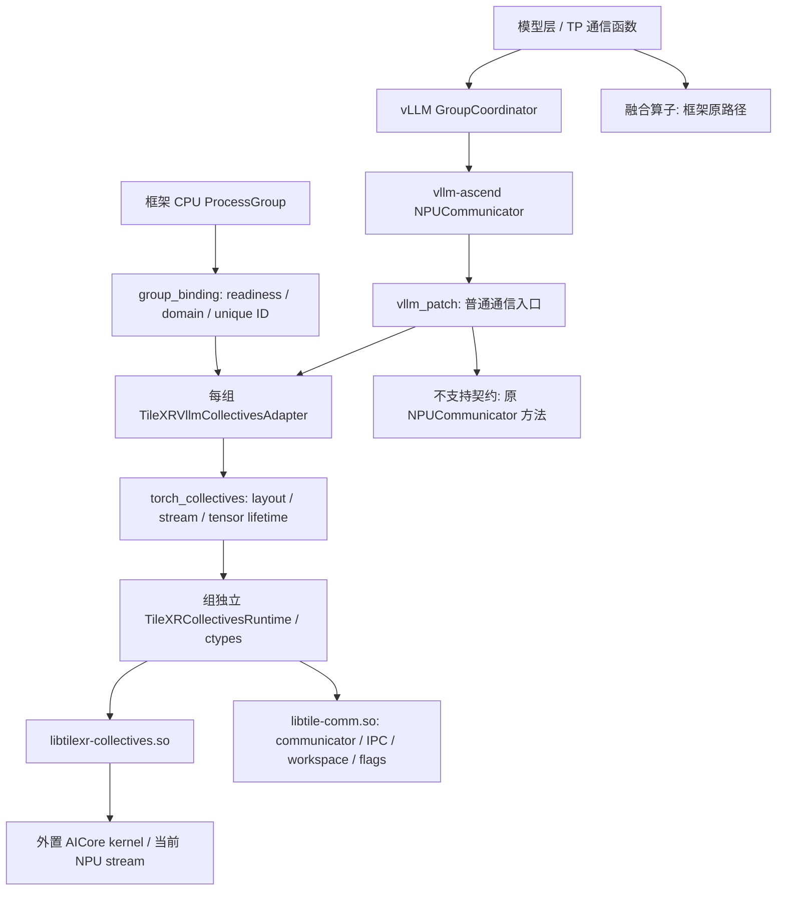
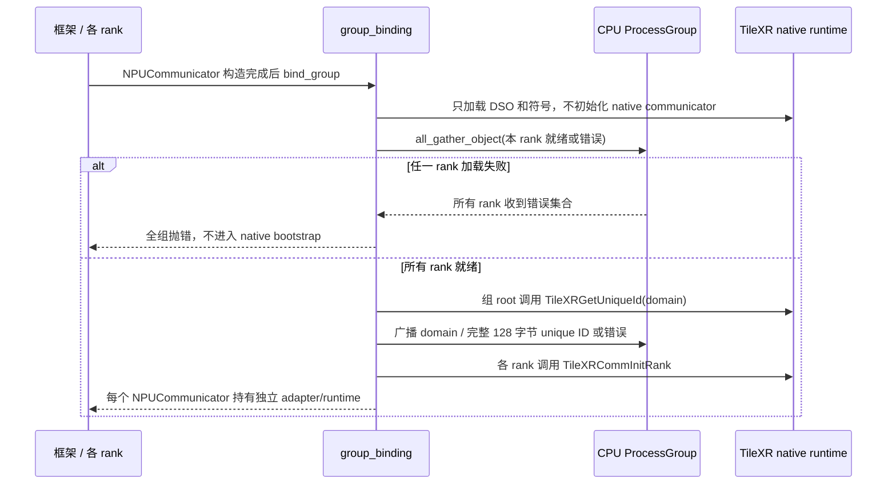

# vLLM / vllm-ascend 集合通信集成设计

本文说明 TileXR 如何接入 vllm-ascend 的普通集合通信、实际调用栈和使用方式。
接口契约以 [集成规范](specs/vllm-ascend-collectives.md) 为准；
硬件测试入口见 [collectives 验证指引](../tests/collectives/README.md)。

## 目标与支持范围

在不修改模型和 native ABI 的前提下，让 `NPUCommunicator` 的普通通信调用
进入 TileXR。框架继续负责模型执行、通信组建立、参与 rank 和调用次序；
TileXR 负责组内 native communicator、peer-memory 映射和集合通信 kernel。

本次资格验证范围为单节点 Ascend 910B、一个 global rank 对应一个 worker、
各 worker 设备可见性一致，以及 eager 推理。不同通信组必须使用不同 domain，
即使成员、rank 和 size 相同，也各自持有 native runtime。

| 路径 | 当前行为 |
| --- | --- |
| AllReduce | TileXR SUM；修改并返回输入对象 |
| AllGather | TileXR；沿指定维度拼接 |
| ReduceScatter | TileXR SUM；保持 vLLM 0.18.0 的维度移动行为 |
| Broadcast | TileXR；`src` 是组内 rank；修改并返回输入对象 |
| AllToAll / 带 split sizes 的交换 | 保留原框架实现；910B 环境未资格验证 native `TOPO_910_93` 路径 |
| 融合通信算子，例如 `npu_mm_all_reduce_base` | 保持框架实现，不接管 |
| 图 / compile 模式 | 本次不支持；使用 `enforce_eager=True` |

支持映射的 dtype 为 int8、int32、int64、fp16、fp32、bf16，仍受 native
操作和硬件约束。本次多组硬件测试覆盖 fp16/bf16，真实模型使用 fp16。
非连续输入在 NPU 上整理；非 NPU、空输入和不支持的 dtype 在提交 TileXR
之前使用原框架实现。不能据此声称所有模型通信或所有 dtype 都已验证。

## 整体架构



| 组件 | 职责与源码 |
| --- | --- |
| 启动入口 | [sitecustomize.py](../integrations/vllm_ascend/sitecustomize.py)：环境变量显式启用后，在 Python 启动时安装 patch |
| 框架接口 | [vllm_patch.py](../integrations/vllm_ascend/tilexr_collectives/vllm_patch.py)：包装构造、四种普通通信、AllToAll 原路径及销毁；维护 route 计数 |
| 组绑定 | [group_binding.py](../integrations/vllm_ascend/tilexr_collectives/group_binding.py)：成员顺序、组内 rank、device、domain 和 unique ID 分发 |
| 框架语义与执行排序 | [vllm_adapter.py](../integrations/vllm_ascend/tilexr_collectives/vllm_adapter.py)：原地契约、维度移动、跨流事件、失败状态和显式 close |
| Tensor 包装 | [torch_collectives.py](../integrations/vllm_ascend/tilexr_collectives/torch_collectives.py)：dtype、连续布局、输出分配、`record_stream` 和指针提取 |
| Python/native ABI | [runtime.py](../integrations/vllm_ascend/tilexr_collectives/runtime.py)：加载两份 DSO，声明 ctypes 参数，返回码转异常 |
| 集合通信 Host | [tilexr_collectives.cpp](../src/collectives/host/tilexr_collectives.cpp)：参数检查、launch context 和 kernel 选择 |
| Kernel 注册与启动 | [collective_kernel.cpp](../src/collectives/host/collective_kernel.cpp)：外置二进制注册、magic 分配、`rtKernelLaunchWithFlagV2` |
| 核心 communicator | [tilexr_api.h](../src/include/tilexr_api.h) / [comm_wrap.cpp](../src/comm/comm_wrap.cpp)：communicator 创建、资源和销毁 |

`libtile-comm.so` 和 `libtilexr-collectives.so` 保持独立。
Kernel 位于安装 libdir 下的 `tilexr/kernels`，相对于 owning Host DSO 加载；
不将 binary object 嵌入 Host DSO，也不使用 `kernel<<<...>>>` Host wrapper。

## 组初始化与 domain



对每个组，从 CPU ProcessGroup 获取 ordered global members、组内 rank 和 size。
Root 分配的 domain 为：

```text
domain = (root_local_sequence * global_world_size + global_root_rank)
         * visible_device_count
```

序号从 1 开始，仅在该进程作为组 root 时递增。不同 root/序号对应不同 domain；
device-sized 间隔容纳 native 默认端点附加的 root device offset。
Root 广播 unique ID 的完整 bytes，而非按 C 字符串处理，保留其中的零字节。

沿用已有 `TileXRGetUniqueId` / `TileXRCommInitRank` API。
每组句柄、workspace 和 flags 独立；框架路径始终显式传入 owned runtime，
不使用 standalone Torch smoke 的 rank/size/device 缓存。

domain 是 native bootstrap 端口偏移。显式设置 `TILEXR_COMM_ID=IP:BASE_PORT`
时，实际端口为 `BASE_PORT + domain`；默认端点还包括 device offset。
不同作业应配置不同基础端点，并为各自的组预留不重叠的端口区间。
超过 65535 的范围会明确报启动错误。跨节点或设备可见性不同的 domain
分配尚未资格验证，不在本次支持范围中。

## 普通通信调用栈

以 TP AllReduce 为例，以下栈按已验证的 vLLM/vllm-ascend 0.18.0 源码整理。
具体模型可能直接调用 GroupCoordinator；融合路径会绕过本栈。

```text
模型 forward / tensor_model_parallel_all_reduce(input_)
  vllm.distributed.communication_op.get_tp_group().all_reduce(input_)
  GroupCoordinator.all_reduce(input_)
    [use_custom_op_call 时] torch.ops.vllm.all_reduce(..., group_name)
    GroupCoordinator._all_reduce_out_place(input_)
  NPUCommunicator.all_reduce(input_)                   # 被 patch 的入口
  vllm_patch._call_tilexr_or_original(...)
  TileXRVllmCollectivesAdapter.all_reduce(input_)
    _execute(): 组锁 + 等待上一次 completion event
    torch_collectives.all_reduce(..., runtime=owned_runtime)
      整理输入、分配输出、record_stream、提取指针和当前 stream
      TileXRCollectivesRuntime.all_reduce(...)
        ctypes -> TileXRAllReduce
          TileXRAllReduceEx -> PrepareHostLaunchContext
          LaunchCollectiveKernel
            EnsureCollectivesKernelsRegistered
              rtDevBinaryRegister / rtFunctionRegister     # 首次注册
            TileXRCommNextMagic
            rtKernelLaunchWithFlagV2                        # 当前 stream
    input_.copy_(native_output)                              # 当前 stream
    record completion event
  返回同一个 input_；成功 route 计数 +1
```

`GroupCoordinator._all_reduce_out_place` 是上游方法名；接入层保持已验证的
`DeviceCommunicatorBase` 实际输入修改契约，不将该名字视为 native 原地保证。
TileXR reduction 先写独立输出，再在同一 stream 更新输入，避免依赖未验证的
native 输入/输出 alias。图模式不在本次资格验证内。

其他普通通信使用同一条 patch → adapter → Torch → ctypes → native Host 路径：

| 入口 | Tensor 处理与 native API |
| --- | --- |
| `all_gather(input_, dim)` | 把目标维移到前面、AllGather、恢复并拼接；`TileXRAllGather` |
| `reduce_scatter(input_, dim)` | 按上游先 `movedim(0, dim)`，沿首维 scatter，再 `movedim(0, dim)`；`TileXRReduceScatter` |
| `broadcast(tensor, src)` | 连续副本必要时复制回输入；把组内 `src` 直接交给 `TileXRBroadcast` |

### Stream、错误与销毁

ctypes 调用不自动向 Torch allocator 登记 tensor 使用；输入、输出及临时布局
都在当前 stream 上 `record_stream`，防止 native kernel 尚未访问完就复用内存。
同组 enqueue 用锁排序，跨 stream 用 completion event 串接，共享 workspace
不会同时被同组两次通信使用。普通操作不逐次设备同步。

框架决定所有 rank 的参与和调用顺序；没有逐次 CPU 协商或额外恢复协议。
不支持的输入契约在 native 提交前调用保存的 original 方法。
Native 返回错误则抛异常并令 adapter 进入失败状态，后续操作继续报错，
不能在部分 rank 已提交后把同一操作切换到 HCCL。设备异步错误也可能在后续
consumer/synchronize 时才暴露，route 成功计数本身不是数值正确性证据。

销毁调用栈为：

```text
NPUCommunicator.destroy()
  adapter.close()
    synchronize(所属 device)
    runtime.close() -> TileXRCommDestroy
    标记 adapter 已关闭
  original NPUCommunicator.destroy()
```

各 rank 按一致组次序销毁。成功销毁后再次 close 安全；native destroy 出错时
保留 handle，不假装资源已释放。原框架可能先销毁其 ProcessGroup，native
销毁使用自己持有的控制连接，不再依赖启动用 CPU group。

## 使用说明

### 1. 准备框架与 native 库

先准备能够用原后端运行的 Ascend vLLM 环境。已验证组合为 CANN 9.1.0、
910B3 ×8、driver 25.5.0、torch/torch_npu 2.9.0，以及匹配的官方
vLLM/vllm-ascend 0.18.0。TileXR 本身保持 C++14 / CANN 9.1 兼容。

框架依赖和 ATB/算子包属于外部环境，TileXR 不负责安装。不能只相信目录名
或 `_version.py`；应检查实际调用签名和已加载模块/DSO 路径。历史 TP8 穿刺
曾遇到同样标为 0.18 的源码不匹配、重叠 Triton 包和 CANN 9.x 路径布局差异；
采用匹配官方源码、独立依赖目录及版本匹配的兼容配置后验证通过。

在已配置 CANN/驱动/必要 ATB 环境的 shell 中，从仓库根目录构建：

```bash
git submodule update --init --recursive
source scripts/common_env.sh
cmake -S . -B build-collectives \
  -DCMAKE_INSTALL_PREFIX="$PWD/install" \
  -DTILEXR_BUILD_COLLECTIVES=ON -DTILEXR_BUILD_TESTS=ON
cmake --build build-collectives -j"$(nproc)"
cmake --install build-collectives
```

保持安装目录中的 DSO 和 `tilexr/kernels` 一起部署。
运行时使用真实 driver HAL，不能把 toolkit `devlib` 放入 runtime 搜索路径。

### 2. 在 Python 启动前启用

```bash
export TILEXR_INSTALL_PREFIX="$PWD/install"
export PYTHONPATH="$PWD/integrations/vllm_ascend:${PYTHONPATH:-}"
export LD_LIBRARY_PATH="$PWD/install/lib64:$PWD/install/lib:${LD_LIBRARY_PATH:-}"
export TILEXR_COMM_ID=127.0.0.1:29688
export VLLM_ASCEND_TILEXR_COLLECTIVES=1
```

单节点使用 loopback 即可；确保基础端口及 group 偏移端口可用。
`sitecustomize` 随 Python 启动导入，必须提前设置 PYTHONPATH 和启用变量，
并让 vLLM worker 继承。显式启用后 bootstrap 失败会终止启动，不能静默使用
原后端。直接运行 Torch shim 或做环境检查时，将启用变量设为 `0`。

| 环境变量 | 用途 |
| --- | --- |
| `VLLM_ASCEND_TILEXR_COLLECTIVES` | `1/true/yes/on` 启用；默认关闭 |
| `TILEXR_INSTALL_PREFIX` | 安装根目录；搜索其 `lib` / `lib64` |
| `TILEXR_COMM_LIB` / `TILEXR_COLLECTIVES_LIB` | 可选，指定两份 DSO 的完整路径 |
| `TILEXR_COMM_ID` | native 基础 bootstrap endpoint；组 domain 作为偏移 |
| `TILEXR_VLLM_TRACE` | 可选 `1` 输出 patch/route 日志；默认关闭 |

不使用自动 bootstrap 时，也可以在创建任何 NPUCommunicator 之前显式安装：

```python
import os
os.environ["VLLM_ASCEND_TILEXR_COLLECTIVES"] = "1"
from tilexr_collectives.vllm_patch import patch_npu_communicator
patch_npu_communicator("/absolute/path/to/install")
```

此方式也必须在各 worker 进程中、communicator 构造前执行。仅在引擎创建后
修改变量或在父进程 patch，不能作为 worker 已接管的证明。

### 3. TP8 模型推理示例

将下列内容保存为自己的应用入口，使用已有的、架构支持 TP8 的真实模型目录：

```python
import os
from vllm import LLM, SamplingParams

if __name__ == "__main__":
    llm = LLM(
        model=os.environ["MODEL_PATH"],
        tensor_parallel_size=8,
        dtype="float16",
        enforce_eager=True,
        max_model_len=128,
        max_num_seqs=1,
        max_num_batched_tokens=128,
        gpu_memory_utilization=0.2,
        trust_remote_code=False,
        seed=42,
    )
    for _ in range(3):
        results = llm.generate(
            ["Explain tensor parallelism in one sentence.", "What is 7 plus 5?"],
            SamplingParams(temperature=0, max_tokens=16),
        )
        print([r.outputs[0].token_ids for r in results])
```

```bash
export MODEL_PATH=/absolute/path/to/model
python your_inference.py
```

这些小规模配置用于已验证的 Qwen3.5-4B 穿刺；更大模型应调整显存和调度参数。
需要 API 服务时，在上述同一环境中启动自己的 vLLM 服务入口，并继续保持 eager。
本次验证使用离线 `LLM.generate`，没有验证常驻 API 服务生命周期。

### 4. 确认接管与执行测试

每个 communicator 暴露：

```python
comm._tilexr_collectives_adapter.domain
comm._tilexr_collectives_adapter.members
comm._tilexr_collectives_route_counts
comm._tilexr_collectives_last_error
```

引擎构造会执行通信，应在 engine-ready 后记录起始计数，与请求结束计数作差。
需要检查全部 rank，而非只看 rank 0 的 patch 日志。计数是 rank-local 的；
成功启动、计数增长或进程退出码不能代替数值检查。异步数据完成由框架消费
依赖、硬件检查或适当同步确认；逐 route 写文件仅用于诊断，不作性能基线。

无硬件单元测试：

```bash
VLLM_ASCEND_TILEXR_COLLECTIVES=0 python -m pytest -q \
  tests/collectives/unit/test_vllm_collectives_patch.py
```

已有匹配环境 HCCL 资格记录且 8 卡空闲时，多组硬件检查：

```bash
python -m torch.distributed.run --nproc_per_node=8 --master_port=29686 \
  tests/collectives/integration/vllm_group_npu.py
```

可选 `TILEXR_VALIDATION_OUTPUT` 指向事先存在的目录，以保存逐 rank JSON。
要求 8 个 rank 全部 `correct=true`、`startup_failure_agreed=true`，且四种已测试
操作 fallback/error 为 0。测试包括两组同成员 TP8、奇偶 TP4、非零 root、
三维与非连续布局、交替 stream、两轮创建/销毁及单 rank 缺库启动故障注入。

官方 HCCL Test 是一次性环境资格检查。先查找同设备子集、拓扑、模式和版本
的记录；匹配记录存在时复用，不因修改 TileXR 或重启模型再次运行。

## 已验证结果与后续工作

真实 Qwen3.5-4B TP8 的原后端/TileXR A/B：三次调用，每次两个 prompt，
各输出 16 token，token ID 一致。每个 rank 请求阶段新增 TileXR AllReduce
6,240 次、AllGather 96 次，fallback/error 为 0。多组硬件测试验证了模型请求
未调用的 ReduceScatter/Broadcast。退出后 8 卡均无遗留进程。
本地与 blue 各 12 项单元测试通过，代码经独立审查。

这些结果证明已测普通 eager 路径、group 隔离和数值一致性；不代表性能提升、
完整答案质量、其他模型、多节点或未测 dtype 的资格验证。图模式属于后续需求，
融合算子继续由框架处理；AllToAll/MoE 和其他平台需单独设计及验证。
