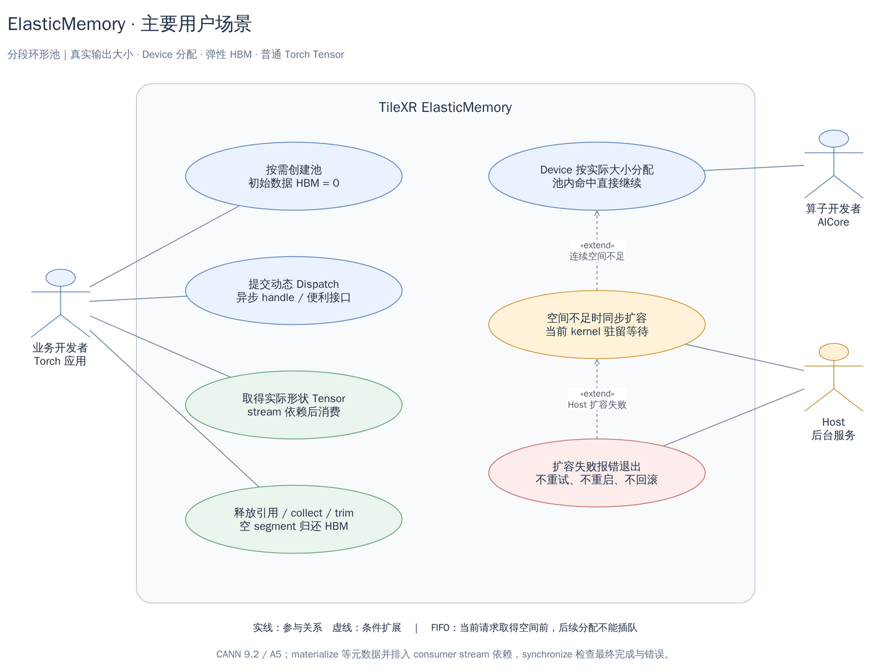
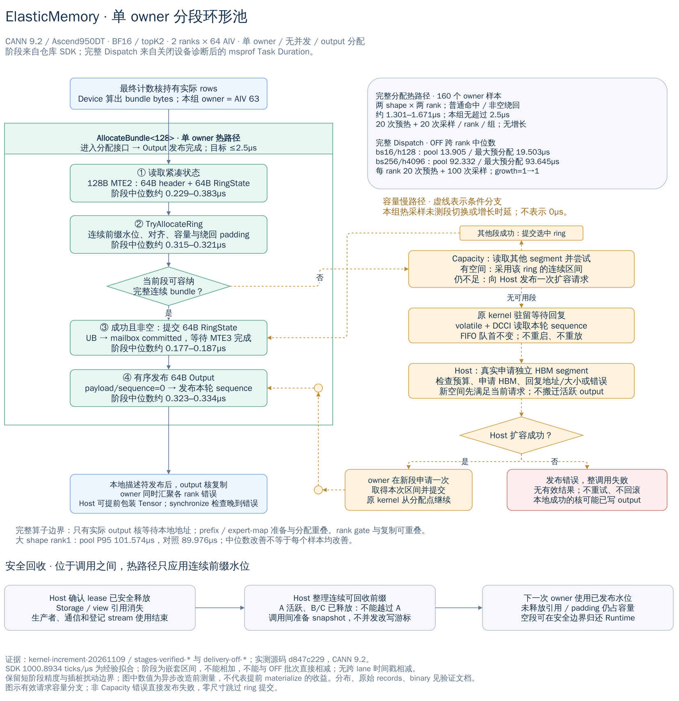
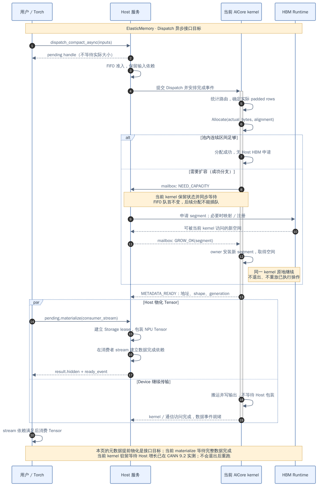
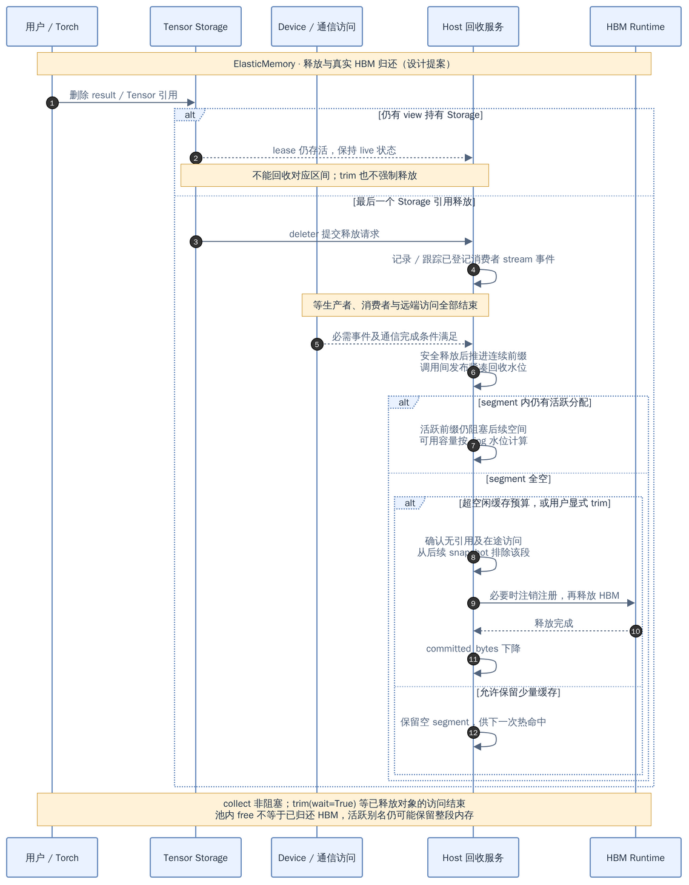
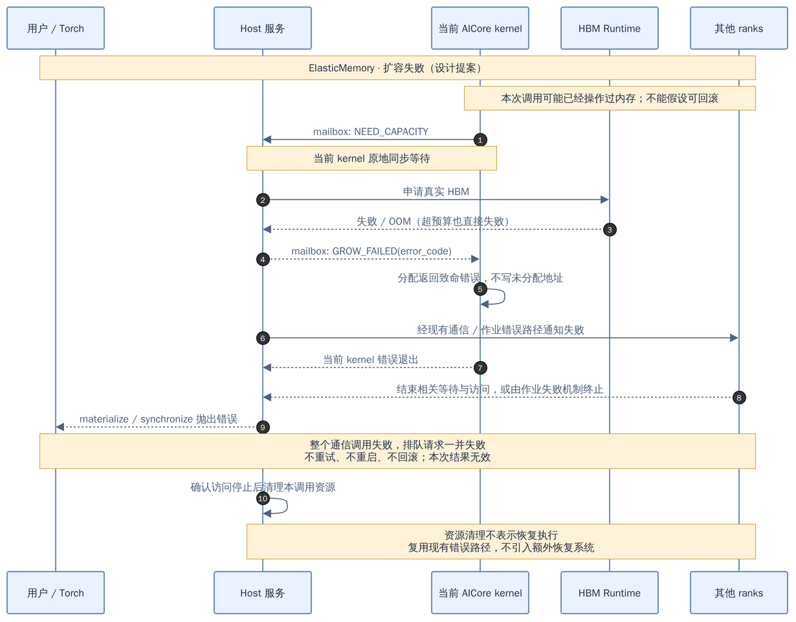
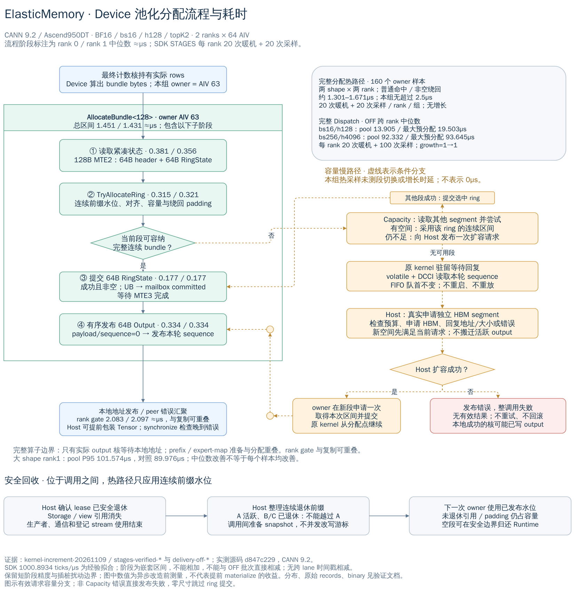

# TileXR ElasticMemory Design

[中文](elastic-memory.md) · [Validation record](validation/elastic-memory.md) · [Torch adapter guide](../integrations/elastic_memory_torch/README.md)

## Contents

1. [What this document solves](#1-what-this-document-solves)
2. [Use cases and prerequisites](#2-use-cases-and-prerequisites)
3. [Components and ownership](#3-components-and-ownership)
4. [Single-owner segmented ring allocation](#4-single-owner-segmented-ring-allocation)
5. [Shared ABI and mailbox protocol](#5-shared-abi-and-mailbox-protocol)
6. [Dispatch, growth, and FIFO admission](#6-dispatch-growth-and-fifo-admission)
7. [Host interfaces and asynchronous semantics](#7-host-interfaces-and-asynchronous-semantics)
8. [Tensors, streams, and capacity return](#8-tensors-streams-and-capacity-return)
9. [Statistics](#9-statistics)
10. [Communication integration and failure contract](#10-communication-integration-and-failure-contract)
11. [Performance targets and validation requirements](#11-performance-targets-and-validation-requirements)
12. [Current support boundaries](#12-current-support-boundaries)
13. [Diagram sources, code, and maintenance](#13-diagram-sources-code-and-maintenance)

## 1. What this document solves

For operators such as MoE Dispatch, the number of output rows depends on routing results, so the
real size is known only after the Device finishes counting. One common answer is to preallocate a
maximum-size output buffer, at the cost of permanently holding a large amount of HBM. Another is to
run a Host-side Planner that predicts the shape, at the cost of an extra synchronization and a
parallel implementation that must stay consistent with the kernel.

ElasticMemory offers a third path: **let the Device allocate by actual size from inside the
operator**. HBM is organized as a single-owner segmented ring pool built from independent segments.
The Device computes the actual byte count and takes a contiguous range directly. Only when the pool
genuinely has no suitable contiguous space does the allocating kernel stay resident, wait for the
Host to allocate real HBM and reply with an address, and then resume at the original allocation
point. The final output is delivered as an ordinary NPU Tensor; when its memory can be reused, and
when it is actually returned to the Runtime, is decided jointly by Storage references and stream
completion.

This document defines the architecture, ownership, and failure contracts. It is a **design
contract**, not an execution record:

- Sections 2–10 describe behavior that must hold. Section 11 gives performance targets and
  validation requirements. Section 12 delimits what is currently implemented and validated.
- Environment details, measurements, source-to-binary provenance, and reproduction commands belong
  in the [validation record](validation/elastic-memory.md). Goals stated here are not claims of
  validated capability.
- This feature does not change the interface contracts of existing EP V1/V2, MoonEP, or upstream
  DeepEP, and does not require a separate Planner.

## 2. Use cases and prerequisites

[](diagrams/elastic-memory/use-cases.drawio.png)

Figure 1 connects four stages: Device allocation, Host growth, Torch-side consumption, and
whole-segment return. Note that `materialize` waits only for stable metadata; it returns once the
producer completion dependency is enqueued on the consumer stream, without waiting for the data to
be written.

**Intended workload.** One-shot dynamic allocation for operator-level outputs. Multiple outputs with
the same lifetime may share one bundle and one reservation. An operator should not repeatedly
allocate and free inside itself, and this allocator does not target large numbers of tiny objects or
arbitrary fragmentation management. "Usually large" describes the typical shape, not a minimum size:
zero-size, alignment-boundary, and extreme requests must still be handled correctly.

**Single owner.** Each pool has exactly one Device allocator owner at a time, and only that core
modifies Device metadata related to allocation and release. The same physical core need not be used
across kernels, but concurrent multi-core malloc is unsupported.

**Serial admission.** Calls to the same pool are admitted serially in FIFO order. All ranks must
submit communication calls in the same order. Concurrent pipelines use independent pools; collective
order must never depend on the arrival order of Host threads.

**Definition of actual size.** The Device must finish counting and layout inside Dispatch before
requesting actual bytes. `actual_rows` includes route replication, expert padding, and required
alignment; counts that are not yet complete must not be treated as the final shape.

**Stable, contiguous addresses.** Each Tensor's valid storage range is contiguous. A bundle never
spans segments and is never stitched across the end of the ring. Once delivered, a live address does
not move: Tensors are not relocated, and noncontiguous segments are not presented as contiguous
storage.

**Zero cold start.** Creating a pool establishes only bounded control metadata; data HBM starts at
zero. The normal hit path allocates no Host HBM and does not wait for the Host to wrap a Tensor
before the data path advances.

**Failure means termination.** When capacity is insufficient, the current kernel stays resident and
waits for one Host growth response. Failure terminates the entire call and the associated
communication domain, without retry, restart, replay, or rollback of data already written.

## 3. Components and ownership

| Component | Responsibility | Ownership and access |
|---|---|---|
| HBM segment | Holds contiguous output ranges | Created and freed by the Host Runtime; the Device accesses data only |
| PoolState snapshot | Request header, current segment, and bounded segment directory | Prepared by the Host between calls; read-only to the running kernel |
| RingState commit | Allocation and reclaim cursors for the selected segment | Committed by the Device owner; validated and mirrored by the Host after metadata publication |
| Host reservation queue | Allocation order, padding, lease/event state, and safe retirement prefix | Owned by the Host; never scanned in the Device hot path |
| Host-visible mailbox | Growth request/response, commit, immutable output descriptor, final status | One writer per slot, paired by the current sequence |
| Native service thread | FIFO admission, growth, completion checks, retirement | Uses the ACL context captured at pool creation; independent of Python callbacks |
| Allocation lease | Retains producer, communication, and Storage usage rights | Shared by the native Runtime and the Torch adapter |
| Kernel execution state | Completed counting, layout, and existing memory side effects | Preserved inside the original kernel while waiting for growth |

The boundary between the two sides is deliberate: **bulk data stays in HBM, and memory mapped to the
Host carries only small control messages.** The Host validates a handle against pool/device
ownership, segment ID, offset, bytes, and generation, then reconstructs the device address from the
known segment base. The Host never dereferences a Device pointer. Host pointers and their Device
mapping addresses are stored separately and need not have the same numeric value.

## 4. Single-owner segmented ring allocation

[](diagrams/elastic-memory/segmented-ring-allocation.drawio.png)

Figure 2 draws three paths separately: normal hits, the capacity slow path, and retirement between
calls. The timings shown are measured baselines from before the asynchronous change and do not
establish its benefits; Section 11 defines their limits.

### 4.1 Contiguous ranges and wraparound

Each segment maintains a pair of logical cursors: the allocation tail `tail` and the reclaim head
`head`/`reclaim`. Their difference is the reserved window that cannot yet be crossed. To avoid a
modulo in the hot path, the implementation additionally stores the physical tail position in
`tailOffset`.

On allocation the owner first applies the reclaim watermark published by the Host, then aligns the
candidate range using the segment's actual base address. If the segment suffix cannot hold the
complete bundle, the owner charges that entire suffix to this reservation as padding and attempts to
wrap to the start of the segment. It commits the cursors only if the payload, alignment padding, and
wrap padding together fit within the available capacity. A failed attempt leaves every committed
state unchanged, and address and size arithmetic check for overflow throughout.

A normal hit touches only the compact current-segment state, with no free-slot search and no
arbitrary-hole compaction. Only when the current segment cannot satisfy the request does the owner
consult the bounded segment directory, and only when no segment has a suitable contiguous range does
it request growth. It is worth stating explicitly: **sufficient logically free bytes do not imply
that a contiguous range is immediately allocatable.**

Two boundary cases are handled separately. An empty ring may normalize its cursors back to zero at a
safe boundary, but must not change a live address or reuse an allocation generation that may still
be observed. A zero-size output consumes no reservation and does not force creation of a data
segment.

### 4.2 Contiguous retirement prefix

A ring structure means space can only be reclaimed in order. From Storage references and the
completion of producers, communication, and registered consumer streams, the Host derives each
segment's **contiguous** safely retired prefix and publishes a new reclaim watermark before the next
call; the Device owner validates it and applies it. The Host never concurrently overwrites the
cursors of a running owner.

Take `A → B → C` allocated in that order within one segment: as long as A still has a view or an
in-flight consumer, the reclaim cursor cannot pass A even if B and C have been released. The space
of B and C is blocked by the head of the ring — counted as logically free but not immediately
allocatable. Later requests may use another segment or trigger growth, subject to the budget. Each
reservation records its own padding and end cursor, so retiring the contiguous prefix reclaims the
padding with it.

The single-core constraint applies only to Device-side cursor writers. Lifetime checks and the
actual `aclrtFree` always happen on the Host: **completion of Device production does not mean the
Torch-side output can be freed.**

## 5. Shared ABI and mailbox protocol

### 5.1 Data structures

The current ABI version is 3 (`kAbiVersion = 3`), and the core structures are 64B-aligned:

- `RingState` (64B) = `Segment{id, address, bytes}` plus `head/tail/reclaim/tailOffset/alignment`.
- `PoolState` = a 64B header (version, requestId, segmentCount, reservationCount) plus up to
  `kMaxSegments = 32` `RingState` entries, with **the current segment always first**.
- `Mailbox` (384B) holds, in order, `GrowRequest`, `GrowReply`, `Output`, a 64B identity header
  (version/requestId/poolId), `committed`, and `finalStatus`.

A nonzero request sequence doubles as the generation of that call's nonempty allocation, and
`alignment` lets the Host recompute and validate the result after metadata publication.

### 5.2 Data flow of one call

Before launch, the Host assembles its mirror of the previous Device commit together with the safe
retirement watermark into a read-only `PoolState` for this call and copies it to HBM as a whole. The
Device hot path uses **one 128B MTE2 read** to obtain the 64B header and the 64B current-segment
RingState together; remaining segments are read one by one only if capacity is insufficient. The
Host does not decide this call's output bytes or allocation offset in advance. Instead it recomputes
and validates after receiving the Device commit: `ValidateCommittedLocked` replays the same
`TryAllocateRing` algorithm on the Host mirror, compares the result against `committed` byte for
byte, and checks the address, segment bounds, and overlap against existing leases.

For a successful nonempty allocation, the Device first writes the selected segment's 64B state
through MTE3 into a separate `committed` slot and waits for writeback completion, then publishes the
64B `Output` in order: **first the complete payload with sequence zero, then the complete descriptor
again carrying this call's sequence.** On failure it clears the handle and address and publishes an
error; invalid entry parameters return an error directly for the caller to handle.

**Once published, Output is immutable.** This is what makes early materialization possible: the Host
can wrap the address and shape into a Tensor while the kernel is still writing payload. Any peer
error or data-validation error discovered afterwards is written to the separate 64B `finalStatus`
slot (mailbox offset 320) and never overwrites a delivered address or shape. After full producer
completion the Host checks final status: sequence zero means no separate status was reported; a
nonzero sequence must match this request, and a matching nonzero error fails the entire call.

### 5.3 Visibility

Requests, responses, commits, Output, and finalStatus are each single-writer slots, and the ABI
version, request sequence, and allocation generation reject duplicate or stale messages. Before
wrapping output, the Host additionally checks pool/device ownership, segment bounds, and the bytes
required by the shape.

Publication order is uniformly "write the complete descriptor, then publish the sequence in the
platform-approved order"; a reader obtains a consistent snapshot only after observing the
publication flag. It must be stated clearly that **C++ `volatile` or CPU atomics alone do not
establish cross-device release/acquire semantics.** The current Device-side growth wait combines
volatile GM reloads with DCCI invalidation and checks this call's sequence; requests and results are
published through ordered UB-to-GM writeback. Field widths, cache handling, slot reuse, and
bidirectional visibility during execution must each be validated with evidence for the applicable
CANN/hardware combination.

### 5.4 Capacity limits

| Limit | Value | Notes |
|---|---|---|
| Segments | 32 | `kMaxSegments` |
| Outstanding reservations | 128 | `kMaxAllocations`, including retired records still blocked by a live prefix |
| Registered streams per lease | 128 | Exceeding it fails explicitly |
| Registered events per lease | 128 | Shares a bounded budget with producer wait-boundary events |

Exhausting control capacity must fail explicitly; counting only live leases must not permit
unbounded growth. Any change to ABI v3 requires rebuilding the native libraries, external kernels,
and Torch extension **together**.

## 6. Dispatch, growth, and FIFO admission

### 6.1 The Device computes the real size inside the operator

Within one kernel, Dispatch completes the final receive counts, computes the actual layout of the
hidden and auxiliary outputs, and has the designated owner call `AllocateBundle`. Outputs with the
same lifetime share one bundle and lease, aligned according to their dtype and communication
requirements. The Combine handle retains routing and inverse mappings, so users do not run a Planner
in advance. Payload received before counting completes must stay in bounded, credit-governed
staging.

In the current Memory implementation the **final count core** is the owner (`aivId == aivNum - 1`):
it already holds the final prefix, so it can allocate without waiting for the other sending cores.
Once allocation completes, the owner writes `{error, address, rows, magic}` as this round's immutable
descriptor into the compact gate inside its own window. Other output cores spin on the local gate's
magic before copying, then read the complete body. Prefix loading, expert-map construction, and
count output do not depend on the allocation result and overlap the owner's allocation.

Cross-core publication must use a visibility protocol validated for the target platform: observe the
publication flag first, then fetch the immutable body. A single 64B DMA must not be assumed to take
an atomic flag-plus-body snapshot, and arbitrary blocks must not be assumed simultaneously resident
and synchronized through an ordinary global spin barrier.

The owner then polls each peer's gate to aggregate errors, which may overlap local copies on other
cores. The Host may therefore export a Tensor as soon as metadata is stable, but **the producer
event guarantees access ordering, not final success**: a late peer error invalidates that Tensor and
any downstream result derived from failed data, so callers must check final status through
`synchronize`, Combine, or discard.

### 6.2 The original kernel stays resident for real HBM growth

1. When neither the current segment nor any other candidate suffices, the Device publishes one
   growth request carrying sequence, bytes, and alignment.
2. The original kernel waits at the allocation point for a matching response, preserving its
   preceding execution state and side effects, and does not write to an address not yet allocated.
3. The native service checks the budget and allocates an independent HBM segment sufficient for the
   request. Its actual size is `min(max(segmentBytes, bytes + alignment - 1), remaining budget)` —
   neither doubling indefinitely nor letting a preferred segment size block a smaller request that
   the remaining budget could satisfy. If a transport requires mapping or registration, those must
   succeed before the address is published.
4. The Host replies with a segment ID, address, and capacity, or with an error. On success the
   Device owner attempts allocation in the new segment **exactly once**, commits, and resumes from
   the original allocation point. A successful response that cannot accommodate the request is a
   protocol failure and does not trigger another growth attempt.
5. Host allocation failure, budget exhaustion, required-registration failure, and post-allocation
   bookkeeping failure must all deliver a failure response to the Device. HBM that was allocated but
   never published is freed under safe cleanup rules — note that the resident kernel must be
   **unblocked before calling Runtime free**, because some allocator cleanup itself waits for Device
   work.

Only one growth per call is permitted; a second observed request is handled as a protocol failure.
Host allocation and response must not depend on completion of the current kernel or be queued behind
its subsequent stream operations, and a growth request must never be read through a D2H copy after
the kernel ends. A platform that cannot perform these operations while the kernel remains resident
does not support this path and **must not silently substitute exit and replay**.

### 6.3 FIFO and communication order

Queued and in-flight allocation requests are bounded by `maxPending` (default 64); reaching the limit
rejects new submissions. Requests not yet admitted wait in the Host queue without occupying AICore
resources, whereas an admitted kernel that needs growth holds its execution resources while waiting.
The head request's sequence of "attempt allocation → wait for growth → obtain a range" cannot be
overtaken; newly grown space serves the head first.

The next request may be admitted only after the allocator's write phase has safely ended; observing
a published address is not by itself permission to launch another writer. The current implementation
waits for full completion of the current call before preparing the next snapshot. Existing outputs
may continue to be consumed on other registered streams, but that does not allow concurrent
allocations in the same pool.

FIFO determines only allocation order within the pool and **does not replace the communication
protocol's own address-readiness, credit, or remote-completion conditions.** The current Torch
buffer permits one active routing handle at a time; Combine must complete or the handle must be
explicitly discarded before the next Dispatch is submitted.

## 7. Host interfaces and asynchronous semantics

[](diagrams/elastic-memory/dispatch-sequence.drawio.png)

Figure 3 distinguishes the moment metadata becomes ready from the moment data completes.

### 7.1 Native C++14 API

The API consists of three classes, `Pool`, `Pending`, and `Allocation`:

- `Pool::Create(Config)` creates a pool on the caller's current ACL context and allocates control
  metadata only. `Config` contains `maxCommittedBytes`, `maxCachedFreeBytes`, `segmentBytes`, and
  `maxPending`.
- `Pool::Submit(launch, inputStream)` records the input-stream dependency and executes the `launch`
  callback on the native service thread; the callback retains input owners until the producer fully
  finishes.
- `Pending::Wait()` preserves full-completion semantics: it returns the allocation or throws the
  final error.
- `Pending::WaitMetadata()` may return the allocation once immutable address/shape validation has
  succeeded and the producer completion event has been recorded. A consumer using it **must** call
  `Allocation::WaitOnStream(stream)` to establish a dependency and `Allocation::Synchronize()` to
  check the final result.
- `Allocation` additionally offers `RecordStream`/`RecordEvent` to register extra consumers and
  `SetRetireHook` so an adapter can run pre-retirement flushing on the service thread, outside the
  pool lock.

The Device entry point is a single-owner call:

```cpp
// The public header is authoritative for the declaration.
template<uint32_t ScratchBytes = 128>
__aicore__ inline uint64_t AllocateBundle(DeviceView view, uint64_t bytes, uint64_t alignment,
                                          uint64_t rows, uint64_t* address,
                                          Profile::Recorder* profiler = nullptr);
```

`ScratchBytes` must be at least 128B and 32B-aligned. The UB scratch is taken from the caller's
`TPipe` and is reset or destroyed by the caller.

### 7.2 Torch-side semantics

`pending.materialize(stream=None)` calls `WaitMetadata`, enqueues the producer dependency on the
current or specified stream, and returns ordinary Tensors; it may return before data completion.
Repeated materialization preserves the same result and the same Storage, and establishes the
dependency for each newly added consumer stream. Waiting releases the Python GIL, and the native
service makes progress without any Python callback. See the
[adapter README](../integrations/elastic_memory_torch/README.md) for examples.

| State | Meaning |
|---|---|
| METADATA_READY | Final address/shape is stable, allocation succeeded, the lease can be delivered, and the producer completion event is recorded; **final execution success is not promised** |
| DATA_READY | Producer writes and required communication accesses have completed; final status must still be checked |
| FAILED | This result and all downstream results derived from failed data are invalid; clean up after associated accesses stop, without resuming execution |

`pending.synchronize()` or `result.synchronize()` waits for full producer completion and reports late
errors. `combine_compact()` and `result.discard()` likewise check final producer status first;
Combine returns after its own completion, and only a successful Combine or discard releases the
communicator turn for that round. Failure poisons the domain, which cannot be reused by a subsequent
submission.

### 7.3 Boundaries that are easy to misread

- The producer event guarantees stream execution order only. It **does not replace error checking**,
  and does not guarantee the Host learns of every peer error before downstream work starts.
- The Runtime retains the event until references are gone and every queued wait has actually passed
  its safety boundary. Zero-byte outputs retain the dependency too, because separately owned count
  Tensors may still need it.
- Early metadata return does not change same-pool FIFO: the service still admits the next request
  only after the current call fully finishes.
- Dropping a pending object does not cancel the device task. The Runtime keeps input owners and any
  early lease until safe completion, then retires according to Storage and consumer conditions.
  **Forced cancellation during execution is not provided.**
- The Host service does not depend on a caller holding the Python GIL, nor on the user calling
  `materialize` to make progress. The active poll loop requests `sleep_for(5µs)` per iteration; that
  is a request to the operating system, neither a guarantee of a 5µs wakeup nor an end-to-end
  latency bound. Measure Host polling, queueing, and CPU utilization separately.

## 8. Tensors, streams, and capacity return

### 8.1 Storage lease

The adapter creates NPU Tensors through the external-memory factory matching the installed
`torch_npu` version, setting device, dtype, shape, stride, and ND format. It currently uses
`at_npu::native::from_blob`, which **does not copy the output and does not replace the global Torch
allocator**.

A custom Storage deleter captures the native lease. When the last Storage reference disappears it
submits a retirement request rather than freeing HBM directly; views, detach, and repeated
materialization share the same storage ownership. A Python finalizer cannot substitute for Storage
retention. Training would additionally require separate autograd and backward-stream integration, so
`requires_grad` is currently rejected outright.

The materialization stream is registered automatically and receives the producer-event dependency.
Repeating materialization on a new stream preserves the same Storage and establishes the dependency
there. Additional consumer streams are registered explicitly through
`result.use_on_stream(stream)`. Torch's `record_stream` does not automatically establish safety for a
custom segment, so **consumption on unregistered streams is outside the supported contract**.

There is one further framework-specific pitfall: tasks in Torch's CPU submission queue may outlive
the disappearance of Python references. The native retirement hook therefore flushes registered
queues on the service thread, outside the pool mutex, and only then records the final stream-tail
events. A Storage deleter that may run on a Torch queue worker **must not** synchronously flush that
queue. The device context and registered streams must remain valid until the lease retires.

### 8.2 Logical retirement and physical return

A range can retire only when two conditions hold together: no Storage/export or pending
materialization handle retains it, and its producer, communication, and all registered consumers
have completed. The ring pool then advances only the contiguous safe prefix. Three states must be
kept distinct: **logically free, available for allocation, and returned to HBM as a whole segment.**

At a safe boundary an empty segment is excluded from future snapshots and released only after
in-flight accesses are ruled out; if a transport holds registration resources, the corresponding
deregistration completes first. A segment-table version still used by a kernel must not be freed, and
live addresses must not be moved to create space.

The three entry points mean:

- `collect()` nonblockingly requests processing of retired objects that already qualify and returns
  the current snapshot; returned counters may precede the effect of this collection.
- `trim(wait=True)` waits for device work associated with retired objects and releases eligible whole
  segments. It does not wait for the user to delete live Tensors and does not force their release.
- `close()` rejects new submissions and drains (or fails) in-flight requests. Live Storage continues
  to retain the native Core and its segment, so **closing admission must not be read as all HBM
  having been released.**

The free-cache budget `maxCachedFreeBytes` controls how much capacity is retained in empty segments
and may be zero, though a single small view can still retain an entire segment. `maxCommittedBytes`
limits actual committed capacity, while Runtime OOM may still occur sooner.

[](diagrams/elastic-memory/reclaim-sequence.drawio.png)

Figure 4 distinguishes four moments: loss of Storage references, completion of accesses, reuse of a
contiguous prefix, and whole-segment return. A live view may retain an entire segment indefinitely.

## 9. Statistics

| Metric | Meaning |
|---|---|
| `live_bytes` | Active leases and in-flight producer reservations, including their alignment/wrap overhead |
| `pending_retire_bytes` | Reservations the user no longer retains but whose accesses have not all finished |
| `free_bytes` | Total logically free segment capacity, including space temporarily blocked by the ring head |
| `blocked_free_bytes` | Subset of `free_bytes` that cannot pass a live prefix; not added again to the total |
| `padding_bytes` | Alignment and wrap overhead inside live/pending reservations; not additional HBM |
| `committed_bytes` / `peak_committed_bytes` | Current actual committed data-segment capacity and its peak |
| `reclaimable_segment_bytes` | Capacity that can safely be returned as whole segments |
| `largest_free_range` | Largest allocatable range under ring-watermark and contiguity constraints |
| `metadata_bytes` | Control storage included in accounting; whether Host container and thread overhead is included must be stated |
| `growth_count` / `trim_count` / `failure_count` | Counts of growth, whole-segment return, and failures |

Accounting satisfies `committed_bytes = live_bytes + pending_retire_bytes + free_bytes`, with no
overlapping categories. While a producer has not yet published its actual size, accounting is
deliberately conservative: all unassigned committed space is counted in `live_bytes`, never reported
as reclaimable, and `reclaimable_segment_bytes` is zero. After metadata publication, reservations are
validated against the Device commit and registered exactly once; early lease export neither
double-counts them nor removes the producer's reclamation protection.

The current `metadata_bytes` includes the mapped mailbox and Device PoolState but **excludes** Host
map/deque, lease/event, and service-thread object overhead. The Torch allocator does not account for
these external segments, so total HBM must not be inferred from `torch.npu.memory_allocated()`
alone, and trim does not automatically empty the Torch cache.

## 10. Communication integration and failure contract

### 10.1 Current integration shape

The current implementation pools the final local output, retains the existing communication staging,
and then copies into the output. Reports must list output, staging, auxiliary flags/guard, and copy
traffic separately. **This is not communication zero-copy**, and the savings must not be offset by
another hidden maximum-output buffer.

Direct peer-memory/UDMA writes into pooled output are a separate extension whose prerequisites are:
mapping/registration and peer descriptor exchange complete before any address is published, and
registration can also progress while the original kernel remains resident. UDMA registers only
permitted owner-local allocations, never a remote IPC mapping, and never in `InitThread`. WQEs are
built in UB and the `st_dev` doorbell is rung only after the MTE3 publication completes; retirement
and deregistration must wait for remote protocol completion. Transport selection depends on
capability, registration state, and transfer size — **not on topology alone.**

### 10.2 Required behavior

| Condition | Required behavior |
|---|---|
| First nonempty call | Obtain space through growth from zero data HBM; pre-allocation side effects occur exactly once |
| Empty receive or all inactive | Return zero-size output correctly while still completing the communication protocol |
| Current segment insufficient or head blocked | Try other segments first; if none fits, the original kernel waits for Host growth |
| Budget exceeded, OOM, required-registration or bookkeeping failure | Publish an error, end associated waits on participating ranks, and terminate the call/domain and queued requests |
| Stale, duplicate, or out-of-bounds descriptor | Reject delivery and duplicate release; enter the appropriate error handling |
| Kernel or communication failure | Preserve the first error; quarantine resources whose accesses are not confirmed stopped rather than reclaiming them early |
| Partially written output | Invalidate the result without rollback or restart; clean up resources after accesses stop |

Dropping tokens, changing routing, or reducing dtype must not be used to disguise failure as
success, and an error must not merely throw on one Host thread while leaving the Device waiting
forever. When device accesses cannot be confirmed stopped, the implementation **fails closed**: it
retains context-bound resources and input owners for the lifetime of the process rather than freeing
or resetting without confirmation. If the device or communication cannot cooperate to exit, use the
existing Runtime/job failure mechanism; ElasticMemory itself provides no fault-recovery system.
Resource cleanup does not restore contents and does not make a failed domain reusable.

[](diagrams/elastic-memory/failure-sequence.drawio.png)

Cleanup in Figure 5 happens only after accesses are confirmed stopped. Writes may have occurred
before the failure; cleanup implies neither rollback nor resumed execution.

## 11. Performance targets and validation requirements

### 11.1 Allocation hot-path target

For normal hits and nonempty wraparound allocation without growth, the hot-path target is
**≤2.5µs**, measured from entry into the Device allocation interface through completed result
publication, including initialization, state reads, reclaim-watermark application, allocation
arithmetic, commit, publication, and required synchronization. Segment switches and Host growth are
reported separately, without moving ordinary per-call costs out of the measured path. Record
median/min/max/P95 per rank, sample counts, and samples above the target; do not treat the observed
maximum as a bound for every workload.

[](diagrams/elastic-memory/device-allocation-profile.drawio.png)

Figure 6 uses SDK-instrumented measurements for internal stages, while the complete Dispatch
comparison comes from a separate batch with Device diagnostics disabled. Stages are nested and may
overlap work on other cores, so they **must not be added or directly subtracted** to isolate
allocation benefits. Figure 6 and earlier allocation/Dispatch numbers are baselines from before the
metadata-only / 5µs poll change; they cannot be used to claim an asynchronous speedup or a latency
guarantee.

### 11.2 Operator comparison method

Core operator performance compares device kernel execution time only. With identical shape, inputs,
routes, dtype, ranks, communication path, compilation, and diagnostic configuration, with sufficient
pool capacity and an unchanged `growthCount` throughout measurement, compare three approaches:
maximum-capacity preallocation, a Host actual-size reference, and the Device pool. The Host reference
exists for comparison only and must not enter the production path as a size Planner.

A formal comparison removes Device diagnostic instrumentation, retains identical Host stage barrier
and framework profiler settings, measures msprof Task Duration for the named Dispatch/Combine
kernels, and keeps in-operator allocation, synchronization, and cross-rank waits inside the measured
interval — Host wall time or Task Wait Time is not a substitute. Cover at least bs16/h128 and
bs256/h4096 with BF16/topK2/2 ranks, retaining warmup, sufficient samples, and per-rank/cross-rank
distributions. Improved medians do not establish improved tail latency.

Reports must also include backend, native status, kernel version, data volume, applicable bandwidth,
actual output bytes, committed/peak/trim, blocked/padding, and retained staging. Host
submission/queueing, materialization, CPU utilization, and growth/registration/trim latency are
auxiliary observations, excluded from core kernel performance.

### 11.3 Diagnostic instrumentation

Diagnosis uses the repository's `TileXR::Profiling` SDK with capture on the actual service stream;
Collect runs after the call completes and must not block the growth service. The current consumer
uses standalone SDK 1.0.0 / DeviceView ABI 2, and Host and kernel must be rebuilt together.
`tests/elastic_memory/profile_compact.py` declares participants and workload before launch, then
merges rank-owned manifest, completion, and Host events after completion and delegates repeat-sample
reports to the public capture-set API. The mapping template leaves the timer scale unset: an
evidenced scale and its basis must be supplied explicitly. Read allocator samples from the owner
lane rather than treating an absent stage on the slowest lane as zero allocation time.

Timer conversion, all-lane/key-owner markers, overflow/drop, and instrumentation disturbance must
also be validated. Do not substitute HWTS/AIV/sysClock frequencies for the `GetSystemCycle`
frequency, and do not subtract timestamps across lanes without establishing that it is valid.

### 11.4 Functional validation checklist

Functional validation covers: real growth before kernel completion, preceding side effects exactly
once, reads/writes at the new address, failure exit without replay, FIFO head priority over newly
grown space, initially zero data HBM, wraparound/segment switch/overflow/zero size, lifetimes and
whole-segment return, and real multi-rank Dispatch/Combine. Host models and the M0 feasibility
experiment do not replace full integration tests.

Async acceptance must additionally hold a producer in flight to prove metadata really does return
early, confirm full `Wait` semantics, and cover immediate Torch consumption, repeated materialization
on another stream, zero-output dependencies, late errors, and early reference drops.

Before every hardware launch, recheck proc-mem and identity mapping for all target physical cards.
Reject busy devices, query/parse failures, and unknown mapping; an empty `fuser` result does not
permit launch, and external tasks are never killed or reset. Existing HCCL qualification for the same
environment must be reused; record incomplete evidence as a qualification boundary rather than
rerunning it per task.

## 12. Current support boundaries

| Item | Current scope |
|---|---|
| Platform | Measured on CANN 9.2.0 and A5/Ascend950DT; compatibility with other versions or hardware is not promised |
| Compilation and deployment | Native C++14; Torch extension uses C++17/ABI matching installed Torch; pure AICore external binaries are registered and launched, without embedding kernels in Host libraries |
| EP | Memory Dispatch/Combine with pooled local outputs; no separate Planner |
| Torch | Ordinary FP16/BF16 contiguous ND Tensors, int32 routes, FP32 Combine weights; inference only |
| Asynchrony | Metadata-only materialize, consumer event dependencies, and explicit final-error checks are implemented; native `Wait` and Combine retain full-completion semantics; CANN 9.2 functional validation passed; see the validation record for timing and limits |
| Lifetimes | Storage/views, registered streams, pending input owners, and live Storage retained across close |
| Extensions not covered | Autograd/backward, graph capture, UDMA direct output writes, multi-host, quantization, shared-expert, and TP paths |

The [validation record](validation/elastic-memory.md) is authoritative for current allocation and
complete-kernel measurements, uncovered cases, and incident disclosures. Development owns
implementation, review, all tests, and evidence; design acceptance checks submitted results against
the contracts and does not require the design session to compile or repeat hardware validation.

## 13. Diagram sources, code, and maintenance

### 13.1 Diagram sources

The figures are embedded in the relevant sections throughout this document. Each PNG contains
editable diagram data and can be opened at full size through its image link:

- [Segmented ring draw.io](diagrams/elastic-memory/segmented-ring-allocation.drawio) ·
  [Flow and measurement notes](diagrams/elastic-memory/segmented-ring-allocation.md)
- [Device profiling draw.io](diagrams/elastic-memory/device-allocation-profile.drawio) ·
  [Stage definitions and evidence](diagrams/elastic-memory/device-allocation-profile.md)
- [Four-page scenario, Dispatch, failure, and reclamation draw.io](diagrams/elastic-memory/elastic-memory.drawio)

### 13.2 Code entry points

| Content | Path |
|---|---|
| Native API | [tilexr_elastic_memory.h](../src/include/tilexr_elastic_memory.h) |
| Shared ABI | [tilexr_elastic_memory_abi.h](../src/include/tilexr_elastic_memory_abi.h) |
| Ring algorithm | [allocator.h](../src/elastic_memory/allocator.h) |
| Host service implementation | [pool.cpp](../src/elastic_memory/pool.cpp) |
| Device allocation entry | [include/device/tilexr_elastic_memory_device.h](../src/include/device/tilexr_elastic_memory_device.h) |
| Device profiling slots | [include/device/tilexr_elastic_memory_profile.h](../src/include/device/tilexr_elastic_memory_profile.h) |
| compact EP interface | [tilexr_elastic_ep.h](../src/include/tilexr_elastic_ep.h) |
| Dispatch kernel | [tilexr_ep_dispatch_memory_kernel.h](../src/ep/kernels/tilexr_ep_dispatch_memory_kernel.h) |
| Torch adapter | [README](../integrations/elastic_memory_torch/README.md) |
| Functional tests | [tests/elastic_memory](../tests/elastic_memory), [Torch tests](../integrations/elastic_memory_torch/tests) |
| Related designs | [EP Memory](specs/ep-memory.md), [Profiling SDK](specs/profiling.md) |

### 13.3 Maintenance conventions

Device headers install under `include/device/`; Host API and shared ABI headers install under
`include/`. Moving a public header requires updating includes, CMake dependencies, and installation
rules together, then compiling an external consumer against a clean install prefix.

When maintaining this document, update diagram sources, PNGs, and both language versions together;
the Chinese and English versions must preserve the same contracts. The shared diagram labels are in
Chinese, and the accompanying English sections describe the same contracts. Beside every figure,
keep metadata readiness, producer completion, and validated behavior distinct: event ordering must
not be presented as error checking, and implementation must not be presented as hardware validation.
Keep environment details, raw logs, commits, and binary hashes in the validation record so that this
design document does not decay into an execution history.
