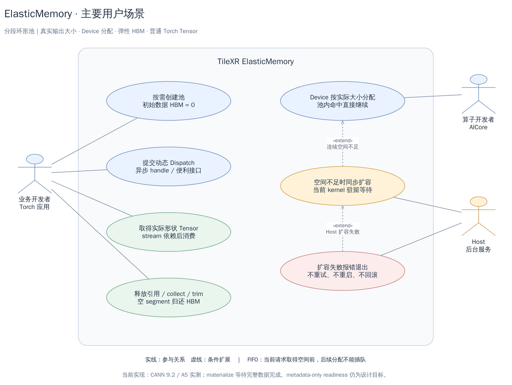
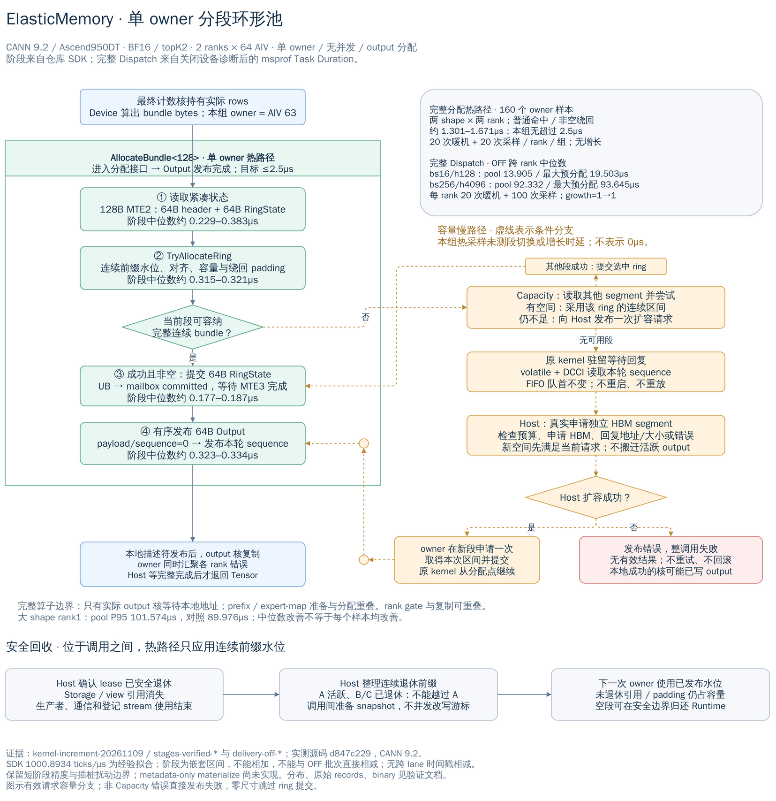
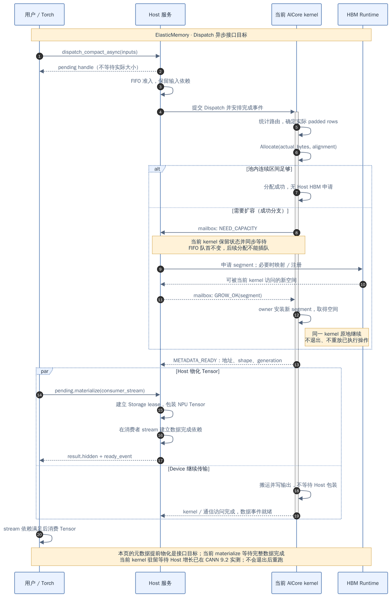
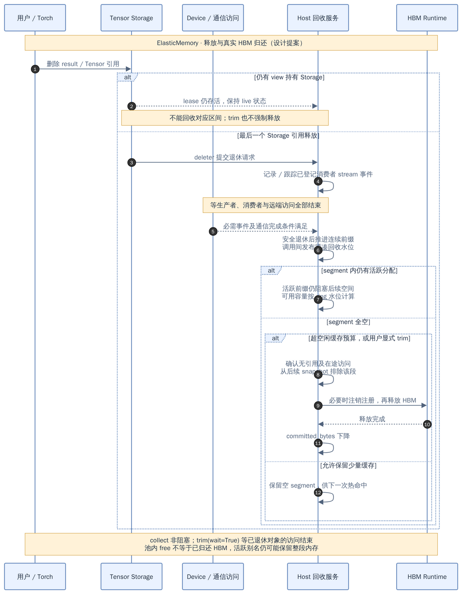
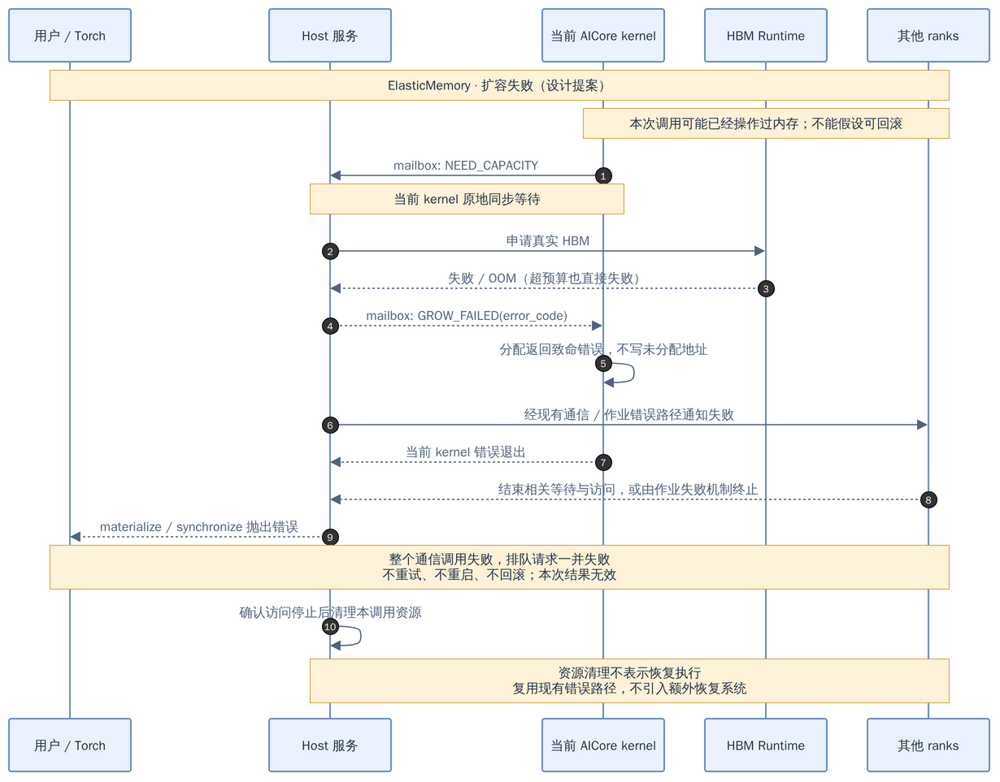
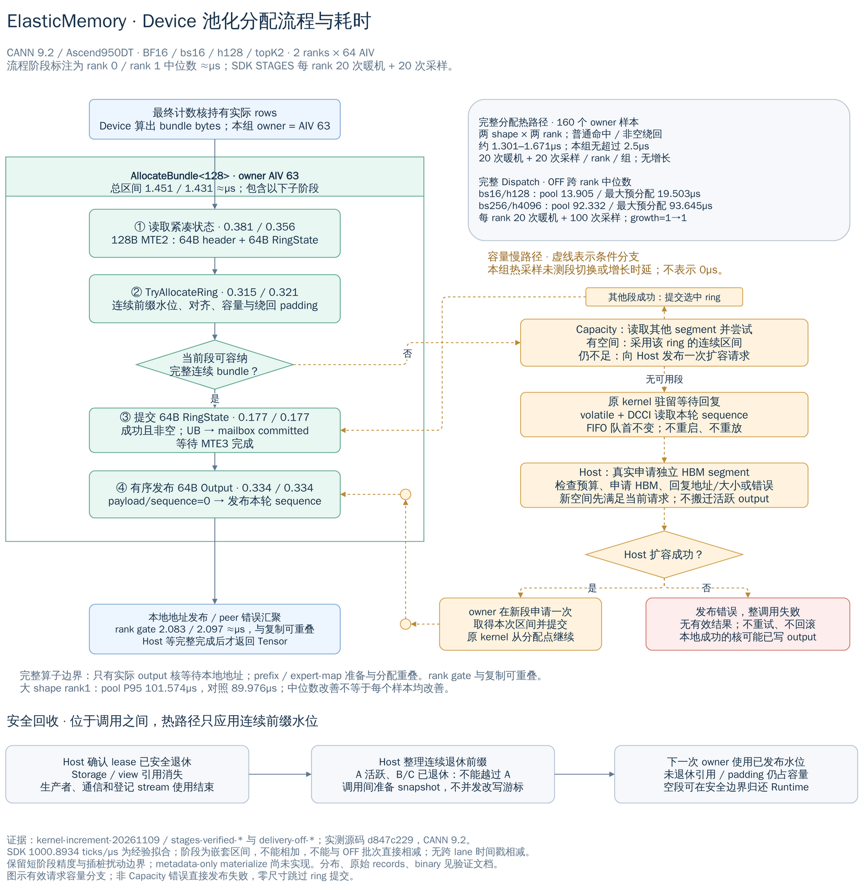

# TileXR ElasticMemory 设计

[English](elastic-memory.en.md) · [验证记录](validation/elastic-memory.md) · [Torch adapter 使用说明](../integrations/elastic_memory_torch/README.md)

ElasticMemory 为执行期间才能确定输出大小的算子提供 Device 侧分配。它以独立 HBM segment 组成单 owner 分段环形池：Device 算出实际大小后取得连续区间，容量不足时由原 kernel 同步等待 Host 申请真实 HBM，再从分配点继续。最终输出导出为普通 NPU Tensor，引用和 stream 完成条件共同决定何时复用或归还内存。

本文规定架构、所有权和失败契约。当前实现范围与尚未实现的接口目标在第 11 节区分；环境、性能数值、源码与 binary 对应关系及测试命令集中在验证记录中。本功能不改变现有 EP V1/V2、MoonEP 或上游 DeepEP 的接口契约，也不要求独立 Planner。

## 1. 适用场景与约束

[](diagrams/elastic-memory/use-cases.drawio.png)

图 1 展示 Device 分配、Host 增长、Torch 消费与整段归还的关系。当前 materialize 等待完整数据完成。

- 动态申请用于算子级 output；同生命周期的多个输出可合为一个 bundle。一个算子内不反复申请释放，不面向大量微小对象或任意碎片管理。“通常较大”不是最小尺寸限制，零尺寸、对齐和边界请求仍须正确处理。
- 每个 pool 同时只有一个 Device allocator owner。申请和释放相关 Device 元数据操作只由该 core 执行；不要求跨 kernel 使用同一个物理 core，不支持多核并发 malloc。
- 同池调用按 FIFO 串行准入。各 rank 必须按相同通信调用顺序提交；不同 communicator 的并发流水线使用独立 pool，不能依赖各 Host 线程的到达顺序决定 collective 顺序。
- Device 在 Dispatch 内完成计数和布局后申请实际 bytes。`actual_rows` 包含 route 复制、专家 padding 和必要对齐，不能将尚未收齐的计数作为最终 shape。
- 每个 Tensor 的有效 storage 范围连续，一个 bundle 不跨 segment 或环尾拼接。活跃地址保持稳定，不搬迁 Tensor，也不将不连续 segment 伪装成连续存储。
- 数据 HBM 初始为零，仅创建有界控制元数据。正常命中不申请 Host HBM，不等待 Host 包装 Tensor 才推进数据面。
- 容量不足时当前 kernel 驻留等待一次 Host 增长响应。失败终止整次调用及相关通信域，不重试、不重启、不重放、不回滚已写数据。

## 2. 组件与所有权

| 组件 | 职责 | 所有权与访问 |
|---|---|---|
| HBM segment | 保存连续 output 区间 | Host Runtime 创建和释放；Device 访问 |
| PoolState snapshot | 本轮请求头、当前段和有界段目录 | Host 在调用间准备，运行中的 kernel 只读 |
| RingState commit | 所选段的分配与回收游标 | Device owner 提交；Host 在完成后校验并保存镜像 |
| Host reservation 队列 | 分配顺序、padding、lease/event 和安全退休前缀 | Host 持有，不放入 Device 热路径扫描 |
| Host-visible mailbox | 增长请求、响应、commit 和输出描述符 | 各槽单写者，按本轮 sequence 配对 |
| Native service | FIFO 准入、增长、完成检查和退休 | 使用 pool 捕获的设备 context；不依赖 Python 回调 |
| Allocation lease | 保持生产者、通信和 Storage 使用权 | native Runtime 与 Torch adapter 共享 |
| Kernel 执行状态 | 已完成计数、布局及已有内存副作用 | 等待增长期间保持在原 kernel 内 |

Host 根据 pool/device、segment ID、offset、bytes 和 generation 校验 handle，再从已知 segment 恢复设备地址；Host 不解引用 Device 指针。大数据留在 HBM，映射 Host 内存只承载小型控制信息。Host 指针与 Device 映射地址分别保存，不要求二者数值相同。

## 3. 单 owner 分段环形分配

[](diagrams/elastic-memory/segmented-ring-allocation.drawio.png)

图 2 将正常命中、容量慢路径与调用间退休分开。图中耗时为已记录条件下的实测，适用边界见第 10 节。

### 3.1 连续区间与绕回

每个 segment 保存逻辑分配尾游标和回收头游标。二者之差表示尚不能跨过的保留窗口；当前实现以 `tailOffset` 保存物理尾位置，避免热路径变量取模。

owner 应用已发布的回收水位，按实际 base 地址对齐候选区间。段尾不足以放下完整 bundle 时，将尾部余量作为本次 reservation 的 padding 后尝试绕回。只有 payload、对齐和绕回 padding 合计不超过可用容量时才提交游标。失败尝试不改变已提交状态；地址和长度运算必须检查溢出。

正常命中只涉及紧凑当前段，无空闲槽搜索或任意空洞整理。当前段不足时检查有界段目录；其他段也没有合适连续区间，才发出增长请求。逻辑空闲字节足够并不意味着存在可立即分配的连续区间。

空环可在安全边界规范化游标；不得改变活跃地址或复用仍可能被观察到的 allocation generation。零尺寸输出不占 reservation，也不强行分配数据 segment。

### 3.2 连续退休前缀

Host 根据 Storage 引用及生产者、通信、登记 consumer stream 的完成情况，整理每段已安全退休的连续前缀，并在下一次调用前发布回收水位。Device owner 校验并应用该水位。Host 不并发改写运行中 owner 的游标。

对于 `A → B → C`，A 仍有 view 或在途消费者时，B/C 即使已释放也不能让回收游标越过 A。其空间计入被队头阻塞的逻辑空闲字节；后续请求可使用其他段或增长，但仍受预算约束。reservation 保存 padding 和结束游标，连续前缀退休时一并回收。

单 core 约束只限制 Device allocator 修改者。Host 仍负责检查生命周期和实际 `aclrtFree`；Device 生产完成不代表 Torch output 已可释放。

### 3.3 ABI 与数据搬运

当前 ABI 使用 64B `RingState`：`Segment{id,address,bytes}` 和 `head/tail/reclaim/tailOffset/alignment`。非零请求序号用作非空 allocation 的 generation，`alignment` 供 Host 完成后校验。

Host 将上一次 Device commit 的镜像和安全退休水位组成本轮只读 `PoolState`，在 launch 前复制到 HBM；当前段排在首位。Device 热路径用一次 MTE2 读取 64B header 和 64B 当前 RingState。其他段仅在容量不足时读取。Host 不预先决定本次 output bytes 或分配 offset；收到 Device commit 后重算并校验结果。

成功且非空时，Device 将所选段的 64B 状态通过 MTE3 写入独立 `committed` 槽，等待写回完成，再有序发布 64B Output。输出发布先写 sequence 为零的完整 payload，再携本轮 sequence 发布完整描述符。失败清空有效 handle/address 并发布错误；参数入口非法时直接返回错误，由调用者处理。

当前结构上限为 32 个 segment、128 个 outstanding reservation，以及每个 lease 分别最多 128 个登记 stream 和 128 个 event。reservation 上限包含已退休但仍被活跃前缀阻塞的记录；控制容量耗尽必须明确失败，不能只统计 live lease 后无界增长。ABI 变更时 native 库、外置 kernel 和 Torch extension 必须一起重建。

## 4. Dispatch、增长与 FIFO

### 4.1 真实大小与热路径

Dispatch 在同一次 kernel 内完成最终接收计数，计算 hidden 和辅助输出的实际布局，并由指定 owner 调用 `AllocateBundle`。同生命周期的输出共享一个 bundle 和 lease，按各自 dtype/通信要求对齐。Combine handle 保存路由及逆映射，用户无需预先执行 Planner。计数完成前已接收的 payload 必须保存在有界、遵守 credit 的暂存区。

当前 Memory 实现由最终计数核执行分配。只有实际 output 核接收和清除计数 flags；prefix、expert-map 和 count-output 准备与 owner 分配重叠。output 核在复制前等待本地不可变地址描述符，读取顺序为发布 magic 后的完整 body。跨核发布必须使用目标平台已验证的可见性协议，不能假设任意 block 都会同时驻留并用普通全局自旋屏障同步。

owner 的 peer 错误汇聚可与其他核的本地复制重叠。Host 在完整完成并检查状态后才导出 Tensor，因此失败的调用可能已写过部分 output，但不会交付有效结果。

### 4.2 原 kernel 等待真实 HBM 增长

1. 当前段及其他候选段均不足时，Device 发布一次包含 sequence、bytes 和 alignment 的增长请求。
2. 原 kernel 留在分配点等待匹配响应，保留之前的执行状态和副作用，不写尚未分配的地址。
3. Native service 检查预算，申请满足该请求的独立 HBM segment；如某个 transport 需要映射或注册，必须先成功完成再发布地址。
4. Host 回复 segment ID、地址、容量或错误。Device owner 成功时只在新段尝试一次分配，提交后从原分配点继续。成功响应却不能容纳请求属于协议失败，不再次扩容。
5. Host 申请、预算、必要注册或分配后记账失败均须让 Device 收到失败响应。已经申请但未发布的 HBM 按安全清理规则释放，不能留下永久等待。

Host 分配和响应不得依赖当前 kernel 完成，也不能排在其后续 stream 操作之后。增长请求不能等 kernel 完成后才通过 D2H copy 读取。若某平台不能在驻留 kernel 期间完成这些操作，则该平台不支持此路径；不能隐式改为退出重跑。

### 4.3 FIFO 与通信顺序

Host 排队及在途 allocation 请求受 `maxPending` 限制，达到上限拒绝新提交。尚未准入的请求在 Host 队列等待，不占用 AICore；已准入且需要增长的 kernel 则占用其执行资源并驻留等待。队首的“尝试分配 → 等待增长 → 取得区间”不可被后续请求插队，新空间先满足队首。

下一请求必须等 allocator 写阶段安全结束后才准入，不能仅观察地址已发布就启动另一个写者。当前实现等待本轮完整完成后准备下一 snapshot。已有输出可在登记的其他 stream 消费；这不等于同池分配可并发。

FIFO 只决定本池分配次序，不能代替通信协议的地址就绪、credit 或远端完成条件。当前 Torch buffer 只允许一个活跃 routing handle；完成 Combine 或显式 discard 后才能提交下一次 Dispatch。

## 5. Mailbox 与可见性

请求、响应、commit 和输出使用独立单写者槽，并通过 ABI version、请求 sequence 和 allocation generation 拒绝重复或过期消息。Host 包装前检查 pool/device 归属、segment 边界和 shape 所需字节数。

先写完整描述符，再以平台认可的顺序发布 sequence；读取侧观察发布后取得一致快照。C++ `volatile` 或 CPU 原子操作本身不能证明跨设备 release/acquire。当前 Device 增长等待组合 volatile GM reload 与 DCCI，并校验本轮 sequence；请求/结果使用 UB 到 GM 的有序写回。字段宽度、缓存处理、槽复用和双向运行中可见性必须以适用 CANN/硬件证据验证。

Host 服务不依赖持有 Python GIL 的调用者，也不依赖用户调用 `materialize` 才推进。Host 轮询、排队和 CPU 占用应单列测量；不承诺尚未验证的设备通知或唤醒机制。

## 6. 接口与异步语义

下图展示异步接口的设计目标：**元数据提前物化尚未实现，当前 materialize 等待完整数据完成。**

[](diagrams/elastic-memory/dispatch-sequence.drawio.png)

当前 C++14 native API 由 `Pool`、`Pending` 和 `Allocation` 组成。`Pool::Submit` 接收 Device launch 回调及输入 stream，在 native service 上运行回调；调用者通过回调持有输入 owners。`Pending::Wait` 返回完成后的 allocation 或抛出运行时/协议错误。Device 入口为：

```cpp
// 单 owner 调用；当前声明以公共头为准。
template<uint32_t ScratchBytes = 128>
uint64_t AllocateBundle(DeviceView view, uint64_t bytes, uint64_t alignment,
                        uint64_t rows, uint64_t* address,
                        Profile::Recorder* profiler = nullptr);
```

Torch adapter 提供 `dispatch_compact_async`、`pending.materialize` 和 `combine_compact`。异步提交保留输入 Storage，记录输入 stream 就绪依赖，返回 pending 后由 native service 独立推进。具体可执行示例见 [adapter README](../integrations/elastic_memory_torch/README.md)，不将概念接口当作上游 DeepEP 已有 API。

**当前 `Pending::Wait/materialize` 等待完整数据完成；Combine 也等待完成后返回。** 等待期间释放 Python GIL；重复 materialize 保持同一 Storage。丢弃 pending 不撤销设备任务，Runtime 仍须跟踪至安全完成并回收未导出的输出；不提供执行中的强制取消。

元数据提前物化是尚未实现的接口目标，需要严格区分：

| 状态 | 语义 |
|---|---|
| METADATA_READY | 最终地址/shape 稳定，分配成功，输出 lease 可交付，数据完成事件已提交并可安全等待 |
| DATA_READY | 生产者写入及必要通信访问完成 |
| FAILED | 本次结果无效；停止相关访问后清理，不恢复执行 |

提前物化若实现，Host 仅等待元数据和可等待事件，在消费者 stream 建立依赖后返回普通 Tensor，不必等待所有数据。但不能对尚未录制的普通事件执行 wait 并假定其代表未来完成。`ready_event` 只保证执行顺序，不能代替运行时/协议错误检查；元数据已发布仍可能发生 peer 失败，异步消费不保证 Host 在下游开始前获知所有错误。当前实现不声明这种 metadata-only wait 语义。

## 7. Tensor、stream 与容量归还

### 7.1 Storage lease

adapter 使用匹配安装版本的 `torch_npu` 外部内存工厂创建 NPU Tensor，设置 device、dtype、shape、stride 和 ND format。当前使用 `at_npu::native::from_blob`，不复制 output，也不替换 Torch 全局 allocator。

自定义 Storage deleter 捕获 native lease。最后一个 Storage 引用消失时只提交退休请求，不直接释放 HBM；view、detach 和重复物化共享存储所有权。Python finalizer 不能替代 Storage 持有。训练还需要独立 autograd 和 backward stream 适配，当前拒绝 `requires_grad`。

materialize 使用的 stream 自动登记；额外 consumer stream 使用 `result.use_on_stream(stream)` 显式登记。Torch 的 `record_stream` 不自动证明自定义 segment 的安全性，未登记 stream 的消费不属于支持契约。

Torch CPU 提交队列中的任务可能晚于 Python 引用消失。native 退休 hook 在 service 线程、pool mutex 外刷新登记队列，再记录最终 stream-tail 事件。不能在可能运行于 Torch 队列 worker 的 Storage deleter 中同步刷新该队列。设备 context 和登记 stream 必须保持有效直至 lease 退休。

### 7.2 逻辑退休与真实归还

区间可退休需要同时满足：没有 Storage/export 或待物化 handle 持有，生产者、通信及所有登记消费者均已完成。环形池随后只推进连续安全前缀；逻辑空闲、可重新分配和整段归还 HBM 是三个不同状态。

空 segment 在安全边界从未来 snapshot 排除，确认没有在途访问；若 transport 持有注册资源，先完成相应注销再释放。不得释放仍有 kernel 使用的 segment 表版本，也不得移动活跃地址来腾出空间。

- `collect()` 非阻塞请求处理已满足条件的退休对象并返回当前 snapshot；返回计数可能早于本次 collection 生效。
- `trim(wait=True)` 等待已退休对象的相关设备工作并释放可归还的整段，不等待用户删除活跃 Tensor，也不强制释放它们。
- `close()` 拒绝新提交并排空或失败处理在途请求；仍存活的 Storage 保持 native Core 和 segment，不把入口关闭等同于 HBM 已全部释放。

空闲缓存预算控制保留空 segment 的容量，可设为零；一个小 view 仍可能保留整段。增长根据请求、对齐、Runtime 粒度和有上限余量确定 segment 大小，不无限倍增。`max_committed_bytes` 限制实际提交量，Runtime OOM 仍可能提前发生；segment 目标大小不能阻止剩余预算内可满足的小请求。

[](diagrams/elastic-memory/reclaim-sequence.drawio.png)

图 4 区分 Storage 引用消失、访问结束、连续前缀可复用和整段归还；活跃 view 可继续保留整段。

### 7.3 统计口径

| 指标 | 含义 |
|---|---|
| live_bytes | 活跃 lease 与在途生产者 reservation，包含相应对齐/绕回开销 |
| pending_retire_bytes | 用户已放弃持有、访问尚未全部结束的 reservation |
| free_bytes | segment 内逻辑空闲总量，包含暂时被环形队头阻塞的空间 |
| blocked_free_bytes | free_bytes 中不能越过活跃前缀的子集，不重复计入总量 |
| padding_bytes | live/pending reservation 中的对齐和绕回开销，不是额外 HBM |
| committed_bytes / peak_committed_bytes | 数据 segment 当前实际提交量及其峰值 |
| reclaimable_segment_bytes | 可整段安全归还的容量 |
| largest_free_range | 满足环形水位和连续性限制的最大可分配区间 |
| metadata_bytes | 已计入的控制存储；必须说明是否包含 Host 容器和线程开销 |

记账满足 `committed_bytes = live_bytes + pending_retire_bytes + free_bytes`，分类不重复。生产者实际大小尚未发布时保守保留未分配 committed 空间，不能将其报告为可回收；allocator 在途时 `reclaimable_segment_bytes` 为零。完成后的 snapshot 按 Device commit 校验 reservation。

当前 metadata 计数包含映射 mailbox 和 Device PoolState，不包含 Host map/deque、lease/event 或 service-thread 对象开销。Torch allocator 不自动统计这些外部 segment，不能单凭 `torch.npu.memory_allocated()` 推断总 HBM，也不自动清空 Torch cache。

## 8. 通信集成与失败契约

当前先池化最终本地输出，保留既有通信 staging，再复制到 output。必须分别报告 output、staging、辅助 flags/guard 和复制流量；不称作通信零拷贝，也不能用另一份隐藏的最大输出缓冲抵消节省。

直接向池输出进行 peer-memory/UDMA 写入属于独立扩展：发布地址前完成映射/注册和对端描述符交换；注册也必须支持原 kernel 驻留时推进。UDMA 只注册允许的 owner 本地分配，不注册远端 IPC mapping、不在 `InitThread` 注册。WQE 在 UB 构建，经 MTE3 发布完成后用 `st_dev` doorbell；退役和注销需等待远端协议完成。transport 选择依据能力、注册和大小，不仅依据拓扑。

| 情况 | 必须的行为 |
|---|---|
| 第一次非空调用 | 从零数据 HBM 经增长获得空间；分配前副作用只执行一次 |
| 空接收或全 inactive | 正确返回零尺寸输出，通信协议仍完成 |
| 当前段不足或队头阻塞 | 尝试其他段；均不足则原 kernel 等 Host 增长 |
| 超预算、OOM、必要注册或记账失败 | 发布错误，结束参与 rank 的相关等待，终止调用/域及排队请求 |
| 描述符过期、重复或越界 | 拒绝交付和重复释放，进入相应错误处理 |
| kernel 或通信失败 | 保留首错；未确认访问结束的资源隔离，不能提前回收 |
| 部分 output 已写 | 结果无效，不回滚、不重启；访问停止后清理资源 |

不得通过删 token、改变路由或降低 dtype 伪装成功。错误不能只在一个 Host 线程抛出而留下 Device 永久等待。若设备或通信无法协作退出，使用现有 Runtime/作业失败机制；ElasticMemory 不提供故障恢复系统。清理资源不表示内容恢复或失败域可继续复用。

[](diagrams/elastic-memory/failure-sequence.drawio.png)

图 5 中的清理只在确认访问停止后进行；失败前可能已发生写入，清理不表示回滚或恢复执行。

## 9. 图源与维护

本文图片已直接嵌入各相关章节；PNG 内嵌可编辑图源，完整尺寸可通过图片链接查看。源文件与测量说明：

- [分段环形池 draw.io](diagrams/elastic-memory/segmented-ring-allocation.drawio) · [流程与实测说明](diagrams/elastic-memory/segmented-ring-allocation.md)
- [Device profiling draw.io](diagrams/elastic-memory/device-allocation-profile.drawio) · [阶段口径与证据](diagrams/elastic-memory/device-allocation-profile.md)
- [场景、Dispatch、失败和回收四页 draw.io](diagrams/elastic-memory/elastic-memory.drawio)

维护时同步更新图源、PNG 和中英文正文。当前实现与接口目标必须在图旁明确标注，不能用目标流程掩盖当前完成等待语义。

## 10. 性能与验证要求

[](diagrams/elastic-memory/device-allocation-profile.drawio.png)

图 6 的内部阶段来自 SDK 插桩测量，完整 Dispatch 对照来自关闭设备诊断的独立批次。阶段嵌套且可与其他核工作重叠，不能相加或直接相减推导纯分配收益。

无增长的正常命中和非空绕回分配热路径目标为 **≤2.5µs**，从进入 Device 分配接口到结果发布完成，包含初始化、状态读取、回收水位应用、分配计算、commit、发布和必要同步。段切换与 Host 增长单列，不能移走正常每次调用的成本。记录逐 rank median/min/max/P95、样本数和超目标样本，不把观测最大值当作所有负载上界。

核心算子性能只比较设备 kernel 执行时间：在相同 shape、输入、路由、dtype、rank、通信路径、编译和诊断配置下，池空间充分且测量期间 growthCount 不变，比较最大容量预分配、Host 实际大小参考和 Device pool。Host 参考仅用于对照，不进入生产路径作为 size Planner。

诊断使用仓库 `TileXR::Profiling` SDK 的真实 service-stream capture；Collect 在完成之后执行，不能阻塞增长服务。验证 timer 换算、全 lane/关键 owner marker、overflow/drop 和插桩扰动，不把 HWTS/AIV/sysClock 频率直接当作 GetSystemCycle 频率，也不未经证明跨 lane 时间戳相减。

正式对照移除设备诊断插桩，保持相同 Host stage barrier/framework profiler，以命名 Dispatch/Combine kernel 的 msprof Task Duration 测量。保留算子内分配、同步和跨 rank 等待，不用 Host wall 或 Task Wait Time 替代。至少覆盖 bs16/h128 和 bs256/h4096、BF16/topK2/2 ranks，保留暖机、足够样本及逐 rank/跨 rank 分布；中位数改善不能代替尾延迟结论。

报告还须包含 backend、native status、kernel 版本、数据量、适用带宽、实际 output bytes、committed/peak/trim、blocked/padding 和仍保留的 staging。Host 提交/排队、materialize、CPU 占用及增长/注册/trim 延迟作为辅助观测，不计核心 kernel 性能。

功能验证覆盖真实增长时 kernel 尚未结束、前序副作用恰好一次、新地址读写、失败退出不重放、FIFO 队首优先使用新空间、初始零数据 HBM、绕回/段切换/溢出/零尺寸、生命周期与整段归还，以及真实多 rank Dispatch/Combine。Host 模型和 M0 可行性实验不能替代完整接入测试。

每次硬件 launch 前重新检查所有目标物理卡的 proc-mem 和 identity mapping；busy、query/parse 失败或 mapping 不明均拒绝，不以 `fuser` 为空放行，不 kill/reset 外部任务。相同环境已有 HCCL qualification 必须复用，证据不全按边界记录，不按任务重跑。

## 11. 当前支持边界

| 项目 | 当前范围 |
|---|---|
| 平台 | CANN 9.2.0、A5/Ascend950DT 实测；其他版本与硬件不作兼容承诺 |
| 编译与部署 | native C++14；Torch extension 匹配安装 Torch 的 C++17/ABI；纯 AICore 外置 binary 注册启动，不在 Host 库嵌入 kernel |
| EP | 本地输出池化的 Memory Dispatch/Combine；无独立 Planner |
| Torch | 普通 FP16/BF16 连续 ND Tensor，int32 routes、FP32 Combine weights；inference-only |
| 异步 | native 提交独立推进；materialize/Combine 当前等待完整完成，metadata-only readiness 未实现 |
| 生命周期 | Storage/view、登记 stream、pending input owner、close 保持活跃 Storage |
| 未覆盖扩展 | autograd/backward、graph capture、UDMA 直接写输出、multi-host、量化、shared-expert 和 TP 路径 |

当前分配与完整 kernel 的实测、未覆盖项和事故披露以 [验证记录](validation/elastic-memory.md) 为准，不把本设计的目标条目当作已验证能力。开发侧负责实现、审查、全部测试与证据；设计验收依据提交结果核对契约，不要求设计侧自行编译或实机复验。

## 12. 代码与维护入口

| 内容 | 路径 |
|---|---|
| Native API | [tilexr_elastic_memory.h](../src/include/tilexr_elastic_memory.h) |
| 共享 ABI | [tilexr_elastic_memory_abi.h](../src/include/tilexr_elastic_memory_abi.h) |
| Device 分配 | [include/device/tilexr_elastic_memory_device.h](../src/include/device/tilexr_elastic_memory_device.h) |
| Device profiling | [include/device/tilexr_elastic_memory_profile.h](../src/include/device/tilexr_elastic_memory_profile.h) |
| 环形算法与 Host service | [allocator.h](../src/elastic_memory/allocator.h)、[pool.cpp](../src/elastic_memory/pool.cpp) |
| Dispatch kernel | [tilexr_ep_dispatch_memory_kernel.h](../src/ep/kernels/tilexr_ep_dispatch_memory_kernel.h) |
| Torch adapter | [README](../integrations/elastic_memory_torch/README.md) |
| 功能测试 | [tests/elastic_memory](../tests/elastic_memory)、[Torch tests](../integrations/elastic_memory_torch/tests) |
| 相关设计 | [EP Memory](specs/ep-memory.md)、[Profiling SDK](specs/profiling.md) |

Device 头安装在 `include/device/`，Host API 与共享 ABI 安装在 `include/`。移动公共头时同时维护 include、CMake dependency 和安装规则，并用干净安装目录编译外部消费者。设计的中英文版本保持相同契约；具体环境、原始日志、提交及 binary 哈希留在验证记录，避免设计文档变成执行历史。
