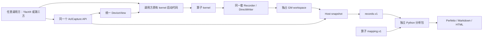
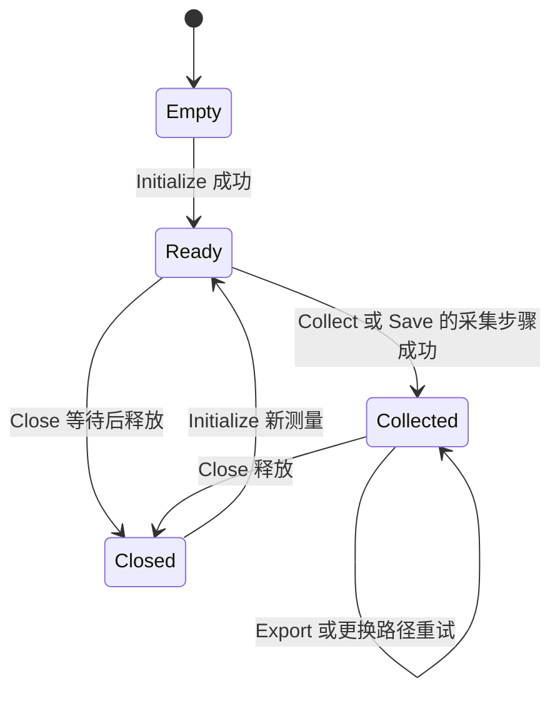

# Profiling 独立化：统一设计与实施计划

更新日期：2026-10-20（Asia/Shanghai）。状态：**I00 已复核；I01–I06 已有代码实现和本地验证，目标 CANN/NPU、Linux 文件发布及最低 Python 版本验收未关闭**。公共 API 已实现；本文的设备与生产验收门槛仍然有效，不能由 Host 替身结果替代。[PR #143](https://github.com/LingquLab/TileXR/pull/143) 仅作历史来源。

实际仓库根目录为 `C:\Git_data\tileXR`（位于用户指定的 `C:\Git_data`）。后续命令、相对源码链接和修改范围均以该仓库为准。最初计划整理仅交付两份文档；当前实现阶段同时交付 SDK、离线包、调用方迁移、示例和测试，具体进度见整改文档第 9 节。

本文与 [代码和文档整改计划](PROFILING_CLEANUP.md) 是本主题仅有的两份有效计划：本文回答“最终工具是什么、如何使用、怎样迁移”，整改计划维护具体风险、修改方向和关闭证据。此前会话草案的旧接口与兼容方案已由本文取代；真实仓库中不存在的日期草案不需要复制或创建，不是实施输入。用户已选择 TileXR 与第三方整体迁移到同一公共 API，取消长期兼容适配层。

人类读者先看范围、方案比较和第 4 节用法，再看相关任务；AI agent 先完成 I00，再读取第 5—8 节合同及整改文档对应 ID，按第 9 节依赖实施。不得以“文档已更新”关闭代码任务。

## 0. 基线取证 I00：已完成的实现前置

| 事项 | 当前证据与处理 |
|---|---|
| 用户确认的主基线 | [codex/TileXR_Profiling_Upgrade](https://github.com/LingquLab/TileXR/tree/codex/TileXR_Profiling_Upgrade)；`main` 作对照 |
| 认证 checkout | `C:\Git_data\tileXR`，origin 为 `https://github.com/LingquLab/TileXR.git`；读取时当前分支 main，工作区干净 |
| 本次远端取证 | 2026-10-20 11:58（UTC+8），通过已有 HTTPS/Git Credential Manager 执行 `ls-remote --heads origin` |
| 主基线分支 tip | `efa5d80d87aea2eb60e4df770625a31236ee9a93` |
| main 对照 tip | `efa5d80d87aea2eb60e4df770625a31236ee9a93`；两条分支同一提交，本次无代码差异 |
| 固定内容来源 | 从该 Git 对象导出只读比较快照；核对 315 个源码/测试/CI 和关键指导文件，忽略 CRLF 后与当前工作区一致 |
| 本次测试 | 固定快照 63 项/2.478 s 通过；又从实际 `C:\Git_data\tileXR` 运行 63 项/2.279 s 通过，Python 3.12.14；不证明新 SDK 或 NPU |

固定提交：[efa5d80d87aea2eb60e4df770625a31236ee9a93](https://github.com/LingquLab/TileXR/commit/efa5d80d87aea2eb60e4df770625a31236ee9a93)。基线阶段只读查询和导出，没有切换、合并、fetch 或修改认证 checkout；计划交付阶段仅新增两份计划，不修改实现、分支或提交。最初未认证访问失败已由认证取证解决，未登录网页 404 不作为不存在的证据。

I00 本次已完成。后续若两条分支继续变化，应在真实 checkout 中先记录 origin/工作区状态并保留用户修改，再重复核验，不能把本次快照永久称为“最新”：

```bash
git remote get-url origin
git status --short
git ls-remote --heads origin refs/heads/main refs/heads/codex/TileXR_Profiling_Upgrade
git rev-parse origin/main
git rev-parse origin/codex/TileXR_Profiling_Upgrade
git log --left-right --oneline origin/main...origin/codex/TileXR_Profiling_Upgrade
git diff --name-status origin/main...origin/codex/TileXR_Profiling_Upgrade -- \
  src tools/profiling tests/profiling docs scripts
```

若 ls-remote 返回的 SHA 与本地对象/跟踪引用不同，先受控 fetch 更新两个 `refs/remotes/origin/...` 再读取固定对象；不能用 fetch 退出成功代替引用核实。记录读取时间、两条完整 SHA、实际主基线、差异和 profiling 文件清单，重读目标版本 AGENTS、构建和测试。若目标分支已实现某项，验证后复用，不增加第二套实现。不得自动 checkout、merge、reset 或覆盖用户工作区；`reference/` 只用于比较，不进入活动构建。

本次在会话比较目录生成的非交付归档 SHA256 为 `5352f96305f0402f7e1edaf02b59c99ff49c18d5da79f99d1d15c1cec640e95e`。真实仓库不要求存在该缓存，未来 agent 直接读取固定 Git 对象，不查找或创建它；该缓存不作为提交产物、文档或构建依赖。实际仓库测试命令为 `python -B -m unittest discover -s tests/profiling/python -p 'test_*.py'`，cwd 为上述真实仓库；本轮未进行 CANN 编译、NPU 或性能测试。

以下为比较快照的文件 SHA256，供后续比对；工作树若使用 CRLF 须先规范化换行。固定 Git SHA 才是代码基线，文件指纹不代替 Git 提交证明：

| 文件 | SHA256 |
|---|---|
| `src/include/tilexr_profiling.h` | `a7f8484f219f84b3907b8f3f0d5c333fdeea6821ed03c5cefb88b6e1f184e547` |
| `src/comm/tilexr_profiling_runtime.cpp` | `d1e188dfb388c06b350587736acd4fff7fe1095edc8c3b040b2a9383bd4c01b1` |
| `src/collectives/host/collective_launcher.cpp` | `6b466e4cddc614e0819d5821c57fcf3819456d1cc6ce5545e5f11eb380f9355d` |
| `tools/profiling/pairing.py` | `add38267658899c9ef1593aea7a63b713c92554d7332094c6c54ff6f3bc70fb8` |

## 1. 范围与目标

TileXR 内部算子与第三方算子都引用 `<tilexr/profiling.h>`，使用相同的类型、配置、打点方式、采集生命周期和报告入口。SDK 不识别调用方身份，不提供 TileXR 专属模式或解释 `CommArgs` 的适配接口。简单用法优先，内存池等进阶能力对所有调用者同样开放。

| 编号 | 独立化部分 | 设计结果 |
| --- | --- | --- |
| I01 | 设备 API 与通信结构解耦 | 公共 Recorder/DirectWriter 只接收独立 DeviceView，不包含 `CommArgs` 或 `ExtraFlag` |
| I02 | Host 采集与导出解耦 | 头文件 AclCapture 管理 workspace、同步、D2H 和 records 导出，不依赖 communicator 生命周期 |
| I03 | 头文件化、独立构建与交付 | 只获得发布 include 和 CANN 即可编译使用，不编译 TileXR `.cpp`，不链接 `libtile-comm.so` |
| I04 | TileXR 自身迁移 | 所有使用本工具的活跃打点改用相同公共 API；只有一套在线采集实现 |
| I05 | 离线分析独立安装 | Python 包离开仓库也可运行，内部和外部使用同一 CLI/API |
| I06 | 统一最小示例 | Add4 演示唯一默认接入流程，可从干净外部工程独立构建 |

独立化不等于消除 Ascend 平台依赖：设备代码仍需 Ascend C 编译器，Host 仍需链接正常的 CANN runtime；调用者仍负责自己的 kernel 编译、注册、launch 和业务正确性。仅采集与导出不需要额外 profiling 二进制库；离线分析不需要 NPU、CANN 或通信库。

兼容目标为 SDK 自身及纯 Host 实现使用 C++14，Host 按 C++14 验证；CANN 9.1.0、驱动 25.1.rc1 或更新版本。设备标准由实际 CANN 框架/工具链验证，当前 demo 的 `gnu++17` 不证明设备 C++14，也不能只修改旗标后宣称支持。首版 Host 文件发布支持 Linux。本文不设计跨设备时钟校准、实时 Host 读取、共享 lane 并发写入、自动识别算子或通用 kernel 启动器，不更改 TileXR/MoonEP 公开业务 API。

### 分歧比较与最终选择

| 分歧 | 此前方案 | 新方案/其他选择 | 采用方案及理由 |
|---|---|---|---|
| TileXR 迁移 | CommArgs 薄 adapter、保留旧签名 | 全活跃调用迁移独立 descriptor | 全量统一迁移；避免长期双接口，内部 Host/Kernel 参数成对更新，公开业务 API 不变 |
| 命名/目录 | `ascend_profile`、头放工具目录 | `<tilexr/profiling.h>`、`TileXR::Profiling`、独立 `src/profiling` | 采用新命名和目录；品牌前缀不引入通信依赖，安装子树自包含 |
| Host 默认流程 | Session，手工 Collect/ExportV1 | AclCapture，Save 包装分步能力 | AclCapture + Save，保留公共 Collect/Export/Snapshot；默认用法短且无内部特例 |
| 设备参数 | 手工 LoadDeviceView 再 Flush | DeviceArgs 返回 GM descriptor，Flush 内部加载 | 采用后者；减少调用样板，不把 Host 栈地址传到 Kernel |
| 重复采集 | Reset | Close 后 Initialize | Close → Initialize，新 UUID/所有权边界明确，首期不增加 Reset 组合 |
| GM 布局 | 对齐 occupied 高水位和 full scan | 有效前缀 count、独立 completion | 整体迁移新提交布局，producer/exporter/测试一同迁移，磁盘 v1 不变 |
| Python 入口 | `ascend_profile`，保留旧 tools.profiling alias | `tilexr_profiling` 唯一入口 | 采用后者；仓内消费者先迁完再删除旧成功入口，不维护两套路径 |
| 宏 | 新建 ASCEND_PROFILE_ENABLE | 沿用 TILEXR_ENABLE_PROFILING 的数值语义 | 沿用后者，未定义/0 关闭、1 开启，Host 类型布局不变 |
| 异步生产编排 | communicator 聚合或局部 Session | 每次 capture + 持久 owner 延迟收集 | 采用后者；launch 不 Save/Collect/析构等待，SDK 无业务回调 |
| 旧设计的可靠性要求 | 所有权、Snapshot、可重试、无覆盖发布、外部消费者 | 新草案细节不足 | 全部保留，并在统一合同中具体化 |
| 分析增强 | 旧表完整、新表未完整承接 | 全塞一期或明确分期 | 一期实现无需改 v1 的统计/来源整改，其余编号延期，见整改清单 |

旧 profiling 源接口兼容与磁盘兼容分别判断。取消旧 CommArgs 采集签名、旧自动多轮聚合和旧 Python CLI/API；历史 records/mapping.v1 继续可读。已有业务 API 不因工具迁移而要求用户换调用方式。

## 2. 当前耦合与拆分边界

| 当前实现 | 耦合位置 | 独立化处理 |
| --- | --- | --- |
| 设备 recorder 依赖通信结构 | [tilexr_profiling.h](../../src/include/tilexr_profiling.h) 的 include、`Flush` 与 `DirectProfilingWriter::Initialize` | 用公共 DeviceView 传递采集地址、容量与状态 |
| communicator 分配并导出采集数据 | [tilexr_comm.cpp](../../src/comm/tilexr_comm.cpp) 的 `InitProfiling/FinalizeProfiling/ResetProfilingState` | 提取为公共 AclCapture；业务对象仅作为普通调用者持有它 |
| exporter 编进通信库 | [runtime.cpp](../../src/comm/tilexr_profiling_runtime.cpp)、[comm CMake](../../src/comm/CMakeLists.txt) | layout、snapshot 与 exporter 实现随头文件交付 |
| 示例需要创建 communicator | [Add4 Host](../../tests/profiling/demo/profiled_add4_host.cpp)、[demo CMake](../../tests/profiling/CMakeLists.txt) | 示例和仓库内算子一起迁移，验证相同 API |
| 分析入口绑定仓库模块路径 | [CLI](../../tools/profiling/cli.py)、[Python API](../../tools/profiling/__init__.py) | 增加可安装包，保留同一分析实现 |

这些是独立化要解除的依赖，不据此认定现有通信功能存在算法错误。槽位初始化、direct writer 状态、文件发布、时钟与完整性等具体问题见整改清单。

固定基线源码已包含 direct writer、标量 GM flush、稀疏扫描/稳定排序、同 rank 多 core 共用 origin、`track/instance_range`，且旧 collectives tracing 已移除、coarse flush 已更新、生产 binary 已外置。旧文档归于 #150/#151/#167/#171 的历史记录只作线索，本计划的事实依据是本次固定 Git 对象与对应测试，不要求回到 #143 旧实现。

## 3. 目标架构



依赖方向固定为“业务调用方 → profiling SDK → CANN/标准库/平台文件 API”。SDK 不反向依赖 TileXR 通信、collectives、EP、MoonEP、HCCL、MPI 或业务日志。算子名、rank 和事件 ID 是数据，不能选择不同使用者的实现。

当前交付目录：

```text
src/include/tilexr/
  profiling.h                 # 唯一公共入口
  profiling/
    types.h                   # DeviceView、版本、配置和固定宽度类型
    device.h                  # deferred Recorder
    direct.h                  # DirectWriter
    host.h                    # layout、snapshot、归一化与 records 编码
    file.h                    # Linux 文件发布
    acl.h                     # 头文件 AclCapture
    detail/                   # 内部实现
src/profiling/
  CMakeLists.txt              # 独立安装与 INTERFACE target
examples/profiling/           # 可独立构建的通用 Add4 示例
tools/profiling/
  pyproject.toml              # wheel/sdist 和唯一包配置
  python/tilexr_profiling/    # 唯一离线分析实现、__main__、公共 API
  README.md                  # 统一安装与最短流程
  API_REFERENCE.md           # 类型、状态、错误和并发
  FORMAT.md                  # mapping/records/时钟/统计/完整性
```

用户只包含 `<tilexr/profiling.h>`。入口按 Host/AICore 编译侧选择实现，设备编译不解析 Host STL、文件或 ACL Host 实现。layout/编码层仅依赖标准 C++14，设备层依赖 Ascend C，Host 管理依赖 ACL，文件发布依赖 Linux 系统 API。

公共类型放在 `TileXR::Profiling`；实现使用模板或 `inline`，不依赖额外定义文件、C++17 inline variables 或可变全局状态。多个 Host translation unit 同时包含时无 ODR 冲突。设备 profiling 开关不改变 Host 类型布局或 records 协议。

## 4. 统一使用方式

### 4.1 默认 Host 流程

```cpp
// 公共 API；check 和 LaunchMyKernel 由调用方提供。
#include <tilexr/profiling.h>

TileXR::Profiling::AclCapture capture;
check(capture.Initialize(stream, blockDim));
check(LaunchMyKernel(stream, inputs, output, capture.DeviceArgs()));
check(capture.Save("capture.records.bin"));
check(capture.Close());
```

`Initialize(stream, logicalStreamCount)` 使用相同默认配置：rank 为 0，每个逻辑 stream 的默认容量为 4096，为本次单进程测量生成新 UUID；生成失败返回错误，不退化为固定 ID。内部 workspace 分配、清零和 descriptor H2D 不需要用户手工完成。逻辑 stream 是采集 lane，与 ACL stream 不同；参数表示实际参与集合 `[0,N)` 的大小，不能直接用物理容量冒充实际参与数。

多 rank 使用同一个 `Initialize(config, stream)` 重载，显式提供 rank、逻辑 stream 数及由应用分发的共享 capture UUID；容量也通过同一个 `CaptureConfig` 设置。工具不负责通信分发，不自动推断拓扑。

`Save(path)` 复用 `Collect()` 与 `Export()`：等待绑定 stream、D2H、校验和导出。需要分别处理采集和导出的调用方可使用这两个分步方法。需要复用内存池时，也通过同一头文件的 layout/view/snapshot/编码能力管理调用者所有的 workspace，不引入另一种使用者模式。

首期 AclCapture 仅拥有自身 workspace；普通调用方可提前准备多份独立 capture，库不再新增借用 workspace 的第二套生命周期。通用借用/池化能力列为后续增强，对所有调用方同样开放。默认 Save 示例用于同步保存，异步 launcher 遵循第 8 节的同 API 延迟收集规则。

`CaptureConfig.enabled=false` 时，`Initialize` 成功但不分配 workspace，`DeviceArgs()` 返回 `nullptr`；设备 `Flush` 接收该值时安全无操作。`Collect/Export/Save/Close` 均成功无操作，`Export/Save` 不创建文件。调用者可保留相同的初始化、launch、保存和清理代码，无需为启停增加分支；已经编译开启的 marker 仍可能读取时间戳。

### 4.2 默认设备打点

```cpp
// profileGM 为 capture.DeviceArgs() 传入的独立 descriptor 地址。
#include <tilexr/profiling.h>

TileXR::Profiling::Recorder<2> profiler;
profiler.RecordMarker<0, 1>();
// 被测工作；结束前完成工作本身要求的流水线同步。
profiler.RecordMarker<1, 2>();
profiler.Flush(profileGM, logicalStream);
```

Recorder 在测量区间内记录固定槽的数值事件与系统时间戳，区间结束后统一 flush。Slot 按实际执行顺序递增分配，条件分支可跳槽；同 timestamp 的 begin/end 依靠该顺序保留含义。事件 ID 非零，名称和层级留在 mapping 中。构造在被测区间之前完成，flush 在 critical end 之后完成。

DirectWriter 供运行时事件数或显式时间戳回填使用，记录时直接写 GM，开销与 deferred Recorder 不同。两种能力对所有调用者开放；一个 logical stream 的一次测量只选择一种 writer。Host 对已提交的有效记录统一按 timestamp 稳定排序，相同 timestamp 保留提交顺序，不能据排序补造缺失事件。

默认关闭设备 profiling；`TILEXR_ENABLE_PROFILING=1` 开启，未定义或 `=0` 为关闭。运行时关闭遵循上节的无操作行为约定，不等同于编译关闭的开销。具体开关统一、状态复用及开销验证见整改清单。

| 设备编译 | runtime enabled | 合同 |
|---|---|---|
| 未定义或 0 | false | 设备 no-op，Host 不分配、不上传、不导出 |
| 1 | false | descriptor 为空、Flush/DirectWriter 安全 no-op；已编译 marker 仍可能读时间戳 |
| 1 | true | 正常采集 |
| 未定义或 0 | true | Host 按配置准备，设备未提交；保留未提交证据，分析为 incomplete，不伪称完整 |

Host 分配由运行时配置决定，类型不随宏变化；非法宏值在编译期拒绝。逻辑 ID/rank 限 0…65535，带符号输入先拒绝负数；每 lane 容量 8…65536、按 8 记录对齐，默认 4096，所有尺寸/总内存预算和文件上限在分配前检查。

### 4.3 同一个报告入口

```bash
python3 -m tilexr_profiling \
  --mapping operator.mapping.json \
  --records capture.records.bin \
  --output-dir profile-report
```

mapping 将事件 1、2 定义为一个 critical interval，并提供目标计时器经确认的 `cycles_per_us`。仓库内外仅事件含义不同，命令与处理流程相同。输出保持 `perfetto_trace.json`、`analysis.md`、`report.html`。

## 5. DeviceView、存储和所有权

DeviceView 为可从 Host 复制到设备的 POD 描述符，包括 ABI 版本、描述符字节数、启用状态、timestamp/event-ID/count/dropped/completion 地址、逻辑 stream 数、容量与 stride。地址使用固定宽度字段，`__gm__` 转换只出现在设备实现中；kernel 接收 descriptor 的 GM 地址，不按值传递依赖 Host 编译器布局的业务结构。

Host/Device 对字段大小、偏移和对齐做编译期校验，view ABI 与文件协议分别版本化。普通 device workspace 保存 descriptor、记录与状态，不要求 peer memory、IPC 或 UDMA 注册。layout 统一计算对齐与容量，launch 前校验算术溢出、rank/lane 范围和文件大小上限。

一个 capture 绑定一个 device/context、一个 ACL stream、一次逻辑测量；每个 logical stream 一个 writer。调用者按实际执行模式为 AIC/AIV、subblock 等分配无冲突 lane，不能普遍假定 `GetBlockIdx()` 唯一。不同 ACL stream、并发 launch 和重复测量使用各自 capture；首版不支持共享 lane 的原子预留和多 launch 测量容器。

AclCapture 拥有 workspace 和 Host snapshot，不拥有 ACL 初始化、device/context、stream 或算子输入输出。调用方提供的 context/stream 必须覆盖 capture 有效期；内存池进阶用法的分配和同步责任归调用方。同一采集协议的记录有效性、提交状态和丢弃数规则对所有调用者一致。

### 5.1 唯一 GM 提交合同

| 字段/状态 | 唯一含义 |
|---|---|
| capacity | 每 lane 可保留的最大有效记录数 |
| count | 密集有效前缀 `[0,count)` 的实际记录数，可以不按 8 对齐 |
| stride | workspace 物理跨度/对齐，不表示有效记录数 |
| dropped | 本次 writer 丢弃的有效事件数，uint32 饱和 |
| state | EMPTY、WRITING、COMMITTED、INVALID；初始 EMPTY |
| Publish/Flush | 单 writer 写 payload/count/dropped，最后提交 COMMITTED |

Recorder 构造清零 ID 槽；Flush 仅对 ID 非零槽读取 timestamp，按 Slot 顺序压紧有效记录。DirectWriter 按 RecordAt 调用顺序追加，timestamp 0 合法，event ID 0 拒绝；Initialize 先完整清除本地旧状态，失败保持 disabled。同对象重复 Publish 幂等；新 writer 再提交同 capture 已提交 lane 是协议错误，不覆盖旧数据，置 INVALID。非原子检查不能可靠检测违规并发，合同仍禁止同 lane 并发/混用两种 writer。

Host 只在绑定 stream 同步成功后读取状态和有效前缀，稳定排序保留同 timestamp 的提交顺序。普通标量状态写不等同 release 原语；写出可见性须目标工具链/NPU 验证，不提供实时 Host 轮询。DeviceView 的地址表示、字段偏移/对齐/总大小由 Host/device 编译探针冻结，不能由草图认定 ABI 已成立。

| 收集状态 | Snapshot/records.v1 结果 |
|---|---|
| EMPTY/WRITING 未完成提交 | 保留该 lane 的空 stream，clear complete，分析 incomplete；不能省略 |
| COMMITTED 且 count=0 | 保留 complete 空 stream；缺 critical 由分析器诊断，与未提交区分 |
| 正常提交 | 仅导出 `[0,count)` 的有效记录 |
| overflow | 保留前缀、dropped、complete/overflow；文件可导出，分析 incomplete |
| 非法 count/state、重复提交等协议错误 | Collect 返回 Snapshot 错误，不造成功完整文件 |
| 同步/D2H 失败 | 不宣称有效快照，不发布成功文件 |

本 capture 已配置 lane 的提交检查与 A03 跨文件缺 rank 的可选预期参与者增强不同。count 不再是旧 occupied 高水位，所有旧 producer 必须整体迁移；历史稀疏布局用例通过等价事件 round-trip 验证替代，不能只缩短旧 exporter 扫描范围。

## 6. 生命周期与错误边界



`Ready` 仅表示缓冲可用于 launch，SDK 不负责观察或执行算子。调用方不得在保存、采集或清理期间继续向该 capture 提交工作。warmup 不使用该 capture；重复测量重新初始化并生成新 UUID。

首个 Collect/Close 开始即封闭该 capture 的提交，旧 DeviceArgs 地址也不可用于后续 launch。SDK 不自动观察业务启动次数，调用方遵守一次测量合同。首版同步 Initialize，H2D staging 生命周期不跨未知异步操作。Snapshot() 返回已收集快照的只读指针，未收集/disabled 返回空；Close 保留 Host 快照，已关闭后仍可纯 Host Export，重新 Initialize 明确替换旧快照。

Initialize 保存所属 context；ACL 操作要求调用线程 current context 匹配，否则返回错误并保留状态。跨线程使用时由应用建立相同 context，Host 方法串行调用。已经收集的 snapshot 可在不匹配 context 的线程做纯 Host 编码与导出。

Collect 只等待绑定 stream，不做设备级同步；同步或 D2H 失败时不导出成功文件，并允许显式重试。成功 Collect 幂等，Save 的导出失败保留 snapshot，换路径重试不重复采集。Close 幂等，在途工作尚未结束时先等待；等待失败不提前释放 workspace。

正常代码显式检查 Close。析构不导出、不抛异常，只安全回收；无法确认在途工作完成时不能释放其 workspace。初始化部分失败须回收已分配资源；对象不可复制，移动转移所有权。

首版允许移动构造、删除移动赋值，避免覆盖仍有在途工作的目标对象。显式 Close 失败时保留对象供重试；析构若仍无法安全回收，保守保留 GM 并输出清理诊断，不承诺任意失败下零泄漏。已收集 Snapshot 自身拥有 Host 数据，Export 失败可换路径重试而无需重跑 Kernel。

status 区分参数/状态、ACL、snapshot 与 I/O 错误。容量溢出可导出为 incomplete，通过 dropped/overflow 表达；它不等于 I/O 失败。导出拒绝覆盖已有目标，失败保留 snapshot，文件发布整改细节见配套清单。

Linux 发布固定为同目录唯一临时文件（O_CREAT|O_EXCL）→ 完整写入/同步/关闭 → hard link 无覆盖创建目标 → 清理本次临时名。文件系统不支持所需语义时明确 I/O 失败，不退化为 check-then-rename。目标已发布但临时清理失败时，结果标为“已发布、清理警告”，不能诱导调用方按未发布重试；不额外承诺断电后目录项持久性。

## 7. 协议与分发

继续使用 `tilexr_profiling_records.v1`、`tilexr_profiling_mapping.v1`，独立化不强制升级文件协议。records 仍为 little-endian 的 48 byte file header、24 byte stream header、16 byte record，stream ID 仍编码 rank 与 logical stream。mapping 的现有事件表达能力保持可用。

内存布局是 SDK 内部约定，不是磁盘格式。不同 producer 必须迁移到统一提交布局，历史 records 保持可读。首版一次分布式测量共享 UUID，每 rank 一个文件，每 stream 恰好一个完整 critical interval；重复的普通子阶段仍可表达。

独立化保留现有报告产物和通用解析原则，包括固定基线已支持的 `track/instance_range`，以及同 `(launch, rank, device)` 下多个 core 的相对时间偏移。时钟声明、重复测量提示、缺失输入的完整性说明等需要整改的事项见配套清单；它们不属于解除通信依赖所必需的架构变化。可选的预期参与者检查另列增强项，不默认扩大本设计范围。

SDK 交付 include 子树、许可证、版本说明和通用示例。可选 `TileXR::profiling` CMake INTERFACE target 仅传播 include 路径与 C++14 要求。`src/profiling/CMakeLists.txt` 可单独安装 SDK，不检查通信依赖、不初始化子模块、不编译 kernel。

独立 CMake 不借用根项目全局 include/link；Host 使用方按其 CANN 工程自行链接所需库，不将 Host ACL 链接选项套到 AICore。统一选项 `TILEXR_PROFILING_BUILD_TESTS`、`TILEXR_PROFILING_WITH_ACL`、`TILEXR_PROFILING_BUILD_EXAMPLES` 默认 OFF；构建设备示例要求显式且经验证的 `TILEXR_PROFILING_SOC`。WITH_ACL 控制 ACL 验证/示例，不限制直接使用安装头；纯类型/layout/编码测试不需 CANN，Python 仅为报告及对应测试依赖。

Python 唯一实现放 `tools/profiling/python/tilexr_profiling`，发行配置放 `tools/profiling/pyproject.toml`，包只收 `tilexr_profiling*`。唯一教程命令为 `python -m tilexr_profiling`，内部/外部调用同一 `generate_reports` API，保持包内相对导入。所有仓内消费者和测试迁移后删除旧 `tools.profiling` 成功入口，不保留 alias 或重复模块。离开仓库根目录仍可运行，不依赖源码 PYTHONPATH、tests 或其他 tools 包。

最低 Python 目标为 3.9，须以最低版本及当前 3.12 的 CI 证据支持 requires-python；当前 3.12 通过不能证明 3.9。最低版本若失败，修复兼容或明确提高并同步元数据/文档，不发布未测支持声明。首期 A04 做 inclusive/union/exclusive 及 critical 裁剪，wait/sync pressure 用并集；A05 统一现有 attributes、换算、工具版本和归零说明，均不扩 v1。其他增强见整改文档 E01…，不得无声删除。

SDK 版本、DeviceView ABI 版本和 records/mapping 版本分别管理。保留现有许可证和来源声明。本设计包含本地 wheel/源码包交付，不包含对外包仓库发布动作。

## 8. TileXR 自身迁移

所有使用本工具的 TileXR 活跃打点和 demo 在独立化交付时完成迁移：Host 包含统一头文件并持有普通 AclCapture，内部 launch 传入 `capture.DeviceArgs()`，kernel 调用公共 Recorder/DirectWriter。SDK 中不增加 communicator adapter、业务销毁回调或第二份 exporter。

固定 Upgrade 基线的迁移对象如下，不能只迁移 Add4 或 #143 最初的调用点：

| 当前接入点 | 当前行为 | 迁移要求 |
| --- | --- | --- |
| [collectives coarse 宏](../../src/collectives/kernels/lccl_op.h#L56) | 通用集合通信在 kernel begin/end 使用 `ProfilingRecorder<2>`，从 `extraFlag/commArgs` 取得配置 | 各集合通信内部 launch 传入独立 DeviceView，打点改用公共 Recorder；业务 API 保持不变 |
| [A5 AllToAll Host](../../src/collectives/host/collective_launcher.cpp#L433) 与 [direct writer](../../src/collectives/kernels/tilexr_alltoall_a5_kernel.cpp#L564) | Host 校验并递增 `profilingLaunchSlot`；send writer 与 receive 多逻辑 lane writer 支持显式时间戳回填 | Host 与 kernel 同步迁移；保留逻辑 lane、事件含义与回填能力，改为每次测量独立 capture |
| [Add4 kernel](../../tests/profiling/demo/profiled_add4_kernel.cpp#L78) 与 [Host](../../tests/profiling/demo/profiled_add4_host.cpp) | deferred recorder，创建 communicator 后采集 | 改为默认 AclCapture 流程，脱离 communicator 独立构建 |

A5 当前按 communicator 累计多个 launch slot；新规范要求一次 capture 对应一次测量，这需要同时调整 Host 采集编排和设备参数，不能只替换设备头文件。重复测量各自保存，不能把多个 critical interval 塞入同一 stream 后继续宣称报告支持多轮。#151 已删除的旧 `perf_trace_session/report`、`perf_trace_kernel` 与 probe 不属于待迁移实现。

业务对象可以从已有配置或环境变量构造普通 CaptureConfig、选择采样时机和文件名；这些是调用方编排。不能继续以 communicator 生命周期自动代表多次算子测量，也不能让公共 API 解释 `CommArgs` 或根据使用者采用不同数据布局。

旧 profiling 字段如因业务结构 ABI 暂留占位，不再作为 SDK 的通信协议。内部 kernel 参数变更时须同步编译安装匹配的 Host 与 kernel binary；公开业务函数及 MoonEP 的 `Buffer`、`MoonEPCommPlan`、异步与零拷贝接口约定保持不变。

旧 `tilexr_profiling.h` 如暂留，仅转包含公共入口或提供通用名称别名，不保留解释业务结构的签名和旧采集实现。稀疏 producer 的事件、lane 和丢弃语义先核对再迁移；相关风险见整改清单，不能机械缩短旧 exporter 的扫描范围。

旧 comm runtime 通用实现迁入 SDK 后移除第二份 exporter；`InitProfiling/FinalizeProfiling/ResetProfilingState` 与 comm_wrap 的旧自动多轮聚合路径已移除。旧环境变量可在普通业务调用方构造 CaptureConfig/选择采样时机，不作为 SDK 的内部身份模式，也不承诺旧聚合语义。

### 异步调用的可执行迁移步骤

当前普通/A5 launcher 入队后返回。不能把第 4 节 Save 示例塞入 launcher，或让局部 capture 析构等待：

1. 普通业务资源 owner 提前准备独立 capture，持有 ready/pending 的 unique_ptr 队列；首次分配/清零和预备成本单独记录，不能声称默认 Initialize 无停顿。
2. 选中 launch 取一个 Ready capture，参数打包增加 descriptor，入队后持久保存 UUID/rank/调用序号/路径；launch 不 Collect、Save、析构等待。
3. 在已有安全完成点或现有业务资源收尾逐 capture Collect/Export/Close。推荐文件名 `run/<capture_uuid>/rank-<rank>.records.bin`；每次 UUID 和文件独立。
4. TileXR 可将现有 collectives resource owner 扩为 CommonCollectiveRuntime，包含 A5 状态和 capture 队列；所有 resource 获取/attach/destroy 及类型转换一起迁移。沿用业务层既有销毁机制，SDK 不注册 communicator callback、不解释业务结构。
5. 设置字节数/待采集次数预算。没有空闲预备 capture 时跳过本次采样并记录 skipped，以空 descriptor 正常执行业务；不得因 profiling 槽位耗尽阻断业务。跨 rank 的 UUID/采样轮次由应用一致分发，SDK 不引入 HCCL/MPI。
6. 延迟 I/O 错误归 pending 结果和既有业务收尾诊断/返回处理；不能从已经返回的 launch 中补返错误。I/O 失败保留 Snapshot，同步失败保留 owner；已发布/关闭条目持久记录，重试不从队头覆盖成功文件。
7. 当前资源 destroy 在内部互斥锁中执行，回调不得重入 Lock/Detach。各 rank pending 长度可能不同，本地逐项 drain 不夹带每 entry 的集体状态协商；在固定共同阶段聚合错误，保持原业务资源协调顺序。

本地 A5 是 32 个 send lane + 16 个 receive lane，共 48，而物理 blockDim 为 33；其中一个 receive block 管理多个 writer。迁移按实际逻辑集合配置 48 并逐 lane 提交，不能套 33。I00 后重新核对目标版本映射。通用稀疏 lane map、借用 workspace/池化另列后续能力，不新增内部专用布局。

统一示例采用外置纯 AICore binary，按安装目录相对加载，通过 `rtDevBinaryRegister`、`rtFunctionRegister` 注册，以 `rtKernelLaunchWithFlagV2` 启动。示例 kernel 是调用方算子产物，不属于 profiling SDK 二进制依赖。用户教程只教一条默认流程，进阶内容按能力展开。

## 9. 实施任务与验收

以下是实施工作包；I00 已完成，I01–I06 的当前代码与分层验收状态见整改文档第 9 节。每个执行 agent 开工前读取本文、整改对应 ID、I00 固定源码及测试，交接时给出修改文件、实际命令/结果、未覆盖项和剩余依赖。依赖表示所需合同/产物先可用，不要求等待其所有集成验收关闭，避免相互等待形成循环。

| ID / 目标 | 前置 | 修改范围与操作 | 产物及关闭门槛 |
|---|---|---|---|
| I00 固定基线（已完成） | 认证 checkout、分支含义确认 | 第 0 节取证；315 文件匹配，63 项 Python 通过；本次两分支同 SHA | 第 0 节固定提交/时间/归档指纹和验证边界；切换基线时重核 |
| I01 统一设备 API/布局 | I00、第 5 节合同 | 新 types/device/direct 头；迁移 Recorder/DirectWriter；GM 前缀/state 整体迁移 | ABI、条件槽、0 时间戳、顺序、未提交/overflow/非法提交行为；C01–C06/C08 |
| I02 统一 AclCapture/导出 | I00、I01 布局 | 新 host/acl/file 头；从 runtime 迁移编码、Snapshot、上下文和所有权、文件发布 | Save=Collect+Export，失败重试/无提前释放；C07/C09、A03 说明 |
| I03 独立构建/安装 | I01/I02 头稳定 | src/profiling CMake/config，comm/collectives include/install；Host/ACL/设备分组 | 多 TU、安装 prefix 外部消费者，无 TileXR 链接；T03 SDK 门槛 |
| I04 TileXR 全量迁移 | I01/I02、I03 include 合同 | lccl_op、collective_kernel 参数、owner、A5 Host/KernelArgs/kernel；旧 comm 路径移除，binary 成对更新 | 无 CommArgs 采集签名/第二实现；业务 API/异步/数值回归；C10/A02/T01 |
| I05 唯一 Python 包/分析整改 | I00、v1 不变 | pyproject/canonical 包、CLI/API、测试与脚本全迁移；A01/A04/A05 | wheel/sdist 外部隔离消费、0/1/2、历史 v1、最低版本；T03 Python 门槛 |
| I06 统一示例/文档/交付 | I03/I04/I05 | 唯一 examples/profiling，合并旧 demo；README/API_REFERENCE/FORMAT、根索引和 CI | 内外同 API/命令完成 Add4/记录/报告；D01–D03、T01–T03 首期门槛 |

I01 的公共合同由一个负责人集成。布局冻结后 Host/Device 可分工，I05 在 v1 不变时可并行；I04 的 Host/Kernel 参数同单元交付。公共 CMake、安装和文档指定集成者，避免多个 agent 同写。整改文档列每项具体触发条件、文件、验收和证据，本文不复制第二套关闭记录。

### 可执行验证入口

下列目录、选项、target 已实现；实际运行结果与未覆盖平台见整改文档第 9 节。依赖预置，离线执行不临时联网下载。不要覆盖已有 build/install/report 结果。

```bash
# 独立纯 Host SDK：无需 CANN、通信依赖或 TileXR 子模块。
cmake -S src/profiling -B build-profiling-host \
  -DTILEXR_PROFILING_BUILD_TESTS=ON \
  -DCMAKE_INSTALL_PREFIX="$PWD/install-profiling"
cmake --build build-profiling-host
cmake --install build-profiling-host
ctest --test-dir build-profiling-host --output-on-failure -L profiling_host

# 隔离 Python 源码测试与发行；预置 build/setuptools/wheel。
python3 -m pip install --no-build-isolation --no-deps -e tools/profiling
python3 -B -m unittest discover -s tests/profiling/python -p 'test_*.py'
python3 -m build --no-isolation tools/profiling --outdir build-profiling-dist
```

T03 另建干净 venv，只装本地 wheel（--no-index --no-deps）、仓库外 cwd、空 PYTHONPATH，用 `python -I -m tilexr_profiling` 和 API 生成实际 fixture 报告，核实模块来自安装目录；sdist 构建 wheel 后同样验证。仅 --help 不足。

```bash
# 已加载实际 CANN 9.1 环境，TARGET_SOC 为已支持的真实型号。
cmake -S src/profiling -B build-profiling-cann \
  -DTILEXR_PROFILING_BUILD_TESTS=ON \
  -DTILEXR_PROFILING_WITH_ACL=ON \
  -DTILEXR_PROFILING_BUILD_EXAMPLES=ON \
  -DTILEXR_PROFILING_SOC="${TARGET_SOC:?set actual supported SoC}"
cmake --build build-profiling-cann
ctest --test-dir build-profiling-cann --output-on-failure -L profiling_cann
```

CTest 统一标签 `profiling_host`、`profiling_python`、`profiling_cann`、`profiling_npu`。缺 Python/工具链明确跳过相应组，不标通过；未给显式设备配置时不注册/启用 NPU 组，不能只靠 label 阻止默认 CTest 占用硬件。I00 的分支证据、普通 Host 行为、安装/包、CANN 编译、NPU 可见性/开销和 TileXR 异步集成分别报告。

### 最终验收矩阵

| 对应范围 | 验收内容 | 证明边界 |
| --- | --- | --- |
| I01/I03 | 干净外部工程仅复制交付 include；多个 Host TU 以 C++14 编译链接；无仓库 `.cpp` 或 TileXR/HCCL/MPI 依赖 | 公共头文件自包含、ODR 正确、依赖边界成立 |
| I01/I03 | CANN 9.1 下编译设备 profiling 开/关；Host 与 DeviceView ABI 校验 | 设备分支与关闭路径可编译，Host 类型/文件布局一致 |
| I02 | 默认 Initialize/Save/Close 与分步 Collect/Export 行为一致；运行时 disabled 可走同一调用流程且不分配、不导出；错误可报告、可重试、无提前释放 | 独立生命周期完整，常用步骤由 SDK 封装 |
| I05 | 在干净虚拟环境安装包，离开仓库运行 CLI/API，读取 exporter 产物和历史 v1 文件 | Python 工具独立交付且协议兼容 |
| I04 | TileXR 与外部算子使用同一公共类型、参数语义和解析器，业务正确性与公开 API 回归通过 | 工具不区分使用对象，不存在长期双路径 |
| I06 | 最小 Add4 在不创建 communicator 的情况下完成数值检查、真实 records 导出和三个报告 | 实测平台上的独立端到端可用性 |

完成标准是 I00–I06 及整改清单全部首期必需项成立并留证，内部/外部教程仅用统一入口，旧在线实现和旧成功入口已移除。只通过 include 编译、合成分析，或 TileXR 仍有专属采集路径，均不能宣称完成。E 类明确延期，不阻塞首期。

当前 Add4 构建限于 Ascend950，独立化不能自动扩张已验证平台。验收分别记录 SoC、执行模式、CANN、driver 和编译选项；Host 测试不证明设备可见性、低扰动或 UDMA 数据面。MoonEP 回归遵守项目已有 grouped mode、框架 profiler、阶段 barrier 与性能报告要求。

MoonEP 回归保持消费者 API、group_credit 默认、框架 profiler 和阶段 barrier，以及项目规定的阶段/多 rank 性能字段。普通 Add4 不启动通信资格测试；进入通信故障调查时按 AGENTS 查找并复用一次匹配的 HCCL Test 留存记录。

维护原则：仓库自身是公共 SDK 的普通用户。后续能力同时考虑仓内示例与干净外部消费者，使用同一接口和教程；业务差异留在调用方编排，风险与增强统一维护在配套清单。SDK 已进入实现与本地验证阶段；CANN 与硬件验证尚未执行，不能宣称最终独立化验收全部完成。

### 本次计划完整性检查

| 用户要求/检查维度 | 本计划中的落点 |
|---|---|
| 基于指定本地仓库 | 第 0 节真实 checkout、分支 SHA、315 文件匹配及实际仓库 63 项基线 |
| 内外入口和方法一致 | 第 3—4 节唯一 include/命名空间/AclCapture/CLI，第 8 节全部活跃调用迁移，无 CommArgs adapter 或旧成功入口 |
| 人类可读 | 范围与选型表、默认使用示例、状态/异常表、首期和延期边界 |
| AI agent 可执行 | I00—I06 的前置/拥有文件/操作/产物，整改 ID 的失败条件/验收/关闭证据；无需此前对话 |
| 迁移和资源安全 | 有效前缀/提交合同、失败重试、异步 owner/预算/锁与 rank 边界、Host/Kernel 配套交付 |
| 验证可分层 | 普通 Host、安装/包、目标编译、NPU、生产集成分别留证；未运行不标通过 |
| 仅两份计划 | 本文负责统一合同/实施，配套整改文档负责具体修改/验收；无第三份必读历史输入 |

检查结论：已形成可分工执行并逐项验收的修改计划；这是计划完整性结论，不是功能改造完成声明。实现中若固定源码、接口或测量范围发生实质变化，应同步更新这两份合同与相关验收。
