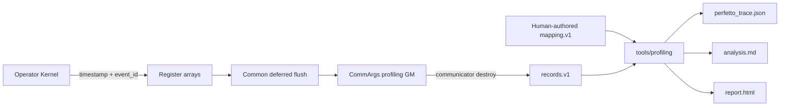
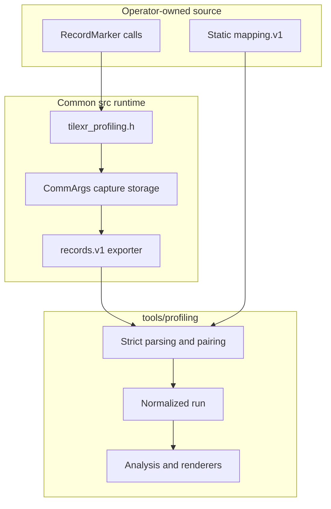
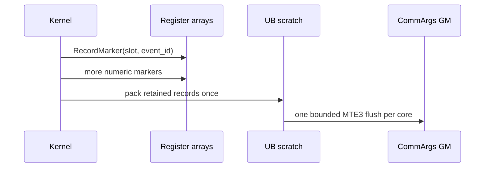
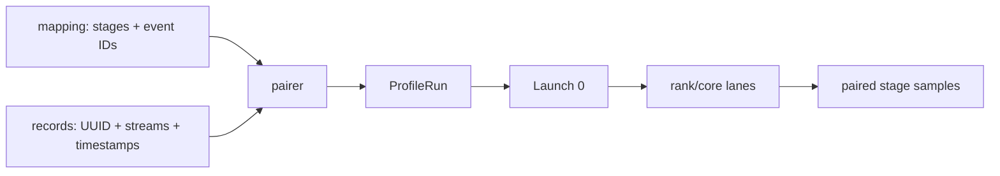
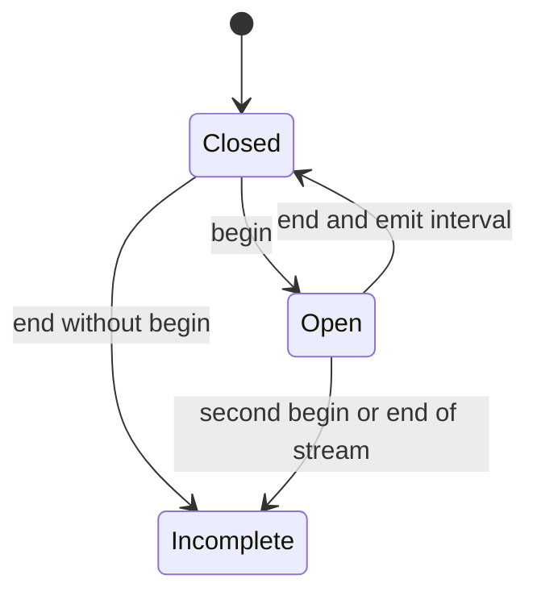
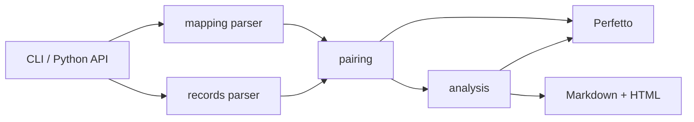

# TileXR Generic Profiling Tool Design

## Status

- Date: 2026-08-29
- State: implemented foundation
- Scope: low-overhead numeric capture, producer-neutral analysis, and report generation

## Overview

`tools/profiling` is a standalone performance-analysis tool. An instrumented
Kernel records only a device timestamp and a nonzero numeric event ID. A small,
human-authored mapping gives those IDs names and hierarchy after the Kernel has
finished.

One profiling input is a pair, not a third container schema:

```text
profiling input
|-- capture.mapping.json      # human-authored event meanings
`-- one or more *.records.bin # runtime-produced timestamps and stream identity
```



The tool never imports an operator, recognizes an operator name, or parses an
operator-private capture layout. New operators integrate by using the common
marker/runtime contract and supplying a mapping file.

## Goals

- Keep the Kernel hot path fixed-size, numeric, allocation-free, and string-free.
- Keep human-authored JSON short enough to review and maintain by hand.
- Avoid duplicating runtime facts in JSON when records already contain them.
- Give all operators the same strict parser, normalized model, analysis, and reports.
- Preserve incomplete-capture evidence rather than fabricating intervals.
- Keep `tools/profiling` independent of collectives, EP, MoonEP, and other producers.

## Non-Goals

- Owning an operator's event IDs or marker placement.
- Providing operator-specific Adapters under `tools/profiling`.
- Launching Kernels, allocating device buffers, or orchestrating remote hosts.
- Inferring semantic stages from event names or numeric ranges.
- Comparing absolute timestamps between cores in version 1.
- Encoding byte metrics, topology, arbitrary attributes, or host diagnostics in mapping v1.

## Ownership And Dependencies



The dependency direction is one way:

```text
operator -> public src profiling API -> records.v1 -> tools/profiling
operator mapping -----------------------------------> tools/profiling
```

`tools/profiling` contains no operator marker constants, event catalogs,
Kernel code, Host launch code, or Adapter registry.

## Kernel Hot Path

`src/include/tilexr_profiling.h` provides a fixed-capacity
`TileXR::ProfilingRecorder<N>`. Each marker is logically:

```text
tilexrProfilingEventStamps_[slot] = AscendC::GetSystemCycle()
tilexrProfilingEventIds_[slot] = event_id
```

The slot and event ID are compile-time constants. The measured region performs
no JSON work, string handling, allocation, lock, atomic reservation, or GM
write. After the critical interval ends, one common flush copies the occupied
register arrays through UB to the per-core GM region referenced by `CommArgs`.



The common runtime allocates capture storage before launch and serializes it to
`tilexr_profiling_records.v1` when the communication domain is destroyed.

## Mapping Contract

The only accepted JSON schema is `tilexr_profiling_mapping.v1`.

```json
{
  "schema": "tilexr_profiling_mapping.v1",
  "operator": "Add4",
  "cycles_per_us": 1000.0,
  "stages": [
    {"name": "kernel_total", "category": "total", "critical": true,
     "begin": 1, "end": 2},
    {"name": "copy_input", "category": "copy", "parent": "kernel_total",
     "begin": 10, "end": 11},
    {"name": "checkpoint", "category": "diagnostic", "instant": 7},
    {"name": "compute_item", "category": "compute", "parent": "kernel_total",
     "instances": [
       {"begin": 100, "end": 101},
       {"begin": 110, "end": 111}
     ]}
  ]
}
```

### Top-Level Fields

| Field | Type | Rule |
|---|---|---|
| `schema` | string | Exactly `tilexr_profiling_mapping.v1` |
| `operator` | non-empty string | Display name only; never selects code |
| `cycles_per_us` | positive finite number | Converts system cycles to microseconds |
| `stages` | non-empty array | Ordered stage and event mapping |

All four fields are required. Unknown fields are rejected.

### Stage Fields

| Field | Type | Rule |
|---|---|---|
| `name` | non-empty string | Unique within the mapping |
| `category` | enum | Generic analysis category |
| `parent` | stage name | Optional; referenced stage must be an interval |
| `critical` | boolean | Optional, default false |
| `begin`, `end` | nonzero uint32 | One interval event pair |
| `instant` | nonzero uint32 | One instant event |
| `instances` | non-empty array | Explicit overlapping interval pairs |

Every stage selects exactly one event form:

1. `begin` and `end` for an interval that may repeat sequentially.
2. `instant` for a zero-duration event.
3. `instances` for intervals that may overlap within one core.

Each `instances` entry contains only `begin` and `end`. Instance IDs are their
zero-based array positions. Stage IDs are stage array positions. These internal
IDs are generated by the parser and never need to be authored.

Exactly one root interval stage must set `critical: true`. Event IDs are
capture-wide unique, nonzero `uint32` values. Parent references must exist,
must target interval stages, and must form an acyclic tree.

Allowed categories are:

```text
total, setup, copy, issue, wait, sync, compute,
reduce, finalize, diagnostic, other
```

### What Is Deliberately Absent

The mapping does not contain:

- capture or run IDs;
- producer and timestamp-source declarations;
- launch, stream, rank, core, host, or device declarations;
- explicit stage IDs, event edge objects, instance IDs, or `kind`;
- attributes, metrics, byte counts, or diagnostics.

These fields either come from records, are fixed by this version, or are not
part of mapping v1. Removing them prevents a human-authored file from
contradicting the actual capture.

## Record Contract

The portable binary schema remains `tilexr_profiling_records.v1`, little
endian, with this layout:

```text
+------------------------------+
| FileHeaderV1 (48 bytes)      |
+------------------------------+
| StreamHeaderV1 (24 bytes)    |
+------------------------------+
| RecordV1[record_count]       |
+------------------------------+
| additional stream blocks ... |
+------------------------------+
```

`FileHeaderV1` contains the magic `TXRPRF1\0`, version `1.0`, fixed structure
sizes, stream count, capture UUID, and exact file size. `StreamHeaderV1`
contains stream ID, retained count, dropped count, completion/overflow flags,
and block size. Each 16-byte record contains:

```text
uint64 timestamp
uint32 event_id
uint32 reserved = 0
```

Records stay in capture order and timestamps are non-decreasing within a
stream. All input record files for one report must carry the same capture UUID,
and stream IDs must be unique across those files.

The runtime encodes lane identity in the stream ID:

```text
stream_id = (rank << 16) | core
rank      = stream_id >> 16
core      = stream_id & 0xffff
```

## Derived Run Model

The tool derives runtime information instead of asking the user to duplicate it:

| Normalized field | Source or fixed value |
|---|---|
| `capture_id`, `run_id` | Shared records UUID |
| `operator` | Mapping |
| `producer` | `tilexr` |
| timestamp unit | `cycles` |
| timestamp source | `AscendC::GetSystemCycle` |
| clock domain | `per_core` |
| streams | Every stream block present in records |
| rank/core | Decoded from `stream_id` |
| launch | One synthetic launch `0` |
| host/device | Unknown |

Each core has its own clock domain. The tool subtracts that stream's earliest
timestamp before converting cycles to microseconds. Durations and within-core
parent containment are meaningful; absolute cross-core start offsets are not.



## Pairing And Completeness

For each stream, the tool uses `(stage_id, instance_id)` as the interval key.
Sequential uses of one normal begin/end pair are allowed. Overlapping work must
use separate entries in `instances`.



Fatal input includes invalid JSON, unknown mapping fields, invalid hierarchy,
duplicate event IDs, corrupt binary structure, capture UUID disagreement across
record files, duplicate stream IDs, undeclared record event IDs, or decreasing
timestamps.

Incomplete but analyzable input includes no captured streams, an incomplete
stream flag, dropped or overflowed records, unmatched interval edges, a child
outside every matching parent interval, or a stream without exactly one
complete critical interval.
Only complete pairs participate in duration analysis.

## Analysis And Outputs

The normalized model feeds one analysis implementation and three renderers:

```text
perfetto_trace.json
analysis.md
report.html
```

Latency is the duration of the critical interval. For each rank, the slowest
core is the rank latency; reports compute minimum, median, and maximum over
ranks. Stage summaries, wait/sync pressure, rank imbalance, numeric event
provenance, dropped data, and pairing diagnostics are producer-neutral.

Perfetto uses one process group per launch/rank/device and one primary thread
per stream. Explicit overlapping child instances receive deterministic
synthetic tracks so the trace preserves real overlap without invalid crossing
slices on a single track.

The output directory is published atomically only after all three artifacts
have been written. Existing non-empty directories are never overwritten.

## Public Interfaces

### Command Line

```bash
python3 -m tools.profiling \
  --mapping capture.mapping.json \
  --records rank0.records.bin \
  --records rank1.records.bin \
  --output-dir profile-report \
  --attribute case_id=smoke
```

`--records` is repeatable. `--attribute KEY=VALUE` adds optional Host-side
report provenance; it is not part of mapping v1 and does not change event
interpretation.

### Python API

```python
from tools.profiling import generate_reports

result = generate_reports(
    mapping="capture.mapping.json",
    records=["rank0.records.bin", "rank1.records.bin"],
    output_dir="profile-report",
    attributes={"case_id": "smoke"},
)
```

The `mapping` argument may also be an in-memory mapping object.

| Exit code | Meaning |
|---:|---|
| `0` | Complete reports published |
| `1` | Fatal input/render/output error; no reports published |
| `2` | Incomplete but analyzable reports published |

## Package Architecture

```text
tools/profiling/
|-- __init__.py
|-- __main__.py
|-- cli.py
|-- mapping.py         # strict mapping.v1 parser
|-- records.py         # bounded records.v1 parser
|-- pairing.py         # derive lanes and pair numeric events
|-- model.py
|-- analysis.py
|-- perfetto.py
|-- html_report.py
`-- io.py
```



## Extension Rule

A future operator normally needs only new marker calls and a new mapping file.
It must not add a producer branch or Adapter to `tools/profiling`. A public
schema revision is justified only when information required for generic
analysis cannot be represented by numeric records plus mapping v1.

## Validation Strategy

- Mapping tests cover strict fields, event modes, IDs, hierarchy, and bounds.
- Binary tests cover headers, exact sizes, flags, timestamps, and reserved data.
- Pairing tests cover per-core normalization, derived rank/core, overlap,
  incomplete evidence, and multi-file capture consistency.
- Renderer tests cover finite output, escaping, hierarchy, and legal Perfetto tracks.
- Dependency guards reject operator terms and imports under `tools/profiling`.
- The Add4 demo proves Kernel marker, CommArgs flush, records export, mapping,
  analysis, and all report artifacts end to end.

## Maintained Engineering Rule

Do not add an input field merely because the normalized model displays it. A
previous full metadata design required users to repeat capture IDs, streams,
rank/core identity, timing constants, and launch structure; those values could
drift from the binary evidence and made a small event map difficult to author.
The correct boundary is: derive observable runtime facts from records, fix
protocol-wide constants in the tool, and ask humans only for event semantics
that cannot be inferred. Validation proves this boundary for mapping v1 and
does not claim compatibility with the removed full-metadata contract.
