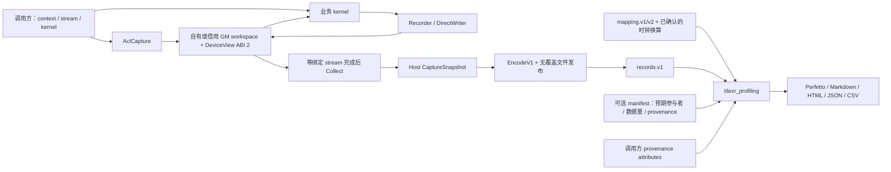

# Profiling 当前实现设计

本文说明已实现的独立采集 SDK、离线分析器及 TileXR 接入边界。面向接手代码的人与 AI；按需手动验证及关键回归见 [TESTING.md](../../tools/profiling/TESTING.md)。代码变化时同步维护本文，验证结果另记，不把设计合同当作运行证据。

## 1. 阅读入口与范围

| 目的 | 入口 |
|---|---|
| 安装、最短用法、迁移入口 | [profiling README](../../tools/profiling/README.md) |
| 理解组件、状态和所有权 | 本文第 2–6 节 |
| 查具体方法、错误码、调用前提 | [API_REFERENCE.md](../../tools/profiling/API_REFERENCE.md) |
| 查磁盘字段、mapping、时钟与统计定义 | [FORMAT.md](../../tools/profiling/FORMAT.md) |
| 选择测试、复现、记录结论 | [TESTING.md](../../tools/profiling/TESTING.md) |
| 查阅历史迁移与整改背景 | [统一计划](../plans/profiling.md)、[整改计划](../plans/PROFILING_CLEANUP.md) |

当前交付包含：header-only C++ SDK、可独立安装的 Python 包、collectives 调用方迁移、独立 Add4 示例。SDK 不管理 communicator、业务 kernel 启动、rank 协调或测量轮次；离线分析器不依赖 CANN、设备或 TileXR 动态库。

工具定位为 CANN 应用的独立 profiling SDK，不要求安装 TileXR 通信运行时、collectives
或 EP。公共命名空间/头文件中的 TileXR 名称不是运行时依赖。SDK 没有 Ascend950
专用门禁；当前该限制仅在 Add4 示例构建中，不能传播为整个工具的支持条件，也不能
反向推断所有 SoC 已验证。对外说明必须区分“依赖合同”“示例目标”“实际验证范围”，
其他目标仍需对应 Ascend C 编译、timer 换算与硬件记录证据。

版本独立演进：SDK `1.0.0`、DeviceView ABI `2`、磁盘协议 `records.v1`、事件定义 `mapping.v1/v2`、Python 包 `0.1.0`。权威版本分别在 [SDK VERSION](../../src/profiling/VERSION)、[types.h](../../src/include/tilexr/profiling/types.h)、[pyproject.toml](../../tools/profiling/pyproject.toml)。内存 ABI 变化不自动改变历史文件格式。

## 2. 组件与数据流

| 层 | 主要源码 | 职责与依赖 |
|---|---|---|
| 公共入口 | [profiling.h](../../src/include/tilexr/profiling.h) | 命名空间 `TileXR::Profiling`；AICore 分支只引入设备层；Host 分支引入布局/文件层，存在 ACL 头时提供 ACL 层 |
| ABI/布局 | [types.h](../../src/include/tilexr/profiling/types.h)、[host.h](../../src/include/tilexr/profiling/host.h) | 固定宽度描述符、预算检查、snapshot 和 v1 编码；纯 Host 部分仅依赖 C++ 标准库 |
| 设备记录 | [device.h](../../src/include/tilexr/profiling/device.h)、[direct.h](../../src/include/tilexr/profiling/direct.h)、[detail/device.h](../../src/include/tilexr/profiling/detail/device.h) | 记录时间戳/非零 event ID，提交有效前缀；无通信库依赖 |
| ACL/文件 | [acl.h](../../src/include/tilexr/profiling/acl.h)、[file.h](../../src/include/tilexr/profiling/file.h) | 借用 context/stream，拥有 GM 分配或借用 lease，保留 snapshot；Linux 文件发布 |
| SDK 安装 | [src/profiling](../../src/profiling/CMakeLists.txt) | `TileXR::profiling` INTERFACE target，只传播 include 路径及 C++14，不隐式链接 ACL/通信库 |
| 业务接入 | [profiling_capture_queue.h](../../src/collectives/host/profiling_capture_queue.h)、[collective_launcher.cpp](../../src/collectives/host/collective_launcher.cpp) | 有界采样、UUID/输出路径策略及安全清理点，属于 collectives |
| 离线包 | [tilexr_profiling](../../tools/profiling/python/tilexr_profiling/__init__.py) | `mapping/records` 解析 → `pairing` → `analysis` → provenance 与报表 renderer → `cli` 发布 |
| 独立使用方 | [examples/profiling](../../examples/profiling/README.md) | Add4 自建 ACL 对象、自行注册/启动外置 kernel，使用公共 SDK |

## 3. 内存协议与设备 writer

### 3.1 布局与身份

`DeviceArgs()` 返回 GM 描述符地址。不得传 Host 栈上的 `DeviceView`；也不得把旧 `CommArgs` 中的 profiling 槽位当作描述符。

| 对象 | 当前约束 |
|---|---|
| `DeviceView` | ABI 2 为 88 bytes、8-byte 对齐；8 个 uint32 元信息、5 个 uint64 GM 数组地址，以及逻辑 lane 查找表地址和 generation；字段偏移由编译期断言固定 |
| SDK 默认布局 | 描述符位于 workspace 起始处，timestamps 从 offset 128 开始，随后为 eventIds/counts/dropped/states；workspace 和数组地址按 64 bytes 对齐 |
| record stride | 以记录元素计；当前 Host 布局将 `recordsPerStream` 向上补齐至 16 的倍数，容量仍为 8…65536 且是 8 的倍数 |
| state stride | 以 uint32 元素计，当前为 16；每 lane 的 count/dropped/state 位于各自数组的 `lane * stateStride` |
| 有效 count | 真正有效的 `[0,count)`，可以不是 8 的倍数；不得按存储对齐向上补成有效事件 |
| 身份 | rank 0…65535；物理 lane 数 1…65536；默认使用密集 ID，也可提供同长度、递增唯一的 `logicalLaneIds`（0…65535）；磁盘 stream ID 为 `(rank << 16) | logical_lane` |
| 预算 | 初始化前检查 workspace 和最坏编码大小；默认 workspace 上限 1 GiB，文件上限 256 MiB，实际可用配置同时受两者限制 |

相邻 lane 必须隔开 64-byte scalar cache line。2026-11-04 A5/CANN 9.2 实测中，
原有 32-byte event/state 间距出现交错 lane 的事件或提交状态丢失；仅增大 records
容量不能修复 state 区。修正只增加工作区 padding，DeviceView 字段和 records.v1
文件格式不变，容量与有效记录数不随 padding 增加；外部工作区调用者需使用 64-byte
对齐，并重新调用 BuildLayout 核对预算。

### 3.2 lane 提交

正常路径为 `EMPTY → WRITING → COMMITTED`。`INVALID` 表示协议错误；不是可继续分析的普通“不完整”。

| 状态/记录 | Host 行为 |
|---|---|
| COMMITTED，count > 0 | 读取有效前缀；校验容量和非零 event ID；按时间戳稳定排序，相同时间戳保留提交顺序 |
| COMMITTED，count = 0 | 导出完整空 block；分析器仍会诊断缺少 critical interval |
| EMPTY / WRITING | 忽略其 count、dropped 和 payload；保留该 lane，导出不完整的空 block |
| INVALID / 未知状态 | Collect/BuildSnapshot 失败，不生成成功 snapshot |
| 溢出 | 保留容量内前缀；dropped 饱和到 UINT32_MAX；磁盘标记 overflow，报告为 incomplete |

每个 capture 测量一次 kernel invocation，每个 lane 只有一个 writer。状态字不是锁，不支持并发抢占或复用已提交 lane。Host 只能在绑定 stream 同步成功后读取；最后一次标量状态写入不构成可供 Host 实时轮询的 release/acquire 协议。

`Recorder<N>` 的 N 为 1…256。构造时仅初始化有效性 ID；`RecordMarker<Slot,EventId>()` 写一个本地槽，重复写同槽会替换旧值；Flush 按 Slot 顺序压紧有效槽，跳过条件分支未写的槽，并提交一次。Slot 应按执行顺序分配，时间戳零是合法值。

`DirectWriter` 接收显式时间戳，适合已有计时逻辑：`Initialize → RecordAt → Publish`。Initialize 先清本地状态，失败后不能误写旧 lane；同一 writer 重复 Publish 为幂等，另一 writer 重用已提交 lane 会使其 INVALID。event ID 零使 lane 无效。

`TILEXR_ENABLE_PROFILING` 未定义或为 0 时禁用设备插桩，1 时启用，其他值编译失败。Host 生命周期与磁盘格式不随此宏变化。运行时传 null 可以跳过写出，但编译启用的 Recorder marker 仍可能读取 timer；因此 null 不能代表“无插桩开销”。marker 不自动插入业务流水屏障，测量完成边界由算子负责。

## 4. Host 生命周期、所有权与失败重试

| 阶段 | 动作 | 仍需调用方负责 |
|---|---|---|
| Initialize | 验证布局/预算、取得当前 context、分配清零 GM、上传描述符；未指定 UUID 时生成随机 UUID | 创建并保持 context/stream；多 rank 统一分发非零 UUID |
| Ready | 暴露 DeviceArgs，交给一次 kernel invocation | 启动 kernel；保证每 lane 单 writer；不在 warmup 使用 capture |
| Collect | 首次调用即封口，等待绑定 stream，D2H，校验并建立只读 snapshot；成功后幂等 | 当前线程必须处于原 context；失败后不可用旧描述符追加任务 |
| Export | 仅从已有 snapshot 编码/发布，不调用 ACL；失败保留 snapshot | 提供新目标路径及可用文件系统 |
| Close | 封口，必要时同步，再释放 GM；成功后幂等，snapshot 保留 | 在 context/stream 销毁前显式检查返回值 |

`Save = Collect + Export`。Close 不自动 Collect，也不导出；未采集就 Close 不会补建 snapshot。Close 后可以导出已有 snapshot，再 Initialize 会清除旧 snapshot。已初始化对象必须先 Close 才能重新初始化。

所有 Host 调用由调用方串行化。复制和移动赋值禁用，移动构造转移 GM/snapshot 所有权。`WorkspaceBytes()` 表示仍持有的 workspace：成功关闭/移出后为零，同步、free 或借用 lease 释放尚未完成时非零。

失败重试的原则：

- context 不匹配：恢复原 context 后重试 ACL 方法；Export 不要求当前 context。
- 同步失败：保留 GM，不能提前释放；D2H 失败可重试 Collect，成功同步无需重复等待。
- 初始化部分失败：尝试清理；若 free 失败，保留所有权并要求 Close 重试。
- 文件失败：保留 snapshot，可改用另一路径；发布成功但临时名清理失败返回 `PublishedCleanupWarning`，`ok()` 为真，不得把它当成未发布再次写同路径。
- 析构不抛异常、不导出；无法确认安全完成时只诊断并保守保留 GM。显式 Close 是可恢复错误的边界。

`enabled=false` 的 capture 不分配、不上传，DeviceArgs 为 null，Collect/Export/Save/Close 成功但不生成文件。它与设备编译宏是两个独立开关。

Linux 发布路径为同目录独占临时文件 → 完整写/fsync/close → hard link 创建最终名 → 清理临时名。已有目标不可覆盖；不支持 hard link 的文件系统报错。该实现不承诺断电后的目录持久性。完整状态码见 API reference。

### 4.1 借用 workspace 与 Host 观测

`WorkspacePool` 登记调用方拥有的普通设备内存，检查 64-byte 对齐、精确大小、
context 和范围不重叠。`Acquire` 返回 move-only lease 和不回绕的 generation；
`InitializeBorrowed` 清空 capture 布局、上传描述符及稀疏 lane 查找表。pool 只管理
reservation，不释放业务分配。调用方须保留分配、pool、context 和 stream，直到
`Close` 成功且无 busy lease；同步失败保留 reservation，无法安全析构时隔离该范围。
任何 Initialize 重试都重新检查 retained lease 的大小、context 和 generation。

`AclCapture::Events()` 保留有界累计 Host 观测；导出失败不能覆盖原业务或 ACL 状态。
`ExportCompletion` 保留原始完成状态与 rank-local generation。Python
`attach_host_events` / `attach_completion` 校验 attempt、capture 和参与者绑定，
`EMPTY` / `WRITING` 不能作为 kernel 已启动的证据。元数据、records 发布和资源清理
各有独立重试边界。完整签名见 [API](../../tools/profiling/docs/API_REFERENCE.md)。

## 5. collectives 与 Add4 的接入策略

### 5.1 collectives

业务资源 owner 持有 `ProfilingCaptureQueue`，普通/A5 Host 参数携带独立 `profilingGM`，配套 kernel 消费同一 DeviceView。这一 collectives 路径不依赖 comm 的采集 owner。公共 `tilexr_profiling.h` 保留兼容 include 入口；main 中 EP 的 `ep_profiling_compat` 与 UniTest 的 `profilingDescriptorsGM` / lane-count 接入继续保留，不能把这些 CommArgs 字段视为空槽。

- 构建开关：`TILEXR_COLLECTIVES_ENABLE_PROFILING=ON`。运行时设置 `TILEXR_PROFILING_OUTPUT_DIR`；多 rank 使用同一 fresh `TILEXR_PROFILING_CAPTURE_ID` seed。
- 首次 Acquire 准备最多 4 个 capture、总计最多 64 MiB，可能分配并上传描述符；不等待业务 stream 或 Drain。后续使用已准备项时不 Collect、不 D2H、不导出、不 free。
- 池按 stream/lane 数匹配，pending 项只使用一次。当前首次准备会尽量占满预算；池满后新 stream/lane 形状、更多调用都可能跳过采样，没有后台回收重填机制。
- 预算耗尽或可选采样初始化失败记录诊断，业务 kernel 使用 null 继续。各 rank 的启动顺序/采样配置必须一致；分析器不会自动补齐采样不一致的 rank。
- 每项派生独立 UUID，输出 `<output>/<capture_uuid>/rank-<rank>.records.bin`。一次分析只提供同一 UUID 的文件；不同 run/owner 使用新 seed。
- 普通路径 lane 数为实际参与 AIV block 数；A5 为 48 个逻辑 lane（32 send + 16 receive），不能用 blockDim=33 代替。Host/Kernel 参数必须成对构建部署。
- 仅在原有安全完成/资源清理点 Drain；逐项失败保留，已发布/已关闭项重试时跳过。逐项 Drain 不做 rank collective；固定共同清理阶段汇合状态，某 rank 没有可选 owner 也必须参与共同阶段。

采样预算耗尽可跳过；清理失败需要保留资源并返回失败供重试，两者不可混为“任何 profiling 错误都忽略”。warmup 不采集，perf driver 已处理输出环境变量抑制。collectives 独立采集路径不使用旧 `TILEXR_PROFILING_RECORDS_PATH` 或 communicator 多 launch 聚合；EP 兼容路径不在此变更范围。

### 5.2 独立 Add4

Add4 当前只支持显式 Ascend950/Linux。Host 为 C++14，现有设备编译路径为 `dav-c310-vec`、`gnu++17`；不能据此声称已验证设备 C++14 或其他 SoC。

4 个 AIV block 各自负责 1 个 lane。最小 Host 有意省略数值和返回值检查；额外的
`npu_check.py` 仅显式检查每 lane 17 条事件的精确序列、4 个完整 lane、零 dropped
和共享原始 begin 记录，不证明计算结果正确。纯 AICore binary 单独安装到 lib 目录下 `tilexr/kernels`，Host 从自身位置相对加载，调用 `rtDevBinaryRegister/rtFunctionRegister/rtKernelLaunchWithFlagV2`。不嵌入 binary、不依赖 TileXR 通信库，不使用 Host 三尖括号 kernel wrapper。

runner 生成填写了时钟换算的 mapping、环境证据、业务日志、records 和三种报告。模板中的 `cycles_per_us=null` 故意不可直接分析；必须提供目标 timer 的可信换算及依据。具体构建、搬迁和运行命令见 [Add4 README](../../examples/profiling/README.md)。

## 6. 离线解释与报告合同

Python 包唯一入口为 `tilexr_profiling`，不是 `tools.profiling`。原四参数 API `generate_reports(mapping, records, output_dir, attributes=None)` 保持兼容；可额外传入 `manifest=`、`artifacts=`、`limits=`。默认输出 `perfetto_trace.json`、`analysis.md`、`report.html`，均可离线阅读。目标目录必须不存在或为空，先 staging 再发布；致命输入错误不发布一组成功报告。

| 合同 | 对测试结论的影响 |
|---|---|
| 严格输入 parser | 拒绝未知/重复字段、非法 ID、坏长度/保留位、重复 stream ID、混合 UUID；磁盘时间戳非递减，相同值保序 |
| 单次 critical interval | 每 lane 恰好一个配对 critical；普通阶段可顺序重复，重叠实例需不同事件对；不从事件顺序猜多轮 kernel |
| 时钟 | 原始整数差值先算后换算；同 rank/device 组保留 lane 相对偏移，各 rank 独立归零；默认显示不建立全局顺序，显式 calibration 必须通过身份、误差和时效校验 |
| inclusive | 样本时长之和，重叠可重复计数，share 可超过 100% |
| union/exclusive | 每 lane 先裁剪到 critical 再求并集；exclusive 只减显式直接子 stage 的覆盖并集；不跨 lane/rank 求并集 |
| wait/sync pressure | 最慢 critical lane 上 wait+sync 的覆盖并集占比，嵌套时间只计一次；不是两类 inclusive 相加 |
| rank latency | 各 rank 最慢 lane 时长，再汇总 rank 间 min/median/max |
| completeness | 无 manifest 时仅覆盖提供的输入，missing rank/lane 为未知；有 manifest 时按执行前声明的参与者区分缺失、未提交、排除和 not_sampled |
| provenance | 所有报表共用校验模型；调用方属性与协议事实分开，unknown 不补猜，attributes 不能覆盖时钟/身份/完整性 |

CLI 退出：0=提供输入 complete，1=致命输入/输出失败，2=incomplete 且有报告。argparse 用法错误也为 2，但没有报告。测试必须同时检查状态、诊断及产物，不能只看退出码。API 非法 attributes 即便为空列表/字符串/标量也要失败；`None` 才代表未提供。

以下可选能力已实现，入口与限制见 [高级指南](../../tools/profiling/docs/ADVANCED.md)：

- `mapping.v2` 支持共享 marker 和 one-based occurrence selector；无法确认所选 occurrence 时保留不完整状态，不猜起点。v1 仍要求唯一事件 ID。
- `manifest.v1` 绑定预期 rank/lane、mapping 指纹、身份、数据量与 Host 观测；各 rank 独立 shard 按显式列表合并，不能从成功文件反推预期参与者。
- 数据量与 inclusive time 必须来自同一采样总体；缺失数据时抑制完整 bandwidth。rank latency 与 bandwidth 报告 min/median/max、覆盖范围及状态，不等同物理网络带宽。
- JSON/CSV 保留原值、单位、缺失原因；CSV 避免公式注入。比较要求已知且一致的工作量、设备、时钟、采样和统计口径；未知为 `missing_data`，不同为 `incomparable`。比较 CLI 另有 3=回归、4=不可比。
- `InputLimits` 在所有文件及 capture-set 成员间累计计费；流式编码限制输出分配。模型预算不代表进程 RSS 上限。HTML 筛选排序不改变统计或隐藏全局健康状态。
- capture set 逐成员独立配对，warmup 和不完整成员保留但不进入完整 repeat 分布。采样策略必须在执行前作用于 producer，保留预期参与者、critical/父阶段和 selector 所需事件，不能事后过滤已有记录。
- 环境探针区分安装信息与调用方 runtime 观测；不会自行初始化 ACL、选择设备或推断 timer。calibration 用调用方实际设备 timer 的有界 reference-clock bracket，拒绝超范围、过期、身份不符及误差/漂移超限；派生视图保留原始 cycles，不自动证明跨 host 同步。

## 7. 维护与测试边界

Profiling 不设专用 CI，也不随根项目测试开关启用。改 writer/ABI 时按需检查 Host snapshot 和 Python reader；改 launcher 时检查 kernel 参数布局与资源清理阶段；改统计时人工核对相关报告。仅保留业务安全、输入/输出完整性及关键计时回归，命令见 TESTING。

可复用的检查规则：对齐空间不等于有效 count；空提交不等于未运行；运行时 null 不等于编译无插桩；文件已发布的清理警告不等于发布失败；本地可选资源缺失不能改变 rank 共同清理阶段；两端各自合成 fixture 不能替代真实 writer→encoder→reader 往返。

CPU stub 仅证明普通 C++ 行为，ACL mock 仅证明替身下生命周期；真实 CANN 编译、设备可见性、数值、异步保持、marker/flush 开销及 spill 都需对应环境证据。Host、Add4 或 910B fallback 不能证明 A5 UDMA 数据面。当前已知验证与待验收项统一维护在 [TESTING.md](../../tools/profiling/TESTING.md)。
