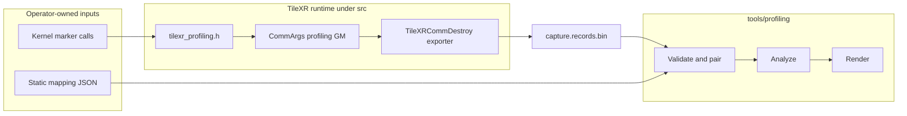
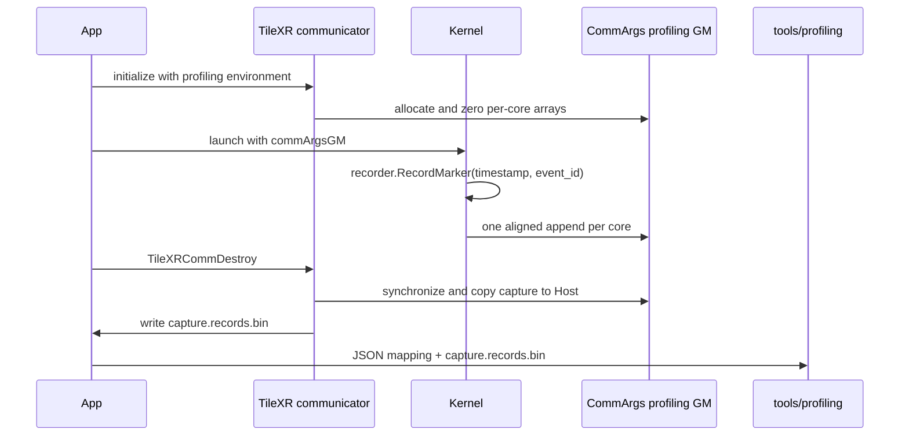

# TileXR Operator Profiling Integration Guide

## Architecture Boundary

TileXR operators use one common device marker and one communication-domain
capture buffer. An operator supplies only numeric marker calls and a JSON
mapping. It does not implement a profiling Adapter, JSON writer, records
writer, parser, or report renderer.



The dependency direction is fixed:

```text
operator Kernel -> src/include/tilexr_profiling.h -> CommArgs GM
TileXRCommDestroy -> tilexr_profiling_records.v1
JSON mapping + records.v1 -> tools/profiling
```

`tools/profiling` contains no operator names, event catalogs, launch code, or
Adapters. The common runtime contains no operator names, stage names, or JSON
parser. Human-readable meaning remains entirely in the supplied JSON.

## Kernel Contract

### Common Storage And Marker

Include the public header and compile the profiled Kernel with
`TILEXR_ENABLE_PROFILING=1`:

```cpp
#include "tilexr_profiling.h"

constexpr uint32_t kEventTotalBegin = 1U;
constexpr uint32_t kEventTotalEnd = 2U;
constexpr uint32_t kRecordCount = 2U;

TileXR::ProfilingRecorder<kRecordCount> tilexrProfiler;
tilexrProfiler.RecordMarker<0U, kEventTotalBegin>();
// measured operator work
tilexrProfiler.RecordMarker<1U, kEventTotalEnd>();
```

`src/include/tilexr_profiling.h` owns the recorder type and its fixed,
prefixed state:

```text
tilexrProfilingEventStamps_[kRecordCount] : uint64
tilexrProfilingEventIds_[kRecordCount]    : uint32
```

Both template arguments are compile-time constants. A marker performs only a
system-cycle read and two scalar-state assignments. It performs no string
operation, allocation, lock, atomic, runtime capacity branch, or GM write.
Event ID zero is reserved.

The recorder is a Kernel-local object and its state is private and prefixed, so
it cannot collide with operator variables or other Kernel binaries. CANN 9.1
rejects ordinary namespace-scope arrays referenced from AICore functions with
`global variable ... is not allowed in aicore function`; do not move this state
to a C++ global. Source syntax still cannot prove register allocation. Every
production Kernel must inspect generated code and compiler diagnostics for
scalar-stack or UB spills. For fixed small marker sets, reduce marker count if
the target compiler spills. For repeated sites or limited local resources,
explicitly choose the standard direct writer described below and measure its
per-event GM overhead.

When `TILEXR_ENABLE_PROFILING` is absent, recorder methods are no-ops and the
device arrays and flush implementation are not emitted.

### One Deferred Flush

After the last measured marker, flush once directly to the per-core GM range:

```cpp
// Record total end before this call; flush time is not part of kernel_total.
tilexrProfiler.Flush(commArgsGM);
```

The helper reads the per-core append counter, writes timestamp and event-ID
slots with scalar GM stores, then publishes the new counter. It deliberately
uses no profiling `DataCopy`, UB scratch, or `S_MTE3`/`MTE3_S` synchronization.
This keeps profiling from adding MTE pipeline dependencies to the operator.
Each append is still padded to eight slots; event-ID zero marks padding and the
Host exporter removes it from `capture.records.bin`. A single Kernel invocation
using `ProfilingRecorder<N>` may record at most 256 markers.

Profiling scalar GM stores must not be generalized to UDMA SQEs, queue heads, or doorbells, whose
cache-coherency and publication rules remain transport-specific.

### Direct GM Writer For Repeated Markers

Use `DirectProfilingWriter` when retaining every repetition is necessary or
Kernel-local timestamp arrays are undesirable. The Host reserves a launch
slot with `TileXRProfilingReserveLaunch(comm, recordsPerLaunch, &launchSlot)`
and passes that slot through the internal Kernel ABI. Budget each launch in
multiples of eight records; use the same budget for one capture. Communication
magic is not a profiling launch identity.

```cpp
TileXR::DirectProfilingWriter profiler;
profiler.Initialize(commArgsGM, logicalCore, launchSlot, recordsPerLaunch);
profiler.Record(kEventTotalBegin);
// Every repeated marker appends a fresh record.
profiler.Record(kEventTotalEnd);
profiler.Publish();
```

`Record(eventId)` reads the system cycle and writes an 8-byte timestamp and a
4-byte numeric event ID directly to the standard per-core GM arrays. It uses
no profiling UB allocation, timestamp array, or MTE operation. The writer
retains pointers and counters of fixed size; only generated AICore code can
establish register/spill usage. Each mark still adds scalar instructions and
GM/cache traffic. It does not fence asynchronous work: an issue-site marker
means Scalar arrival, and a completion marker must follow an existing business
completion fence. Keep that distinction in the operator's stage descriptions.

`Publish()` pads to eight slots and publishes the occupied count. Capacity
exhaustion drops subsequent markers and marks the capture incomplete; it must
never stop communication or overwrite previous launches. A disabled launch
slot (`UINT32_MAX`) makes recording a no-op. Standard runtime reservation
retains capture-level evidence when no launch slot is available.

### Retain Only The Latest Launch

For a long sequential batch where only the final launch is needed, reserve with
`TileXRProfilingReserveLatestLaunch(comm, recordsPerLaunch, &launchSlot)` and
initialize with `profiler.InitializeLatest(commArgsGM, logicalCore, launchSlot,
recordsPerLaunch)`. Keep the usual marker calls and `Publish()`. Configure
`TILEXR_PROFILING_RECORDS_PER_CORE` for one launch, without multiplying by the
batch length. The reservation returns slot zero on every enabled launch; a
disabled or insufficient-capacity capture returns `UINT32_MAX`.

The initializer resets only that core's occupied and dropped counts. It adds no
writer state or local arrays. The latest-mode exporter scans only the published
valid range, so shorter and empty launches cannot expose a preceding launch's
tail. A preceding launch's device overflow is also replaced. Reports describe
the final launch, not batch-wide samples or completeness of discarded launches.

Use a fixed logical core set and record budget, order launches on the same
stream (or with equivalent dependencies), and keep the communicator capture
exclusive to latest writers. The runtime rejects mixing its latest and reserved
reservation APIs or changing the latest budget. Legacy independently assigned
slots and `ProfilingRecorder` are not visible to that allocator and must not
share the capture. Ordinary reserved and legacy capture semantics are unchanged.

Do not approximate latest mode by using ordinary `Initialize` with slot zero:
its published count preserves the earlier high-water mark and dropped counts,
and ordinary export may inspect stale slots beyond a shorter last launch.

## CommArgs And Runtime Lifecycle

`CommArgs` carries the common GM state to every TileXR Kernel:

```text
tilexrProfilingTimestampsGM
tilexrProfilingEventIdsGM
tilexrProfilingRecordCountsGM
tilexrProfilingDroppedCountsGM
tilexrProfilingRecordsPerCore
tilexrProfilingCoreCapacity
ExtraFlag::PROFILING
```

Operators that already receive `commArgsGM` add no profiling Host parameters.
A direct-launch operator must obtain the normal device `CommArgs` pointer with
`TileXRGetCommArgsDev` and include it in its Kernel ABI.



Profiling is opt-in. These environment variables are read when the
communication domain initializes:

| Variable | Requirement | Meaning |
|---|---|---|
| `TILEXR_PROFILING_RECORDS_PATH` | Enables profiling | Output path for records.v1; supports `{rank}`, `{device}`, and `{comm_domain}` |
| `TILEXR_PROFILING_CAPTURE_ID` | Required when enabled | Canonical UUID embedded in every records file for this capture |
| `TILEXR_PROFILING_RECORDS_PER_CORE` | Optional | Aligned per-core GM capacity for the whole capture; default 4096, maximum 67,108,856 |

The output parent directory must already exist, and an existing records path is
never overwritten. Multi-rank runs should use a unique path such as:

```bash
export TILEXR_PROFILING_RECORDS_PATH=/capture/rank-{rank}.records.bin
```

`TileXRCommDestroy` synchronizes the current device, validates counts and
timestamp ordering, removes alignment padding, and writes the existing strict
`tilexr_profiling_records.v1` format. Export failure is returned from
`TileXRCommDestroy`; GM is still released.

## JSON Mapping

The JSON is prepared outside the Kernel and passed directly to the generic
tool. It is not generated or parsed by the operator Host code.

```json
{
  "schema": "tilexr_profiling_mapping.v1",
  "operator": "example_op",
  "cycles_per_us": 1000.0,
  "stages": [
    {"name": "kernel_total", "category": "total", "critical": true,
     "begin": 1, "end": 2},
    {"name": "compute_window", "category": "compute",
     "parent": "kernel_total", "begin": 10, "end": 11},
    {"name": "subevent", "category": "compute",
     "parent": "compute_window", "instances": [
       {"begin": 100, "end": 101},
       {"begin": 110, "end": 111}
     ]}
  ]
}
```

Only four top-level fields are accepted: `schema`, `operator`,
`cycles_per_us`, and `stages`. A stage selects exactly one of these forms:

- `begin` plus `end` for a normal interval;
- `instant` for a point event;
- `instances` for explicit intervals that may overlap.

Stage IDs and instance IDs are generated from array order. `kind` is inferred.
Parent references use readable stage names. Exactly one root interval is
critical, all event IDs are unique nonzero `uint32` values, and the parent
graph must be acyclic.

Capture IDs, streams, launches, rank/core identity, attributes, metrics, and
diagnostics are deliberately absent. Runtime stream IDs are deterministic:

```text
stream_id = (rank << 16) | core
```

The tool accepts every stream present in the records and derives rank/core from
this encoding. The capture UUID comes from records; all record files supplied
to one report must share it. Each critical begin starts a new launch in that
core's record order. IDs are zero-based begin ordinals, with a per-core clock
domain, cycle timestamps, and `AscendC::GetSystemCycle`. Multiple cores/ranks
must record the same ordered launches. Unequal begin counts make the report
incomplete; timestamps cannot determine where a wholly missing launch belonged.
Records before the first begin remain a diagnostic fragment with launch ID -1.

Event IDs are `uint32` values and must be unique across every operator recorded
into one communication-domain capture. Sequential repetitions may reuse one
begin/end pair. Overlapping repetitions require distinct event IDs mapped to
separate entries in `instances`.

Parent/child structure also lives only in JSON:

```text
kernel_total
|-- copy_input
|-- compute_window
|   |-- subevent[0]
|   `-- subevent[1]
`-- copy_out
```

The binary record remains exactly 16 bytes: `uint64 timestamp`, `uint32
event_id`, and `uint32 reserved`. Names, stage IDs, parent names, and instance
positions never enter the Kernel capture.

## Capacity And Concurrency

Each core appends into a disjoint GM range. The per-core occupied counter is
updated during deferred `Flush()` or direct-writer `Publish()`. Direct writers
reserve disjoint fixed-size launch slots on the Host; total capacity must
cover warmup and measured launches. For example, 65,536 records/core/launch
across 64 cores needs approximately 48 MiB GM per launch, plus shared counters.
The exported record has 16 bytes rather than the 12-byte GM payload.

When capacity cannot fit additional data, retained records remain valid and
the report is incomplete. A truncated begin/end pair contributes no fabricated
duration and is never paired across the next critical begin or the next parent
invocation. Valid earlier intervals remain available. The binary reader accepts
files up to 64 GiB and reads in 64 KiB chunks; normalized records and rendered
artifacts still require Host memory proportional to actual recorded events.

The v1 append path deliberately has no device atomic. Kernel launches that can
execute concurrently on the same communicator and the same core ID must not
share one profiling capture. Order profiled launches on one stream, or use
separate communicators/captures. Without that rule, two flushes could reserve
the same per-core range.

The Host reservation allocator does not share its cursor with deferred
`ProfilingRecorder` appends or older operator-owned direct-writer slot counters.
Do not mix those allocation schemes within one communicator capture, even on
an ordered stream: each can otherwise write slots already owned by another.
Use a dedicated communicator/capture for the new reservation path. Operators
that all use this Host reservation API can share a capture with a common JSON
catalog and non-conflicting event IDs.

## Report Command

After the communicator has been destroyed:

```bash
python3 -m tools.profiling \
  --mapping capture.mapping.json \
  --records capture.records.bin \
  --output-dir report
```

For two warmup launches followed by ten measured launches, add
`--skip-launches 2 --launch-count 10 --expected-launch-count 12`.
The Python `generate_reports()` and `load_profile_run()` APIs accept equivalent
keyword arguments `skip_launches`, `launch_count`, and `expected_launch_count`.
When the caller also needs normalized data for validation or summaries, load
once with `load_profile_run()` and pass the result to the public
`generate_reports_for_run(run, output_dir, attributes=None)` API. This avoids
parsing a large capture again while the first normalized run is still retained.
Selection preserves the original launch IDs. All capture diagnostics remain
visible, including warmup loss; selection cannot turn an incomplete capture
into a complete report. The expected count detects missing whole launches even
when every core lacks them, but cannot identify missing middle-launch positions
without additional producer identity. Reports retain only observed intervals;
they do not fill missing branches or truncated intervals with zero durations.

Stage durations and shares are inclusive. Do not add a parent's duration to
its nested children's durations. Wait/synchronization pressure uses the union
of covered intervals on the critical lane to avoid double counting.

The public artifacts remain:

```text
report/perfetto_trace.json
report/analysis.md
report/report.html
```

`perfetto_trace.json` uses the Chrome Trace Event format (`traceEvents`,
`ph: "X"`, `ts` and `dur` in microseconds). Open `chrome://tracing`, select
**Load**, and choose the JSON file to view each core's nested stage intervals.
The HTML file is an auxiliary table, not the timeline viewer.

Omit the optional `displayTimeUnit` field: Chrome rejects `"us"` there with
`Unit us is not supported`, even though Trace Event `ts` and `dur` are in
microseconds. Perfetto accepting a file does not prove Chrome compatibility.
The per-rank collection command also removes this header from reports written
by the older standard generator, without rescaling events or changing the
checksummed producer files. Re-export retained reports to repair old downloads;
no kernel execution is required.

Server Dedup's validation exporter converts the recorded boundary markers into
the shared framework's interval samples before analysis/rendering. Each core
shows `init`, `send_cnt`, its send or receive stages, and `finish`; receive and
finish detail nests within those stages. Adjacent packet-issue observations form
`packet_issue_interval` slices, with `send_drain_and_outputs` for the final tail.
They measure Scalar issue spacing, not DMA completion; the minimal records do
not carry token, route, or first-hop/DIRECT identity. Instant and zero-duration
samples are omitted from this timeline, while raw records and capture diagnostics
remain available. Missing boundaries must not be filled with invented durations.

This restores the stage view used before migration to the standard recorder:
declaring every boundary as an instant loses the visible work intervals even
when timestamp capture succeeds. The adapter runs on each rank's server; central
collection still only copies the completed per-rank JSON. Existing point-only
reports need raw reprocessing (ordinary collection preserves their old content):

```bash
python3 tools/validation/measurements.py /run/summary.json \
  --records-dir /copied-records --output-dir /run/interval-traces
```

The raw directory must contain `rank-N.records.v1` for each rank; the output JSON
files are in `interval-traces/chrome/`. Host fixture tests cover 64-core interval
coverage, nesting, equal timestamps, and the no-task receive branch; they do not
establish real NPU timing accuracy.

## Integration Checklist

1. Assign capture-wide unique, nonzero event IDs.
2. Add only operator, cycle conversion, stage hierarchy, and event IDs to JSON.
3. Include `tilexr_profiling.h` and compile the profiled Kernel with the enable macro.
4. Use a fixed recorder of at most 256 slots, or a direct writer with a bounded
   per-launch budget and the common Host launch reservation API.
5. Record the critical end before the common `Flush()` or `Publish()` call.
6. Pass the communicator's device `CommArgs` and any direct-writer launch slot
   through the internal Kernel ABI.
7. Set a new records path and one shared capture UUID before communicator initialization.
8. Order profiled launches on one stream for each communicator capture.
9. Destroy the communicator before invoking `tools/profiling`.
10. Inspect generated Kernel code for spills and confirm profiling adds no MTE synchronization.
11. Compare profiling-on/off latency.
12. Retain the JSON, records file, reports, build provenance, and hardware identity.

The complete executable example is under `tests/profiling/demo`.
