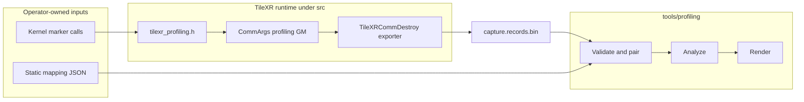
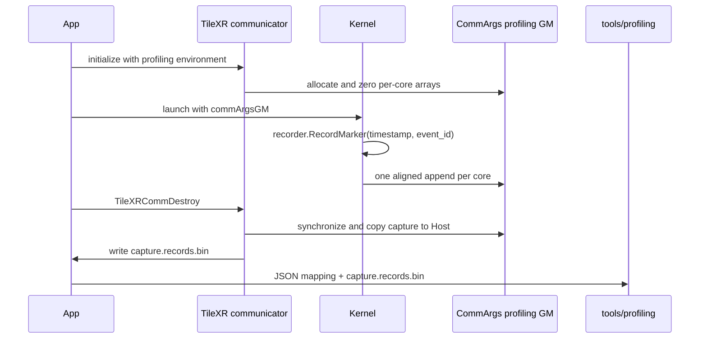

# TileXR Operator Profiling Integration Guide

## Architecture Boundary

TileXR operators use one common device marker and one communication-domain
capture buffer. An operator supplies only numeric marker calls and a JSON
mapping. It does not implement a profiling Adapter, JSON writer, records
writer, parser, or report renderer.



The dependency direction is fixed:

```text
operator Kernel -> src/include/tilexr_profiling.h -> CommArgs GM
TileXRCommDestroy -> tilexr_profiling_records.v1
JSON mapping + records.v1 -> tools/profiling
```

`tools/profiling` contains no operator names, event catalogs, launch code, or
Adapters. The common runtime contains no operator names, stage names, or JSON
parser. Human-readable meaning remains entirely in the supplied JSON.

## Kernel Contract

### Common Storage And Marker

Include the public header and compile the profiled Kernel with
`TILEXR_ENABLE_PROFILING=1`:

```cpp
#include "tilexr_profiling.h"

constexpr uint32_t kEventTotalBegin = 1U;
constexpr uint32_t kEventTotalEnd = 2U;
constexpr uint32_t kRecordCount = 2U;

TileXR::ProfilingRecorder<kRecordCount> tilexrProfiler;
tilexrProfiler.RecordMarker<0U, kEventTotalBegin>();
// measured operator work
tilexrProfiler.RecordMarker<1U, kEventTotalEnd>();
```

`src/include/tilexr_profiling.h` owns the recorder type and its fixed,
prefixed state:

```text
tilexrProfilingEventStamps_[kRecordCount] : uint64
tilexrProfilingEventIds_[kRecordCount]    : uint32
```

Both template arguments are compile-time constants. A marker performs only a
system-cycle read and two scalar-state assignments. It performs no string
operation, allocation, lock, atomic, runtime capacity branch, or GM write.
Event ID zero is reserved.

The recorder is a Kernel-local object and its state is private and prefixed, so
it cannot collide with operator variables or other Kernel binaries. CANN 9.1
rejects ordinary namespace-scope arrays referenced from AICore functions with
`global variable ... is not allowed in aicore function`; do not move this state
to a C++ global. Source syntax still cannot prove register allocation. Every
production Kernel must inspect generated code and compiler diagnostics for
scalar-stack or UB spills. Reduce the marker count or split the capture if the
target compiler spills; do not silently change markers to per-event GM stores.

When `TILEXR_ENABLE_PROFILING` is absent, recorder methods are no-ops and the
device arrays and flush implementation are not emitted.

### One Deferred Flush

After the last measured marker, flush once directly to the per-core GM range:

```cpp
// Record total end before this call; flush time is not part of kernel_total.
tilexrProfiler.Flush(commArgsGM);
```

The helper reads the per-core append counter, writes timestamp and event-ID
slots with scalar GM stores, then publishes the new counter. It deliberately
uses no profiling `DataCopy`, UB scratch, or `S_MTE3`/`MTE3_S` synchronization.
This keeps profiling from adding MTE pipeline dependencies to the operator.
Each append is still padded to eight slots; event-ID zero marks padding and the
Host exporter removes it from `capture.records.bin`. A single Kernel invocation
may record at most 256 markers.

Direct scalar GM stores are limited to this post-interval profiling capture.
They must not be generalized to UDMA SQEs, queue heads, or doorbells, whose
cache-coherency and publication rules remain transport-specific.

## CommArgs And Runtime Lifecycle

`CommArgs` carries the common GM state to every TileXR Kernel:

```text
tilexrProfilingTimestampsGM
tilexrProfilingEventIdsGM
tilexrProfilingRecordCountsGM
tilexrProfilingDroppedCountsGM
tilexrProfilingRecordsPerCore
tilexrProfilingCoreCapacity
ExtraFlag::PROFILING
```

Operators that already receive `commArgsGM` add no profiling Host parameters.
A direct-launch operator must obtain the normal device `CommArgs` pointer with
`TileXRGetCommArgsDev` and include it in its Kernel ABI.



Profiling is opt-in. These environment variables are read when the
communication domain initializes:

| Variable | Requirement | Meaning |
|---|---|---|
| `TILEXR_PROFILING_RECORDS_PATH` | Enables profiling | Output path for records.v1; supports `{rank}`, `{device}`, and `{comm_domain}` |
| `TILEXR_PROFILING_CAPTURE_ID` | Required when enabled | Canonical UUID embedded in every records file for this capture |
| `TILEXR_PROFILING_RECORDS_PER_CORE` | Optional | Aligned per-core GM capacity; default 4096, maximum 65536 |

The output parent directory must already exist, and an existing records path is
never overwritten. Multi-rank runs should use a unique path such as:

```bash
export TILEXR_PROFILING_RECORDS_PATH=/capture/rank-{rank}.records.bin
```

`TileXRCommDestroy` synchronizes the current device, validates counts and
timestamp ordering, removes alignment padding, and writes the existing strict
`tilexr_profiling_records.v1` format. Export failure is returned from
`TileXRCommDestroy`; GM is still released.

## JSON Mapping

The JSON is prepared outside the Kernel and passed directly to the generic
tool. It is not generated or parsed by the operator Host code.

```json
{
  "schema": "tilexr_profiling_mapping.v1",
  "operator": "example_op",
  "cycles_per_us": 1000.0,
  "stages": [
    {"name": "kernel_total", "category": "total", "critical": true,
     "begin": 1, "end": 2},
    {"name": "compute_window", "category": "compute",
     "parent": "kernel_total", "begin": 10, "end": 11},
    {"name": "subevent", "category": "compute",
     "parent": "compute_window", "instances": [
       {"begin": 100, "end": 101},
       {"begin": 110, "end": 111}
     ]}
  ]
}
```

Only four top-level fields are accepted: `schema`, `operator`,
`cycles_per_us`, and `stages`. A stage selects exactly one of these forms:

- `begin` plus `end` for a normal interval;
- `instant` for a point event;
- `instances` for explicit intervals that may overlap.

Stage IDs and instance IDs are generated from array order. `kind` is inferred.
Parent references use readable stage names. Exactly one root interval is
critical, all event IDs are unique nonzero `uint32` values, and the parent
graph must be acyclic.

Capture IDs, streams, launches, rank/core identity, attributes, metrics, and
diagnostics are deliberately absent. Runtime stream IDs are deterministic:

```text
stream_id = (rank << 16) | core
```

The tool accepts every stream present in the records and derives rank/core from
this encoding. The capture UUID comes from records; all record files supplied
to one report must share it. The tool uses one synthetic launch, a per-core
clock domain, cycle timestamps, and `AscendC::GetSystemCycle`.

Event IDs are `uint32` values and must be unique across every operator recorded
into one communication-domain capture. Sequential repetitions may reuse one
begin/end pair. Overlapping repetitions require distinct event IDs mapped to
separate entries in `instances`.

Parent/child structure also lives only in JSON:

```text
kernel_total
|-- copy_input
|-- compute_window
|   |-- subevent[0]
|   `-- subevent[1]
`-- copy_out
```

The binary record remains exactly 16 bytes: `uint64 timestamp`, `uint32
event_id`, and `uint32 reserved`. Names, stage IDs, parent names, and instance
positions never enter the Kernel capture.

## Capacity And Concurrency

Each core appends into a disjoint GM range. The per-core occupied counter is
updated only during the deferred flush. When a flush cannot fit, the retained
records are preserved, the dropped count is increased, and the generated run
is reported as incomplete.

The v1 append path deliberately has no device atomic. Kernel launches that can
execute concurrently on the same communicator and the same core ID must not
share one profiling capture. Order profiled launches on one stream, or use
separate communicators/captures. Without that rule, two flushes could reserve
the same per-core range.

Different operators recorded into the same communicator must share one JSON
catalog with non-conflicting event IDs. When separate operator reports are
desired, use separate communicator lifetimes and records paths.

## Report Command

After the communicator has been destroyed:

```bash
python3 -m tools.profiling \
  --mapping capture.mapping.json \
  --records capture.records.bin \
  --output-dir report
```

The public artifacts remain:

```text
report/perfetto_trace.json
report/analysis.md
report/report.html
```

## Integration Checklist

1. Assign capture-wide unique, nonzero event IDs.
2. Add only operator, cycle conversion, stage hierarchy, and event IDs to JSON.
3. Include `tilexr_profiling.h` and compile the profiled Kernel with the enable macro.
4. Use compile-time marker slots and prove the maximum marker count is at most 256.
5. Record the critical end before calling the common flush helper.
6. Pass the communicator's existing device `CommArgs` pointer to the Kernel.
7. Set a new records path and one shared capture UUID before communicator initialization.
8. Order profiled launches on one stream for each communicator capture.
9. Destroy the communicator before invoking `tools/profiling`.
10. Inspect generated Kernel code for spills and confirm profiling adds no MTE synchronization.
11. Compare profiling-on/off latency.
12. Retain the JSON, records file, reports, build provenance, and hardware identity.

The complete executable example is under `tests/profiling/demo`.
