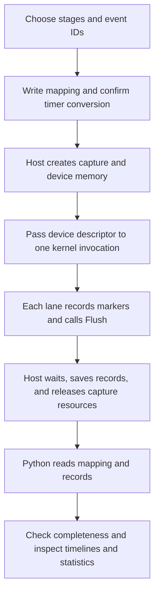

# TileXR Profiling User Guide

[Overview](../README.md) · [English](USER_GUIDE.md) / [简体中文](USER_GUIDE.zh-CN.md)

TileXR Profiling measures the execution time of stages inside Ascend C operators.
You mark the positions of interest in a kernel; the tool records timestamps and
converts them into timelines and analysis reports to help identify time spent on
computation, data movement, or waiting.

This guide introduces the components and concepts for operator developers using
the tool for the first time, then walks through installation, instrumentation,
capture, and analysis. The [Add4 example](../../../examples/profiling/README.md) provides
a complete runnable integration.

## 1. What the tool helps you do

Common uses include:

- **Break down operator time:** examine copy-in, computation, and copy-out separately.
- **Inspect waiting and overlap:** view synchronization or waiting intervals and overlap between stages.
- **Find slower execution lanes:** compare total intervals across lanes in one invocation to identify lanes delaying completion.
- **Keep measurements reviewable:** retain raw records, event definitions, and version information so others can analyze them without an NPU.

The tool uses explicit instrumentation. It measures only the intervals you define;
it does not automatically identify every stage or launch the application's kernel.
A slow stage provides a lead for investigation, but a timeline alone does not
establish the root cause.

Ordinary CANN applications can use it independently. Despite the `TileXR` API
names, integration does not require the TileXR communication runtime, collectives,
EP, or an additional capture service.

## 2. Components

From a user's perspective, the tool has four parts. The capture SDK and offline
analyzer are the components you actually install or import.

| Part | Contents | Responsibility | Usage |
|---|---|---|---|
| Capture SDK | Kernel recording APIs; Host capture and file export APIs | Record timestamps and event IDs, manage capture memory, read back and save raw records | Install C++ headers and CMake configuration; compile into the operator |
| Offline analyzer | Input parsing, event pairing, statistics, report generation | Convert records into stage durations, completeness diagnostics, and three reports | Install the Python package; use its CLI or Python API |
| Data files | Mapping event definitions and raw records | Connect capture to analysis and give event IDs application meaning | Developers write mappings; the SDK exports records; these are data, not code packages |
| Examples and integrations | Standalone Add4 example and TileXR collectives integration | Demonstrate real operator integration and asynchronous resource management | Optional references, not required dependencies for external operators |

Within the capture SDK, Kernel and Host APIs cooperate to produce one capture:

| Location | Common APIs | Purpose |
|---|---|---|
| Kernel | `Recorder<N>`, `RecordMarker<Slot, EventId>()`, `Flush()` | Keep markers locally, then publish them to device global memory (GM) |
| Host | `CaptureConfig`, `AclCapture` | Configure lane count and capacity, allocate device memory, supply kernel arguments, read back, save, and release resources |
| Kernel with existing timing logic | `DirectWriter` | Accept caller-supplied timestamps through `RecordAt()` and commit through `Publish()` |

For a first integration, `Recorder` and `AclCapture` are usually sufficient.
Lower-level workspace management, encoding, and export APIs support custom
integrations; see the [API reference](API_REFERENCE.md).

## 3. Installation and build entry points

Install the [capture SDK](../README.md#install-the-capture-sdk) on the operator
build machine and the [Python package](../README.md#install-and-analyze-offline)
on the analysis machine. Offline analysis needs Python ≥3.9, not CANN or an NPU.

Host and Kernel both include `<tilexr/profiling.h>`. The Host project imports
`TileXR::profiling` through `find_package(TileXRProfiling 1 CONFIG REQUIRED)`;
configure with `-DCMAKE_PREFIX_PATH=/path/to/sdk-prefix`. This supplies include
paths and C++14, while the application configures CANN headers/libraries.
Custom device compilation commands must explicitly receive
`-I/path/to/sdk-prefix/include` and `-DTILEXR_ENABLE_PROFILING=1`; they do not
inherit them merely because the Host target links the SDK. See the
[Add4 CMake example](../../../examples/profiling/CMakeLists.txt) for complete build wiring.

The Python distribution is `tilexr-profiling`; its import/module name is
`tilexr_profiling`. Use the same interpreter for installation and execution.

## 4. Concepts to understand before adding markers

| Concept | Meaning | Example or constraint |
|---|---|---|
| capture | Measurement of one kernel invocation | Use a new capture for the next invocation; do not capture warmup |
| rank | Participating application process ID | A single process normally uses the default 0 |
| lane | Independent recording channel | A block can own a lane in a simple layout; a lane is not an ACL stream |
| Slot | Local position holding one marker in `Recorder` | `Recorder<4>` has slots 0–3; repeatedly overwriting one slot in a loop does not accumulate events |
| Event ID | Nonzero ID describing a marker | For example, 10 can mean computation begins and 11 that it ends |
| stage | Application stage shown in reports | The mapping pairs begin/end Event IDs into a stage |
| critical interval | Reference interval for total time in each lane | Usually covers all measured work; each lane must have exactly one complete interval |

Slot, Event ID, and lane are distinct IDs. For example, `RecordMarker<1, 10>()`
records event 10 in local slot 1; `Flush(profileGM, lane)` determines its output lane.

Local slot count and GM capacity are also distinct. `Recorder<N>` supports 1–256
slots. The Host `recordsPerStream` is the exportable capacity per lane: 8–65536,
a multiple of 8, with default 4096. Insufficient capacity retains the prefix that
fits and reports dropped records; that result is not a complete measurement.

## 5. From instrumentation to reports



### Step 1: Define the measurement scope and events

Decide which question to answer. For example, measure the operator's total interval
and a computation stage within it:

| Event ID | Meaning |
|---|---|
| 1 / 2 | Total interval begin / end |
| 10 / 11 | Computation stage begin / end |

Marker boundaries must respect the operator's existing pipeline synchronization.
To measure when a transfer has completed, place the end marker after the relevant
completion synchronization. `RecordMarker()` reads the timer; it does not wait
for the application's pipeline to complete.

### Step 2: Write the mapping

The mapping is a JSON file telling the analyzer which stages event IDs describe
and how to convert timer values to microseconds. Save this as `operator.mapping.json`.
**The value `50.0` only illustrates a confirmed 50 MHz timer. Before use, replace
it with the value confirmed for the target environment; it is not a universal default.**

```json
{
  "schema": "tilexr_profiling_mapping.v1",
  "operator": "MyOperator",
  "cycles_per_us": 50.0,
  "stages": [
    {"name": "kernel_total", "category": "total", "critical": true, "begin": 1, "end": 2},
    {"name": "compute", "category": "compute", "parent": "kernel_total", "begin": 10, "end": 11}
  ]
}
```

`cycles_per_us` is the timer count per microsecond; divide timestamp differences
by it to obtain microseconds. Offline analysis uses this declared conversion;
qualified calibration is a separate opt-in workflow linked in section 7.
`parent` expresses stage containment; `category` distinguishes computation, copy,
wait, synchronization, and other purposes. See the [format specification](FORMAT.md)
for event ID, hierarchy, and repeated-interval rules. Use
[mapping.v2](FORMAT.md#mappingv2-shared-boundaries) when stages share a boundary
or need explicit occurrence selectors. The [Add4 mapping](../../../examples/profiling/profiled_add4.mapping.template.json)
pairs the marker in slot 9U (event 20) with ends 201, 202, and 203.

### Step 3: Record and commit in the kernel

Add a `profileGM` parameter, construct a recorder, place markers at the selected
positions, and commit the records to the lane's GM:

```cpp
TileXR::Profiling::Recorder<4> profiler;
profiler.RecordMarker<0, 1>();
profiler.RecordMarker<1, 10>();
// Original computation and the synchronization needed to complete it.
profiler.RecordMarker<2, 11>();
profiler.RecordMarker<3, 2>();
profiler.Flush(profileGM, lane);
```

This snippet belongs inside the kernel; the operator supplies its signature,
`profileGM` parameter, lane assignment, and application code.
Each participating lane must have one writer and commit its records. Check every
early-return and conditional path. A plain block-index scheme does not suit every
kernel layout; Host configuration must match the actual lane design.

### Step 4: Prepare and save the capture on the Host

Create the ACL context/stream first, then the capture. Pass the device descriptor
address returned by `DeviceArgs()` to the kernel. Update the launcher's argument
structure so its argument order matches the kernel signature.

This is workflow pseudocode. The application must implement `CheckProfile`,
`CheckLaunch`, and `LaunchMyKernel`, check each return type, and handle cleanup:

```cpp
TileXR::Profiling::CaptureConfig config;
config.logicalStreamCount = participatingLaneCount;

TileXR::Profiling::AclCapture capture;
CheckProfile(capture.Initialize(config, stream));
CheckLaunch(LaunchMyKernel(stream, input, output, capture.DeviceArgs()));
CheckProfile(capture.Save("capture.records.bin"));
CheckProfile(capture.Close());
```

`Save()` waits for the bound stream, reads back and validates records, and exports
the file. Use `Collect()` and `Export()` to schedule readback and file writing
separately; `Save()` combines those two steps.

Asynchronous applications should retain the capture until an existing safe
completion point. Saving immediately after each asynchronous launch would add
synchronization. Even after a launch or save failure, keep the borrowed
context/stream valid until `Close()` succeeds. Relying only on destruction does
not replace checking cleanup results; destruction does not save files automatically.

### Step 5: Run offline analysis

In the environment containing the Python package, run:

```bash
python3 -m tilexr_profiling \
  --mapping operator.mapping.json \
  --records capture.records.bin \
  --output-dir profile-report \
  --attribute kernel_version=my-kernel-v1
```

The output directory must be absent or empty. The equivalent Python API is:

```python
from pathlib import Path
from tilexr_profiling import generate_reports

result = generate_reports(
    Path("operator.mapping.json"),
    [Path("capture.records.bin")],
    Path("profile-report"),
    attributes={"kernel_version": "my-kernel-v1"},
)
print(result.status)
```

Choose either method; use separate output directories to preserve each report set.
`--attribute` or `attributes` can supply SDK/kernel versions, SoC, CANN, driver,
backend, native status, and other provenance. These caller-supplied attributes
cannot override UUID, completeness, timer conversion, or other recorded facts;
do not add them as arbitrary new mapping fields.

## 6. Outputs and how to read them

| File | Purpose | Recommended use |
|---|---|---|
| `analysis.md` | Completeness diagnostics, stage statistics, and measurement provenance | Read first to establish whether the data is usable |
| `report.html` | Offline browser report | Inspect stage durations, shares, and provenance |
| `perfetto_trace.json` | Per-lane event timeline | Import into a compatible Perfetto viewer to inspect order and overlap |

Check the operator's existing numerical validation first, capture completeness
second, and timings last. File generation shows that export or analysis completed;
it does not establish that every participant was captured correctly.

| CLI exit status | Meaning | Next step |
|---|---|---|
| 0 | Supplied inputs are complete | Check required ranks/lanes and application correctness before interpreting performance |
| 1 | Fatal input/output or other error | Resolve the error; do not treat it as a successful report |
| 2 | Incomplete capture with reports; argument usage errors can also return 2 | Distinguish by diagnostics and artifacts; check missing events, uncommitted lanes, and overflow |

Keep three distinctions in mind when reading statistics:

- **Accumulated duration differs from time coverage.** Inclusive time sums interval durations and can count overlap repeatedly, so its share can exceed 100%. Union merges overlapping intervals within a lane and clips them to the total interval.
- **Exclusive time depends on an explicit hierarchy.** It subtracts the coverage of explicitly declared direct child stages. Sibling stages can still overlap, so shares need not sum to 100%.
- **The slowest lane differs from the sum of all lanes.** A rank's latency is its slowest critical lane. Cross-rank minimum, median, and maximum summarize those rank latencies.

Each rank's timeline has its own display origin. This does not synchronize device
clocks or establish absolute ordering across devices. See [FORMAT.md](FORMAT.md)
for the full statistical definitions.

## 7. Multiple ranks and optional workflows

The application distributes the same fresh nonzero capture UUID to participating
ranks, assigns distinct rank IDs and writes separate files. Repeat `--records`
only for files from that invocation; the SDK does not coordinate ranks.
Prepare independent expected participants with `--manifest` to detect missing
ranks/lanes. The minimal Add4 exports ordinary records/reports without metadata
sidecars. Use a fresh capture for each invocation and exclude warmup.

[Advanced usage](ADVANCED.md) groups manifests and health, machine outputs and
comparisons, capture sets, workspace leases, sampling, clock calibration and
collectives integration. These features are optional additions to this workflow.

`TILEXR_ENABLE_PROFILING=1` enables device markers; undefined/0 disables them.
Align Host `CaptureConfig.enabled` with the same switch to disable output too.
A null runtime descriptor alone may still incur enabled marker timer reads.
Overhead, spill, global ordering and new-device support require their own evidence.
MoonEP also keeps its required grouped mode, framework profiler and stage barrier.

## 8. Environment, troubleshooting, and further reading

Capture targets Linux/CANN applications with C++14 Host code and Ascend C device
code; the project currently targets CANN 9.1. Execution requires the target NPU
and matching toolchain. SDK installation and offline analysis require no device.

The SDK has no hard-coded Ascend950 gate. Each SoC needs an appropriate compiler
target, confirmed timer conversion and actual hardware validation. Add4's
maintained build targets Ascend950. Record the actual environment with each
validation result; a different target requires its own evidence.

| Symptom | Check first |
|---|---|
| Cannot find `tilexr/profiling.h` | SDK prefix, Host includes, and `-I` in custom device compilation commands |
| Cannot find `AclCapture` or ACL headers | Target CANN environment and Host compiler access to `acl/acl.h` |
| `No module named tilexr_profiling` | Same Python for installation/execution and actual import location |
| Save or analysis refuses overwrite | Fresh records path and a new or empty report directory |
| Incomplete report | Every lane committed, events paired, and capacity sufficient |
| Implausible latency | Timer conversion, synchronization boundaries, loaded kernel version, and matching mapping |

For handoff, retain mapping, records, reports, source/kernel versions, commands,
actual environment, timer conversion basis, expected ranks, and numerical results.
Use the checks below and the [API reference](API_REFERENCE.md) for lifecycle
and retry contracts.

## 9. Validation

Profiling has no CI jobs and root test switches do not enable its tests. Sampling,
reports, calibration metadata, packaging and documentation changes do not require
new tests. For critical runtime ownership or retry changes, run only the relevant
existing Host mocks manually from the repository root:

```bash
cmake -S src/profiling -B build/profiling-host -DTILEXR_PROFILING_BUILD_TESTS=ON
cmake --build build/profiling-host --target profiling_sdk_acl_mock profiling_workspace_mock profiling_capture_queue_mock -j2
ctest --test-dir build/profiling-host --output-on-failure -R '^(profiling_sdk_acl_mock|profiling_workspace_mock|profiling_capture_queue_mock)$'
```

For real CANN compilation, source the target CANN 9.1 environment and use a new
build directory. This compiles Add4; it does not execute an NPU test:

```bash
cmake -S src/profiling -B build/profiling-cann \
  -DTILEXR_PROFILING_WITH_ACL=ON \
  -DTILEXR_PROFILING_BUILD_EXAMPLES=ON -DTILEXR_PROFILING_SOC=Ascend950
cmake --build build/profiling-cann -j2
```

On explicitly selected compatible hardware, follow [Add4](../../../examples/profiling/README.md)
for ON/OFF execution. The minimal Host omits numerical and return-value checks.
The optional qualification command checks exact
four-lane event sequences, zero drops and shared raw begin-record identity:

```bash
python3 examples/profiling/npu_check.py \
  --binary /path/to/tilexr_profiled_add4_demo \
  --mapping examples/profiling/profiled_add4.mapping.template.json \
  --output-root /path/to/new-npu-results --device 0 \
  --cycles-per-us "$TILEXR_PROFILING_CYCLES_PER_US" \
  --clock-basis "$TILEXR_PROFILING_CLOCK_BASIS"
```

Add4 qualification is an explicit manual command; it is not registered with
CTest or CI. Do not add test matrices for optional profiling helpers.

Use a confirmed idle device and retain the actual source/binary, environment,
commands, numerical results and clock basis outside the source tree. Compilation,
Host mocks and example outputs do not prove other hardware, production multi-rank
communication, UDMA transfer or performance. Generated reports and binary
records stay with external validation evidence; maintain reusable contracts and
commands in these guides.
