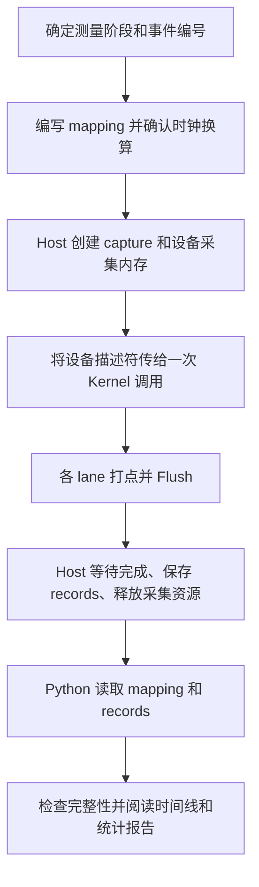

# TileXR Profiling 工具指南

[返回入口](../README.zh-CN.md) · [简体中文](USER_GUIDE.zh-CN.md) / [English](USER_GUIDE.md)

TileXR Profiling 用于观察 Ascend C 算子内部各阶段的执行时间。你在 Kernel 中标记需要关注的位置，
工具记录时间戳，再将这些记录转换成时间线和分析报告，帮助判断时间主要花在计算、搬运还是等待上。

本文面向第一次使用工具的算子开发者，先介绍组成和概念，再说明安装、打点、采集与分析的完整流程。
完整可运行接入见 [Add4 示例](../../../examples/profiling/README.zh-CN.md)。

## 1. 工具能帮助你做什么

常见使用场景包括：

- **拆分算子耗时**：分别观察数据拷入、计算、数据拷出等阶段。
- **观察等待与重叠**：查看同步或等待区间，以及不同阶段在时间上是否重叠。
- **寻找较慢的执行通道**：比较同一次调用中不同 lane 的总区间，关注拖慢整体执行的通道。
- **保存可复查的测量结果**：保留原始记录、事件定义和版本信息，供其他人在没有 NPU 的机器上分析。

工具采用显式打点。它只测量你定义的区间，不会自动识别算子中的全部阶段，也不负责启动业务 Kernel。
阶段较慢可以成为进一步调查的线索，但仅凭时间线不能自动确定根因。

它可以由普通 CANN 应用独立使用。虽然接口名称带有 `TileXR`，但接入时不要求安装
TileXR 通信运行时、collectives 或 EP，也不需要启动额外的采集服务。

## 2. 工具由哪些部分组成

从使用者的角度，可以将工具分为以下四部分。其中，真正需要安装或导入的组件是采集 SDK 和离线分析器。

| 部分 | 包含内容 | 负责的功能 | 使用方式 |
|---|---|---|---|
| 采集 SDK | Kernel 记录接口、Host 采集与文件导出接口 | 记录时间戳和事件 ID，管理采集内存，回读并保存原始记录 | 安装 C++ 头文件与 CMake 配置，在算子中编译使用 |
| 离线分析器 | 输入解析、事件配对、统计分析、报告生成 | 将记录转换为阶段耗时、完整性诊断和三种报告 | 安装 Python 包，使用命令行或 Python API |
| 数据文件 | mapping 事件定义、records 原始记录 | 连接采集端和分析端，让事件编号具有业务含义 | mapping 由开发者编写，records 由 SDK 导出；它们不是代码包 |
| 示例与业务接入 | 独立 Add4 示例、TileXR collectives 接入 | 展示如何将 SDK 接入真实算子和异步资源管理流程 | 按需参考，不是外部算子的必需依赖 |

采集 SDK 内部的 Kernel 和 Host 接口共同完成一次采集：

| 位置 | 常用接口 | 作用 |
|---|---|---|
| Kernel | `Recorder<N>`、`RecordMarker<Slot, EventId>()`、`Flush()` | 在本地保存打点，再提交到设备全局内存（GM） |
| Host | `CaptureConfig`、`AclCapture` | 配置 lane 数与容量，分配设备内存，提供 Kernel 参数，回读、保存和释放资源 |
| 已有计时逻辑的 Kernel | `DirectWriter` | 接收调用方提供的时间戳，通过 `RecordAt()` 写入、`Publish()` 提交 |

第一次接入通常选择 `Recorder` 和 `AclCapture` 即可。
手工管理 workspace、编码或导出等底层接口主要用于定制接入，详见 [API 参考](API_REFERENCE.md)。

## 3. 安装与构建入口

在算子构建机器上安装[采集 SDK](../README.zh-CN.md#安装采集-sdk)，在分析机器上安装
[Python 包](../README.zh-CN.md#安装并离线分析)。离线分析需要 Python ≥3.9，不需要 CANN 或 NPU。

Host 与 Kernel 均包含 `<tilexr/profiling.h>`。Host 工程通过
`find_package(TileXRProfiling 1 CONFIG REQUIRED)` 导入并链接 `TileXR::profiling`，
配置时传入 `-DCMAKE_PREFIX_PATH=/path/to/sdk-prefix`。该 target 提供头文件与 C++14 要求，
CANN 头文件和库仍由应用配置。设备自定义编译命令须显式传入
`-I/path/to/sdk-prefix/include` 和 `-DTILEXR_ENABLE_PROFILING=1`，不会因 Host 链接 SDK
而自动继承。完整构建接线见 [Add4 CMake 示例](../../../examples/profiling/CMakeLists.txt)。

Python 发行名为 `tilexr-profiling`，导入/模块名为 `tilexr_profiling`；安装与运行使用同一解释器。

## 4. 打点前需要理解的几个概念

| 概念 | 含义 | 例子或注意点 |
|---|---|---|
| capture | 一次 Kernel 调用的采集 | 第二次调用应使用新的 capture；warmup 不采集 |
| rank | 业务中的参与进程编号 | 单进程通常使用默认值 0 |
| lane | 独立的记录通道 | 普通场景可让一个 block 独占一个 lane；它不是 ACL stream |
| Slot | `Recorder` 内部保存一次打点的位置 | `Recorder<4>` 提供 0～3 四个槽；循环记录不能反复覆盖同一槽来累计事件 |
| Event ID | 描述打点含义的非零编号 | 可以约定 10 表示计算开始、11 表示计算结束 |
| stage | 报告中的业务阶段 | mapping 将开始和结束 Event ID 配成一个阶段 |
| critical 区间 | 每个 lane 用于分析总耗时的参考区间 | 通常覆盖本次测量的全部业务；每个 lane 必须恰好有一个完整区间 |

Slot、Event ID 和 lane 是三种不同的编号。例如 `RecordMarker<1, 10>()` 表示在本地槽 1
记录事件 10；最终写到哪个 lane，由 `Flush(profileGM, lane)` 决定。

本地槽数和 GM 容量也不同：`Recorder<N>` 支持 1～256 个槽；Host 的 `recordsPerStream`
是每个 lane 可导出的记录容量，范围为 8～65536，必须是 8 的倍数，默认 4096。
容量不足会保留可容纳的前缀并报告 dropped，不能将这种结果当作完整测量。

## 5. 从打点到报告的完整流程



### 第一步：定义测量范围与事件

先决定想回答的问题。例如，先测算子总区间，再在其中测一个计算阶段：

| Event ID | 含义 |
|---|---|
| 1 / 2 | 总区间开始 / 结束 |
| 10 / 11 | 计算阶段开始 / 结束 |

打点边界需要配合算子原有的流水同步。比如，要测“搬运已完成”的时间，结束 marker
就应放在相应搬运完成的同步之后。`RecordMarker()` 本身只读取时钟，不会替你等待业务流水完成。

### 第二步：编写 mapping

mapping 是一份 JSON 文件，告诉分析器“事件编号对应什么阶段”以及“时钟值如何换算成微秒”。
将以下内容保存为 `operator.mapping.json`。**其中 `50.0` 仅演示已确认 timer 为 50 MHz 的场景，
实际使用前必须替换为目标环境确认的值，不能将它视为通用默认值。**

```json
{
  "schema": "tilexr_profiling_mapping.v1",
  "operator": "MyOperator",
  "cycles_per_us": 50.0,
  "stages": [
    {"name": "kernel_total", "category": "total", "critical": true, "begin": 1, "end": 2},
    {"name": "compute", "category": "compute", "parent": "kernel_total", "begin": 10, "end": 11}
  ]
}
```

`cycles_per_us` 表示 timer 每微秒的计数，时间差除以它才得到微秒。离线分析使用此声明换算；
合格校准是单独选择的流程，入口见第 7 节。
`parent` 表达阶段的包含关系，`category` 帮助区分计算、拷贝、等待、同步等用途。
事件编号、分层和重复区间的详细规则见 [格式说明](FORMAT.md)。

阶段共享起止事件或需要显式 occurrence 选择器时，使用
[mapping.v2](FORMAT.md#mappingv2-shared-boundaries)。[Add4 mapping](../../../examples/profiling/profiled_add4.mapping.template.json)
将槽位 9U 的同一条 marker（事件 20）分别配对到 201、202、203。

### 第三步：在 Kernel 中记录并提交

为 Kernel 增加 `profileGM` 参数，创建记录器，在选定位置打点，最后将记录提交到该 lane 的 GM：

```cpp
TileXR::Profiling::Recorder<4> profiler;
profiler.RecordMarker<0, 1>();
profiler.RecordMarker<1, 10>();
// 原始计算及保证其完成所需的同步。
profiler.RecordMarker<2, 11>();
profiler.RecordMarker<3, 2>();
profiler.Flush(profileGM, lane);
```

此片段位于 Kernel 内；算子提供签名、`profileGM` 参数、lane 分配与业务代码。
每个参与采集的 lane 只能有一个 writer，
且要执行提交；有提前返回或条件分支时，应逐条检查这些路径。
普通 block index 方案不适用于所有 Kernel 布局，Host 配置必须与实际 lane 设计一致。

### 第四步：由 Host 准备和保存 capture

Host 先建立 ACL context/stream，再创建采集对象，将 `DeviceArgs()` 返回的设备描述符地址传给 Kernel。
同时修改 launcher 的参数结构，使参数顺序与 Kernel 签名一致。

下面是流程伪代码，`CheckProfile`、`CheckLaunch` 和 `LaunchMyKernel` 需要应用实现，
并按各自返回类型检查失败、处理清理：

```cpp
TileXR::Profiling::CaptureConfig config;
config.logicalStreamCount = participatingLaneCount;

TileXR::Profiling::AclCapture capture;
CheckProfile(capture.Initialize(config, stream));
CheckLaunch(LaunchMyKernel(stream, input, output, capture.DeviceArgs()));
CheckProfile(capture.Save("capture.records.bin"));
CheckProfile(capture.Close());
```

`Save()` 等待绑定的 stream，回读并校验记录，再导出文件。若希望分开安排回读和文件写入，
可使用 `Collect()` 与 `Export()`；`Save()` 就是这两个步骤的组合。

异步应用应将 capture 保留到原有安全完成点，不能在每次异步 launch 后立即保存而意外增加同步。
即使 launch 或保存失败，也要保持借用的 context/stream 有效，直到 `Close()` 成功。
只依赖析构不能代替检查清理结果，析构也不会自动保存文件。

### 第五步：运行离线分析

在安装了 Python 包的环境中执行：

```bash
python3 -m tilexr_profiling \
  --mapping operator.mapping.json \
  --records capture.records.bin \
  --output-dir profile-report \
  --attribute kernel_version=my-kernel-v1
```

输出目录必须不存在或为空。也可以从 Python 调用同一分析流程：

```python
from pathlib import Path
from tilexr_profiling import generate_reports

result = generate_reports(
    Path("operator.mapping.json"),
    [Path("capture.records.bin")],
    Path("profile-report"),
    attributes={"kernel_version": "my-kernel-v1"},
)
print(result.status)
```

上述两种方式任选一种；使用不同输出目录保留各次报告。
`--attribute` 或 `attributes` 可以补充 SDK/Kernel 版本、SoC、CANN、驱动、backend、native 状态等信息。
这些信息由调用方提供，不能覆盖记录中的 UUID、完整性或时钟换算等事实，也不应添加为 mapping 的任意新字段。

## 6. 生成了什么，应该怎样阅读

| 文件 | 用途 | 推荐阅读方式 |
|---|---|---|
| `analysis.md` | 完整性诊断、阶段统计和测量来源 | 先阅读，确认本次数据是否可用 |
| `report.html` | 可在浏览器打开的离线报告 | 查看阶段耗时、占比及来源信息 |
| `perfetto_trace.json` | 逐 lane 的事件时间线 | 导入兼容的 Perfetto 查看器，观察执行先后与重叠 |

先确认算子原有数值校验通过，再检查采集完整性，最后分析耗时。
生成了文件只表示导出或分析流程完成，不代表每个参与者都被正确采集。

| CLI 退出码 | 含义 | 下一步 |
|---|---|---|
| 0 | 提供的输入完整（complete） | 继续核对所需 ranks/lanes 和业务正确性，再阅读性能结果 |
| 1 | 输入或输出等致命错误 | 根据错误信息修正，不能视为成功报告 |
| 2 | capture 不完整，仍生成报告；参数用法错误也可能为 2 | 结合错误信息与产物区分原因，检查缺失事件、未提交 lane 或溢出 |

阅读统计时还要留意三个区别：

- **阶段累计时间与时间覆盖不同。** inclusive 将各次区间时长相加，重叠部分可能重复计算，因此其占比可以超过 100%；union 合并同一 lane 内的重叠区间并裁剪到总区间。
- **exclusive 依赖明确的阶段层级。** 它从阶段覆盖中扣除显式声明的直接子阶段覆盖；兄弟阶段仍可能重叠，因此各项占比不保证相加为 100%。
- **较慢 lane 与全部 lane 的总和不同。** 每个 rank 的延迟按该 rank 最慢的 critical lane 计算；跨 rank 的最小值、中位数、最大值汇总这些 rank 延迟。

跨 rank 的时间线分别对齐显示起点，不代表不同设备时钟已经同步，不能据此直接判断跨设备的绝对先后。
完整统计定义见 [FORMAT.md](FORMAT.md)。

## 7. 多 rank 与可选用法

应用向参与 rank 分发相同的 fresh、非零 capture UUID，设置不同 rank 编号并保存到不同文件。
只对同一次调用的文件重复传入 `--records`；SDK 不负责 rank 协调。使用 `--manifest` 提供
执行前独立生成的预期参与者，才能发现缺 rank/lane。最简 Add4 只导出普通 records/报告，
不生成元数据 sidecar。每次调用使用新的 capture，不采集 warmup。

[高级用法（英文）](ADVANCED.md) 集中说明 manifest 与健康、机器输出与比较、capture set、
workspace lease、采样、时钟校准和 collectives 接入，按需在基础流程上增加。

`TILEXR_ENABLE_PROFILING=1` 启用设备打点，未定义/0 时禁用。Host 的
`CaptureConfig.enabled` 也须与同一开关保持一致才能关闭输出；仅传空描述符仍可能产生
已启用 marker 的 timer 读取。开销、spill、全局排序和新设备支持需要独立证据。
MoonEP 还须保留规定的 grouped 模式、框架 profiler 和阶段屏障。

## 8. 环境要求、常见问题与后续阅读

采集面向 Linux/CANN 应用，Host 使用 C++14，设备侧使用 Ascend C；项目当前面向 CANN 9.1。
实际运行需要目标 NPU 和对应工具链。仅安装 SDK 或执行离线分析不需要设备。

SDK 未硬编码 Ascend950 限制。每种 SoC 都需要相应编译目标、确认 timer 换算并完成
硬件验证。Add4 维护的构建面向 Ascend950。每次验证均记录实际环境；其他目标需要
独立的验证证据。

| 现象 | 优先检查 |
|---|---|
| 找不到 `tilexr/profiling.h` | SDK 安装位置、Host include 配置和设备自定义编译命令的 `-I` |
| 找不到 `AclCapture` 或 ACL 头文件 | 是否已加载目标 CANN 环境，Host 编译器是否能找到 `acl/acl.h` |
| `No module named tilexr_profiling` | 安装与执行是否使用同一 Python，实际导入位置是否正确 |
| 保存或分析拒绝覆盖 | 使用新的 records 文件路径和新的或空的报告目录 |
| 报告 incomplete | 是否每个 lane 都提交、事件是否配对、容量是否溢出 |
| 时延明显异常 | timer 换算、测量同步边界、实际加载的 Kernel 版本和 mapping 是否一致 |

交接时保留 mapping、records、报告、源码/Kernel 版本、命令、实际环境、timer 换算依据、
预期 rank 清单和数值结果。验证入口见下文；生命周期和重试合同见 [API 参考](API_REFERENCE.md)。

## 9. 验证

Profiling 不进入 CI，也不随根项目普通测试开关启用。采样、报表、校准元数据、
打包和文档修改不要求新增测试。只有影响业务正确性的资源归属或重试修改，
才从仓库根目录手动运行相关的已有 Host mock：

```bash
cmake -S src/profiling -B build/profiling-host -DTILEXR_PROFILING_BUILD_TESTS=ON
cmake --build build/profiling-host --target profiling_sdk_acl_mock profiling_workspace_mock profiling_capture_queue_mock -j2
ctest --test-dir build/profiling-host --output-on-failure -R '^(profiling_sdk_acl_mock|profiling_workspace_mock|profiling_capture_queue_mock)$'
```

真实 CANN 编译先 source 目标 CANN 9.1 环境，使用新的构建目录。以下命令编译 Add4，
不执行 NPU 测试：

```bash
cmake -S src/profiling -B build/profiling-cann \
  -DTILEXR_PROFILING_WITH_ACL=ON \
  -DTILEXR_PROFILING_BUILD_EXAMPLES=ON -DTILEXR_PROFILING_SOC=Ascend950
cmake --build build/profiling-cann -j2
```

在明确选定的兼容硬件上，按 [Add4](../../../examples/profiling/README.zh-CN.md) 执行 ON/OFF 运行。
最简 Host 不做数值和返回值校验。
可选验收命令检查精确的 4 lane 事件序列、零丢弃以及共享原始 begin 记录来源：

```bash
python3 examples/profiling/npu_check.py \
  --binary /path/to/tilexr_profiled_add4_demo \
  --mapping examples/profiling/profiled_add4.mapping.template.json \
  --output-root /path/to/new-npu-results --device 0 \
  --cycles-per-us "$TILEXR_PROFILING_CYCLES_PER_US" \
  --clock-basis "$TILEXR_PROFILING_CLOCK_BASIS"
```

Add4 验收仅由显式手动命令触发，不注册到 CTest 或 CI；
可选 profiling 辅助工具不维护额外测试矩阵。

先确认目标设备空闲，实际源码/二进制、环境、命令、数值结果与时钟依据保存在源码树外。
编译、Host mock 和示例输出不能证明其他硬件、生产多 rank 通信、UDMA 传输或性能。
生成报告和二进制记录随外部验证证据保留；维护指南记录可复用的合同和验证命令。
